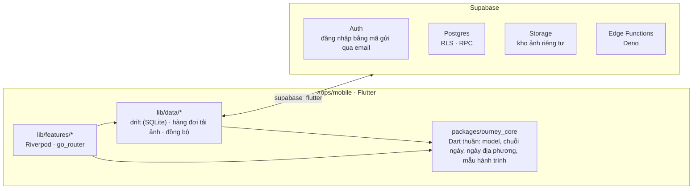

<div align="center">

# Ourney

**Mỗi ngày một tấm ảnh, từng bước đi trọn mục tiêu.**

Ứng dụng giúp bạn kiên trì với mục tiêu của mình, dù đi một mình hay cùng bạn bè.

[](https://github.com/hofang42/Ourney/actions/workflows/ci.yml)
[](https://github.com/hofang42/Ourney/actions/workflows/android.yml)
[](https://github.com/hofang42/Ourney/actions/workflows/ios.yml)


[Tài liệu](docs/) · [Đặc tả yêu cầu](docs/SRS.md) · [Phân công](docs/TASKS.md) · [Báo lỗi](https://github.com/hofang42/Ourney/issues)


<sub>Bản thiết kế tham khảo, chưa phải ảnh chụp từ ứng dụng.</sub>

</div>

## Giới thiệu

Ourney ra đời từ một điều rất quen thuộc: đặt mục tiêu thì dễ, đi đến cùng mới khó. Vì thế, Ourney không bắt bạn ghi chép dài dòng. Mỗi ngày, bạn chỉ cần chụp một tấm ảnh để ghi dấu rằng hôm nay mình vẫn kiên trì. Ngày qua ngày, những tấm ảnh ấy nối lại thành cuốn nhật ký của cả hành trình.

Strava dành cho người chạy bộ, Duolingo dành cho người học ngoại ngữ, còn Ourney dành cho mọi mục tiêu: giảm cân, học tiếng Anh, tập luyện, một chuyến đi xa hay một thói quen nhỏ bạn muốn giữ. Bạn có thể đi một mình, hoặc rủ vài người bạn thân cùng nhắc nhau. Chuỗi ngày liên tiếp càng dài lại càng tiếc nếu để đứt, và cả nhóm vẫn đang chờ bạn điểm danh, nên ngày nào cũng có một lý do để quay lại.

Hiện nhóm đang hoàn thiện bản thử nghiệm đầu tiên, `v0.1.0`. Mã nguồn đã đáp ứng đủ các yêu cầu bắt buộc trong [tài liệu đặc tả](docs/SRS.md), toàn bộ kiểm thử tự động đều đạt, và đã có bản cài thử cho cả iOS lẫn Android. Những việc còn lại được ghi trong [docs/TASKS.md](docs/TASKS.md).

## Tính năng chính

- **Chụp là xong.** Mở ứng dụng là camera đã sẵn sàng, chỉ cần tối đa ba lần chạm để ghi lại ngày hôm nay. Ảnh được lưu ngay trên máy và tự tải lên khi có mạng, nên mất sóng giữa chừng cũng không sao.
- **Hành trình theo ý bạn.** Chọn một trong bốn mẫu có sẵn (giảm cân, học tiếng Anh, 30 ngày tập luyện, du lịch) hoặc tự đặt mục tiêu riêng, kèm chỉ số muốn theo dõi như cân nặng hay số phút học. Cả hành trình hiện lên như một cuốn lịch ảnh, bên cạnh chuỗi ngày liên tiếp và phần trăm đã hoàn thành.
- **Cùng nhau đi xa hơn.** Mời bạn bè bằng một mã tám ký tự hoặc một đường link, mỗi nhóm tối đa mười người. Hằng ngày, cả nhóm thấy ai đã điểm danh, ai còn đang chờ, và thả cảm xúc cho nhau. Ourney không xếp hạng ai giảm được nhiều cân hơn; điều được ghi nhận là sự đều đặn.
- **Chia sẻ những cột mốc.** Đến ngày thứ 7, thứ 30 hay ngày về đích, ứng dụng sẽ gợi ý bạn tạo một tấm thiệp vừa khổ story lẫn bài đăng mạng xã hội. Hành trình cá nhân còn có thể chia sẻ bằng một đường link chỉ để xem.
- **Riêng tư là mặc định.** Với hành trình giảm cân, số cân được ẩn và ảnh được làm mờ mỗi khi chia sẻ. Bạn có thể báo cáo hay chặn người khác, và khi xoá tài khoản, mọi dữ liệu, kể cả ảnh trên máy chủ, đều bị xoá thật sự.
- **Lời nhắc vừa đủ.** Thông báo đến đúng giờ bạn hẹn cho từng hành trình. Chín giờ tối mà chưa điểm danh, ứng dụng sẽ khẽ nhắc rằng chuỗi ngày sắp đứt.
- **Không có máy chủ vẫn dùng được.** Khi chưa kết nối máy chủ, mọi hành trình cá nhân vẫn hoạt động đầy đủ.

Danh sách yêu cầu chi tiết, kèm mã FR và NFR, nằm ở mục 3 và 4 của [tài liệu đặc tả](docs/SRS.md). Những tính năng dành cho các phiên bản sau được liệt kê ở mục 7.

## Sáu phong cách giao diện

Mỗi loại hành trình mang một tâm trạng riêng, nên giao diện cũng không nên giống nhau. Ourney có sáu phong cách, mỗi phong cách đổi màu sắc, cách trình bày dòng thời gian, màn hình chụp và tấm thiệp chia sẻ. Khi bạn chuyển sang hành trình khác, giao diện chuyển theo một cách nhẹ nhàng ngay tại chỗ, không cần tải lại ứng dụng. Phong cách nào cũng có đủ giao diện sáng và tối. Chi tiết thiết kế xem ở [docs/06-adaptive-persona-ui-system.md](docs/06-adaptive-persona-ui-system.md).

| # | Phong cách | Dành cho | Dòng thời gian | Màn hình chụp | Thiệp chia sẻ |
|:-:|---|---|---|---|---|
| 1 | Quiet Transformer | Giảm cân | Đường biểu diễn cân nặng nối liền ảnh các cột mốc | Ảnh ngày đầu hiện mờ phía sau để đứng đúng tư thế | Ảnh ngày đầu và ảnh hôm nay đặt cạnh nhau |
| 2 | Accountability Squad | Học tiếng Anh | Con đường quanh co dẫn tới chiếc cúp ngày thứ 30 | Số phút học và chuỗi ngày hiện ngay trên khung hình | Bức tường ảnh Polaroid của cả nhóm |
| 3 | Memory Collectors | Du lịch | Trang sổ lưu niệm với ảnh Polaroid dán băng keo | Mang dáng dấp chiếc máy ảnh film dùng một lần | Tờ phim 35mm in lại cả chuyến đi |
| 4 | Couple Rituals | Cặp đôi | Mỗi ngày một đôi ảnh của hai người | Nửa khung là ảnh người ấy, nửa kia dành cho bạn | Tấm poster ghép ảnh của hai người |
| 5 | Aesthetic Flexer | 30 ngày tập luyện | Biểu đồ phát sáng cùng các cột mốc tập luyện | Thông số buổi tập đặt chồng lên ảnh | Ảnh story dọc kèm dải màu những ngày đã tập |
| 6 | Minimalist Habit | Thói quen tự đặt | Lịch ảnh liền mạch, "đừng để đứt chuỗi" | Một lần chạm, không cần gõ chữ | Tấm thẻ tổng kết tối giản |

<details>
<summary>Xem sáu bản thiết kế</summary>
<br>

| | |
|:-:|:-:|
| <br>1 · Quiet Transformer | <br>2 · Accountability Squad |
| <br>3 · Memory Collectors | <br>4 · Couple Rituals |
| <br>5 · Aesthetic Flexer | <br>6 · Minimalist Habit |

</details>

## Kiến trúc

Ứng dụng được viết bằng Flutter, dùng chung một mã nguồn cho cả iOS và Android, và chia thành ba lớp. Lớp giao diện được tổ chức theo từng tính năng. Lớp dữ liệu lưu mọi thứ trên máy trước, rồi đồng bộ lên Supabase khi có mạng. Gói `ourney_core` chứa phần logic viết bằng Dart thuần mà cả hai lớp trên cùng dựa vào.



| Thành phần | Công nghệ |
|---|---|
| Ứng dụng | Flutter 3.47.7, Dart 3.13, Riverpod, go_router, drift, camera, flutter_image_compress, share_plus, flutter_local_notifications |
| Logic dùng chung | `packages/ourney_core`, viết bằng Dart thuần nên chạy kiểm thử được ngay trên Linux. Đây là bản cam kết giữa giao diện và dữ liệu |
| Máy chủ | Supabase: Postgres bật RLS trên mọi bảng, RPC `SECURITY DEFINER`, kho ảnh riêng tư với đường link có thời hạn, Edge Functions viết bằng Deno, kiểm thử bằng pgTAP |
| Đóng gói | GitHub Actions: Ubuntu chạy kiểm thử và đóng gói bản Android, macOS đóng gói bản iOS, nên cả nhóm không ai cần đến máy Mac |

Trước khi chạm vào phần dữ liệu hay máy chủ, hãy đọc kỹ [hợp đồng dữ liệu](docs/contracts/schema.md) và `packages/ourney_core/lib/src/models.dart`.

## Cấu trúc thư mục

```
.
├── apps/mobile/            # Ứng dụng Flutter cho iOS và Android
│   ├── lib/app/            #   khung ứng dụng, điều hướng, giao diện theo phong cách
│   ├── lib/features/       #   mỗi tính năng một thư mục (quy ước ở lib/features/README.md)
│   ├── lib/data/           #   cơ sở dữ liệu trên máy, repository, đồng bộ
│   ├── lib/shared/         #   các widget dùng chung
│   └── assets/             #   phông chữ, bản thiết kế sáu phong cách
├── packages/ourney_core/   # Model, chuỗi ngày, kiểm tra dữ liệu, mẫu hành trình
├── supabase/               # Migration, RLS, RPC, Edge Functions, kiểm thử pgTAP
├── scripts/                # Script phát hành, triển khai Supabase, quản lý GitHub, đóng gói IPA
├── docs/                   # Đặc tả, phân công, quyết định kiến trúc, hợp đồng dữ liệu, hướng dẫn vận hành
└── .github/                # CI/CD, CODEOWNERS, mẫu pull request
```

## Cài đặt và chạy thử

### Công cụ cần có

| Công cụ | Phiên bản | Dùng để |
|---|---|---|
| [Flutter](https://docs.flutter.dev/get-started/install) | 3.47.7 (Dart 3.13.5) | Chạy ứng dụng và `ourney_core` |
| [Docker](https://docs.docker.com/get-docker/) và [Supabase CLI](https://supabase.com/docs/guides/local-development/cli/getting-started) | CLI 2.121.0 | Dựng máy chủ ngay trên máy |
| [Deno](https://docs.deno.com/runtime/getting_started/installation/) | 2.x | Kiểm tra Edge Functions |
| JDK | 17 | Đóng gói bản Android |

Bạn không cần máy Mac: bản iOS được đóng gói tự động trên GitHub Actions.

### Chạy không cần máy chủ

```bash
git clone https://github.com/hofang42/Ourney.git
cd Ourney/apps/mobile
flutter pub get
flutter run
```

Ở chế độ này, mọi hành trình cá nhân đều dùng được đầy đủ; riêng các tính năng nhóm cần có máy chủ.

### Chạy cùng Supabase trên máy

```bash
# Tại thư mục gốc: Docker dựng Postgres, Auth, Storage và áp các migration trong supabase/
supabase start           # in ra API URL và anon key

# Chép tệp mẫu rồi điền URL và anon key (env.json đã được bỏ qua trong .gitignore)
cp apps/mobile/env.example.json apps/mobile/env.json

cd apps/mobile
flutter run --dart-define-from-file=env.json
```

Khi chạy trên điện thoại thật, hãy đặt `SUPABASE_URL` là địa chỉ IP trong mạng LAN của máy đang chạy Docker. **Tuyệt đối không** đưa khoá `service_role` vào ứng dụng hay đẩy lên repo.

### Cài bản dựng sẵn

- **Android:** tải tệp `.apk` ở trang [Releases](https://github.com/hofang42/Ourney/releases), hoặc trong artifact của workflow `Android (APK)`.
- **iOS:** tải `Ourney-unsigned.ipa`, sau đó tự ký bằng Apple ID miễn phí theo hướng dẫn ở [docs/platform/ios.md](docs/platform/ios.md).

## Kiểm thử

Mỗi lần mở hoặc cập nhật pull request, CI chạy bốn nhóm kiểm tra dưới đây (xem [`ci.yml`](.github/workflows/ci.yml)). Sửa phần nào, bạn nên chạy trước phần đó trên máy để khỏi mất công chờ.

| Phần | Lệnh | Thư mục |
|---|---|---|
| Logic dùng chung | `dart pub get && dart analyze && dart test` | `packages/ourney_core` |
| Ứng dụng | `flutter pub get`<br>`dart run tool/gen_l10n.dart`<br>`dart run build_runner build -d`<br>`flutter analyze && dart analyze && flutter test` | `apps/mobile` |
| Máy chủ | `supabase start && supabase test db`<br>`deno check supabase/functions/*/index.ts` | Thư mục gốc |
| Script | `find scripts -name '*.sh' -print0 \| xargs -0 shellcheck`<br>`bash scripts/tests/run.sh` | Thư mục gốc |

Các tệp sinh tự động (bản dịch, `*.g.dart`) cần được commit cùng mã nguồn; nếu chạy lại mà tệp thay đổi, CI sẽ báo lỗi. Đừng quên `dart analyze`, vì chỉ lệnh này mới chạy bộ kiểm tra `riverpod_lint`.

## Đóng gói và phát hành

| Workflow | Khi nào chạy | Kết quả |
|---|---|---|
| [`ci.yml`](.github/workflows/ci.yml) | Mỗi pull request và mỗi lần đẩy lên `main` | Kiểm tra mã và chạy kiểm thử cho toàn bộ dự án |
| [`android.yml`](.github/workflows/android.yml) | Đẩy lên `main` hoặc tạo tag `v*` | Tệp APK bản phát hành (ký bằng khoá gỡ lỗi nếu chưa có keystore) |
| [`ios.yml`](.github/workflows/ios.yml) | Đẩy lên `main` hoặc tạo tag `v*` | Tệp `Ourney-unsigned.ipa` |
| [`deploy-supabase.yml`](.github/workflows/deploy-supabase.yml) | Chạy thủ công, chỉ từ `main` | Áp migration, triển khai Edge Functions và cấu hình đăng nhập trên Supabase thật (mặc định chỉ chạy thử) |

Để phát hành, quản trị viên tạo một tag `v*`; workflow sẽ tự đính kèm bản IPA và APK vào trang GitHub Release. Các bước cụ thể có trong [docs/runbooks/release.md](docs/runbooks/release.md), còn cách dựng máy chủ thật nằm ở [docs/runbooks/hosted-supabase.md](docs/runbooks/hosted-supabase.md).

## Quy trình làm việc

1. **Nhận việc** trong [docs/TASKS.md](docs/TASKS.md). Mỗi người phụ trách một vùng thư mục riêng (mục 2; giai đoạn giao diện sáu phong cách xem mục 7.1). Khi cần sửa sang vùng của người khác, hãy tách thành một pull request nhỏ và nhờ chính người đó xem giúp.
2. **Đặt tên nhánh** theo dạng `feat/<mã việc>-<tên ngắn>`, hoặc `fix/...`, `chore/...`; ví dụ `feat/Z1-chain-grid`.
3. **Viết commit** theo chuẩn [Conventional Commits](https://www.conventionalcommits.org/), chẳng hạn `feat(journeys): ...` hay `fix(camera): ...`.
4. **Mở pull request** theo [mẫu có sẵn](.github/pull_request_template.md): làm gì, vì sao, đã kiểm thử ra sao. Nếu có thay đổi giao diện, kèm ảnh hoặc video trên cả iPhone lẫn Android.
5. **Gộp vào `main`** khi CI đạt và mọi góp ý đã được xử lý. Người xem lại được ghép cặp sẵn trong TASKS và cố gắng phản hồi trong vòng 24 giờ.

Những nguyên tắc bất di bất dịch (xem thêm mục 6.4 của [tài liệu đặc tả](docs/SRS.md)):

- Không bao giờ commit thông tin bí mật như khoá `service_role`, khoá SMTP, keystore hay Apple ID. Những thứ này chỉ nằm trong GitHub Secrets hoặc tệp `env.json`.
- Bảng mới nào cũng phải có RLS và kiểm thử pgTAP. Repo để công khai và anon key vốn công khai, nên RLS là lớp bảo vệ duy nhất.
- Không xếp hạng người dùng theo kết quả cơ thể.
- Dùng thư viện hay API mới thì dẫn kèm đường link tài liệu trong pull request.
- Giao diện phải hiển thị đúng ở cả nền sáng lẫn nền tối, không dùng chữ hay emoji thay cho biểu tượng hệ thống, và chữ tiếng Việt không được tràn khung hay mất dấu (xem [CLAUDE.md](CLAUDE.md)).

## Làm việc cùng Claude Code

Dự án đã được cấu hình sẵn cho [Claude Code](https://claude.com/claude-code). Tệp [`CLAUDE.md`](CLAUDE.md) ghi các quy tắc giao diện bắt buộc, còn thư mục [`.claude/skills/`](.claude/skills/README.md) chứa các kỹ năng riêng của dự án, gọi bằng `/<tên kỹ năng>`.

| Kỹ năng | Dùng khi |
|---|---|
| `/recall [mã việc]` | Bắt đầu hoặc làm tiếp một việc: gợi lại nội dung việc, nhật ký và những bài học cũ |
| `/design-ref <phong cách> <màn hình>` | Làm giao diện theo phong cách: cắt và phóng to đúng màn hình trong bản thiết kế |
| `/pr-check [mã việc]` | Trước khi mở pull request: chạy đúng những kiểm tra liên quan và soạn sẵn phần mô tả |
| `/wrap-up` | Cuối buổi làm việc: ghi nhật ký gồm việc đã làm, commit và bằng chứng kiểm thử |
| `/lesson [lỗi]` | Khi Claude làm sai: ghi lại bài học và đề xuất kiểm thử để lỗi không lặp lại |

Khi chạy trên cloud, Claude Code tự cài đúng phiên bản Flutter mà CI đang dùng, nhờ hook [`.claude/hooks/session-start.sh`](.claude/hooks/session-start.sh).

## Thành viên

| Thành viên | Phụ trách ở bản v0.1.0 | Giai đoạn sáu phong cách ([TASKS mục 7](docs/TASKS.md#7-giai-đoạn-2--persona-ui-mỗi-người-trọn-persona)) |
|---|---|---|
| [@hofang42](https://github.com/hofang42) | Chủ dự án, dựng máy chủ, phát hành | Quiet Transformer và Aesthetic Flexer |
| [@thydynh03](https://github.com/thydynh03) | Kiểm thử trên iPhone, giao diện, truy vết yêu cầu | Phần nền dùng chung: giao diện gốc, thanh điều hướng, khung phong cách, trang hành trình, màn tạo hành trình |
| [@lken1514](https://github.com/lken1514) | Android, tác vụ nền, thông báo, mã native | Couple Rituals và Minimalist Habit |
| [@nguyenductien-qnm](https://github.com/nguyenductien-qnm) | Web, máy chủ, vận hành | Accountability Squad và Memory Collectors |

## Tài liệu

| Tài liệu | Nội dung |
|---|---|
| [SRS.md](docs/SRS.md) | **Nên đọc đầu tiên.** Ourney là gì, phạm vi bản đầu tiên, các yêu cầu và cách cả nhóm làm việc |
| [TASKS.md](docs/TASKS.md) | Ai làm việc gì, ai phụ trách thư mục nào, ai xem lại cho ai, và lịch làm việc |
| [03-design-system.md](docs/03-design-system.md) | Màu sắc, phông chữ, chuyển động, thiệp chia sẻ |
| [06-adaptive-persona-ui-system.md](docs/06-adaptive-persona-ui-system.md) | Sáu phong cách giao diện, bảng màu sáng và tối, cách đổi hành trình mà không cần tải lại ứng dụng |
| [contracts/](docs/contracts/) | Hợp đồng dữ liệu giữa ứng dụng và máy chủ |
| [adr/](docs/adr/) | Những quyết định kiến trúc đã chốt: phiên bản iOS tối thiểu, email hỗ trợ, văn bản pháp lý |
| [platform/](docs/platform/) | Ghi chú riêng cho iOS và Android |
| [runbooks/](docs/runbooks/) | Hướng dẫn vận hành: dựng Supabase thật, phát hành phiên bản |
| [01](docs/01-analysis.md) · [02](docs/02-requirements-v2.md) · [04](docs/04-implementation-plan-v1.md) · [05](docs/05-platform-plan-ios-android.md) | Phân tích thị trường, yêu cầu chi tiết, kế hoạch triển khai, kế hoạch cho từng nền tảng |

## Giấy phép

Dự án hiện chưa chọn giấy phép mã nguồn; repo chưa có tệp `LICENSE`.
