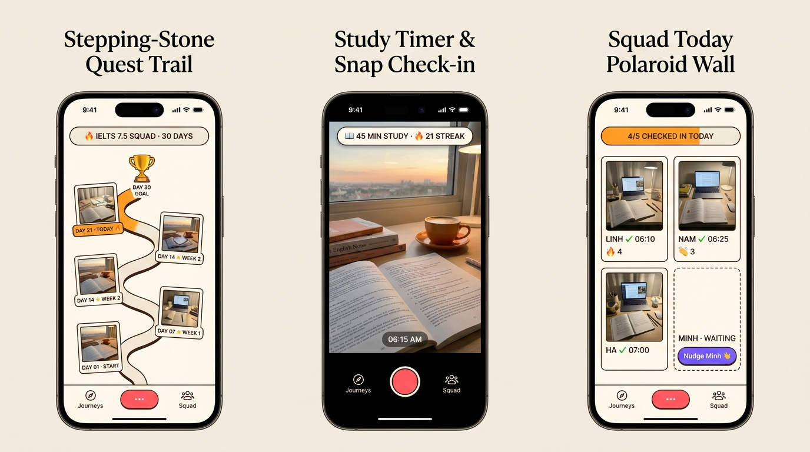
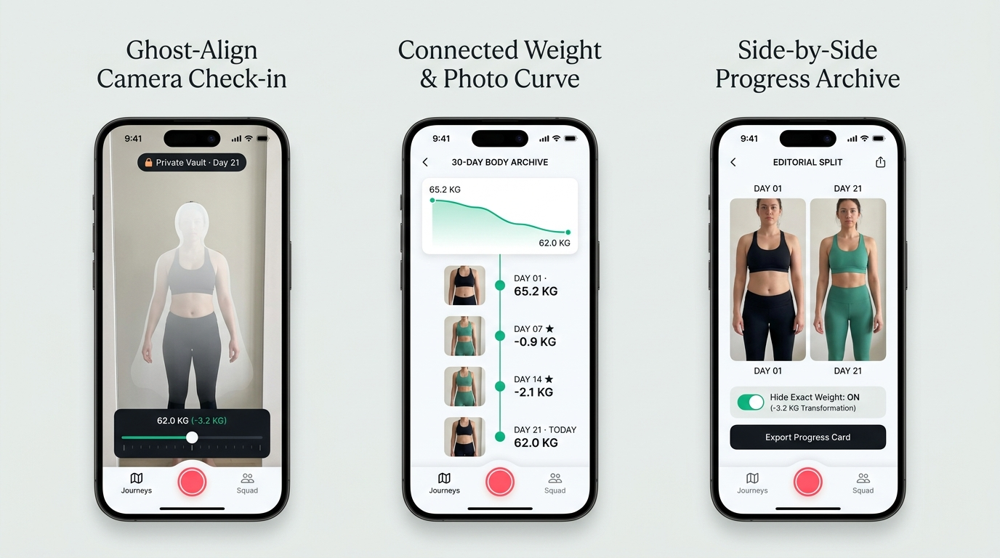
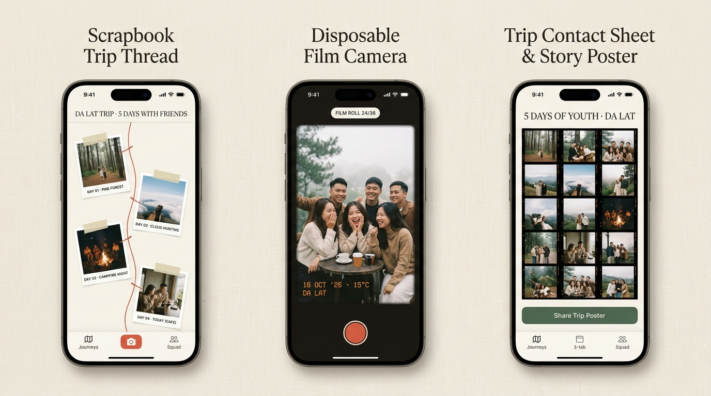
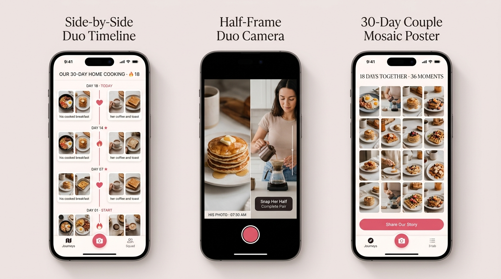
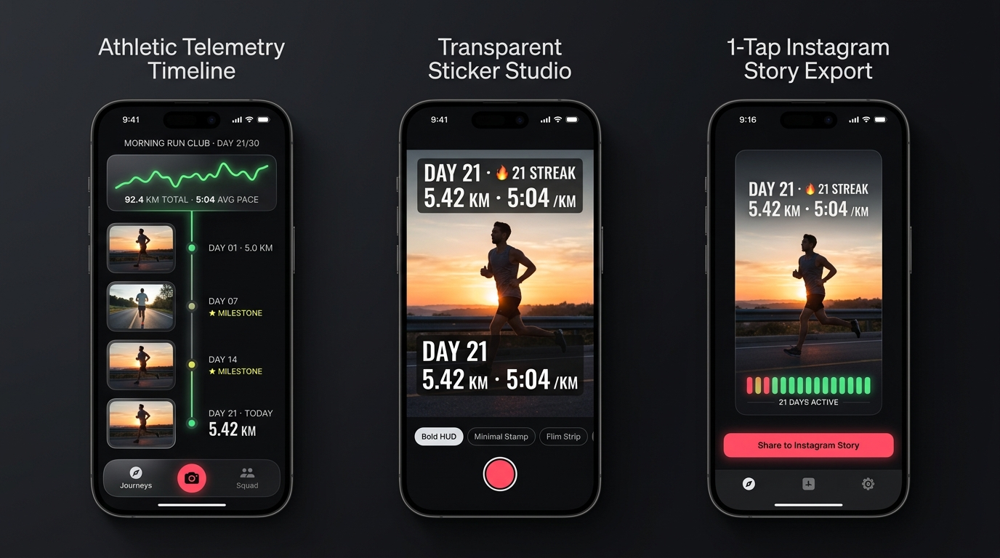
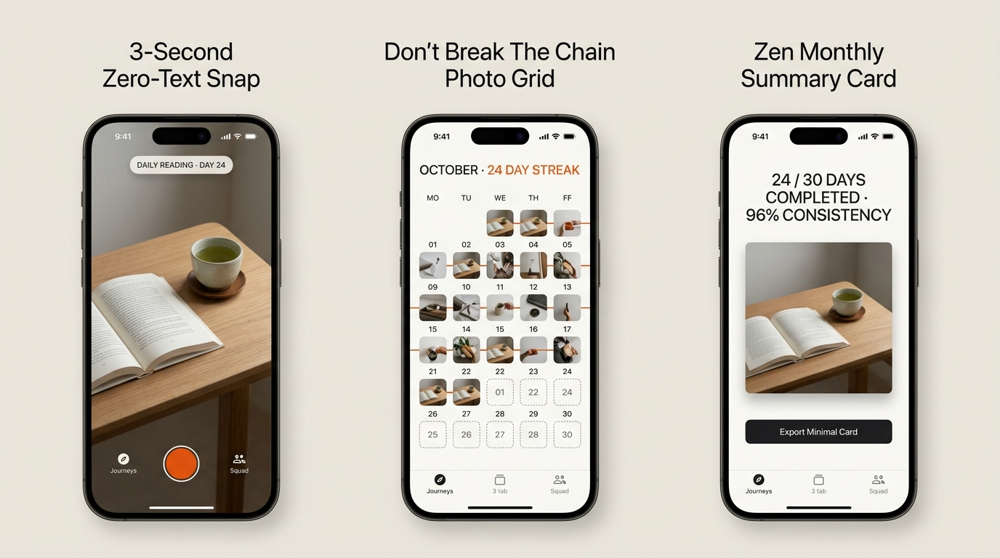
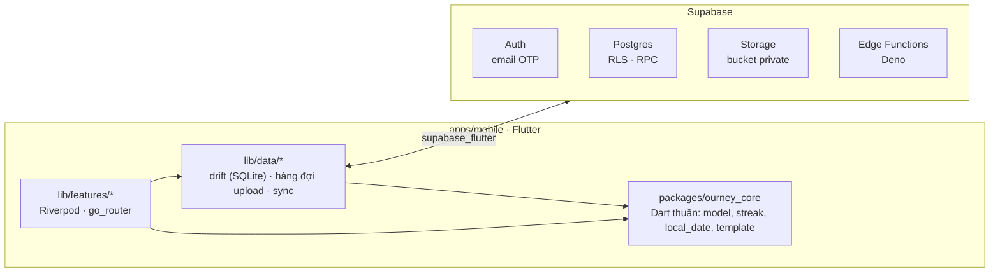

<div align="center">

# Ourney

**Locket cho mục tiêu.** Mỗi ngày một ảnh check-in để đi hết hành trình của bạn: giảm cân, học tiếng Anh, tập luyện, du lịch, hay bất cứ mục tiêu nào. Đi một mình hoặc cùng nhóm bạn thân, tới mốc thì khoe bằng share card kiểu Strava.

[](https://github.com/hofang42/Ourney/actions/workflows/ci.yml)
[](https://github.com/hofang42/Ourney/actions/workflows/android.yml)
[](https://github.com/hofang42/Ourney/actions/workflows/ios.yml)


[Tài liệu](docs/) · [SRS](docs/SRS.md) · [Chia việc](docs/TASKS.md) · [Báo lỗi](https://github.com/hofang42/Ourney/issues)



<sub>Bản thiết kế tham chiếu (mockup), chưa phải ảnh chụp app.</sub>

</div>

## Mục lục

- [Giới thiệu](#giới-thiệu)
- [Tính năng](#tính-năng)
- [Giao diện: 6 persona](#giao-diện-6-persona)
- [Kiến trúc](#kiến-trúc)
- [Cấu trúc repo](#cấu-trúc-repo)
- [Bắt đầu nhanh](#bắt-đầu-nhanh)
- [Kiểm thử](#kiểm-thử)
- [CI/CD và phát hành](#cicd-và-phát-hành)
- [Đóng góp](#đóng-góp)
- [Làm việc với Claude Code](#làm-việc-với-claude-code)
- [Nhóm phát triển](#nhóm-phát-triển)
- [Tài liệu](#tài-liệu)

## Giới thiệu

App chuyên ngách như Strava, Duolingo hay Polarsteps rất mạnh trong ngách của mình, nhưng chưa app nào gom **mọi loại hành trình + bằng chứng mỗi ngày + nhóm bạn thân** vào một chỗ. Ourney lấy thói quen chụp nhanh của Locket/BeReal và gắn nó vào **mục tiêu có thời hạn**: có streak để giữ, có nhóm đang chờ mình check-in.

**Trạng thái:** đang chuẩn bị beta `v0.1.0`. Code v1 đủ các yêu cầu P1 trong [SRS](docs/SRS.md), CI xanh, CI build ra `.ipa` chưa ký và `.apk`. Việc còn lại nằm ở [docs/TASKS.md](docs/TASKS.md).

## Tính năng

| Nhóm | Có gì ở v1 |
|---|---|
| **Check-in camera-first** | Mở app vào thẳng camera, đăng trong ≤ 3 chạm, 1 ảnh/ngày/journey. Nén trên máy, **offline-first**: lưu ngay, upload qua hàng đợi và tự thử lại |
| **Journey** | 4 template (Giảm cân, Học tiếng Anh, 30 ngày tập luyện, Chuyến đi) hoặc tự đặt. Solo hoặc nhóm, có metric tuỳ chọn. Timeline lưới lịch, streak, % hoàn thành |
| **Nhóm** | Mời bằng mã 8 ký tự hoặc link `ourney://join/<code>`, tối đa 10 người. Màn "Hôm nay" xem ai đã check-in, thả reaction. Không xếp hạng theo kết quả |
| **Chia sẻ** | Share card 1080×1920 (story) và 1080×1350 (feed) render trên máy. Link xem read-only cho journey solo |
| **Riêng tư và an toàn** | Journey giảm cân mặc định ẩn số kg và làm mờ ảnh khi share. Report, block, EULA. Xoá tài khoản là xoá thật cả ảnh trên server |
| **Nhắc nhở** | Thông báo local theo giờ của từng journey, cảnh báo 21:00 khi streak sắp mất |
| **Local-only mode** | Chưa cấu hình server vẫn dùng đủ journey solo |

Phạm vi đầy đủ và mã yêu cầu (FR/NFR) ở [docs/SRS.md](docs/SRS.md) §3–4. Những gì để sau v1 ở §7.

## Giao diện: 6 persona

Một app shell, sáu "skin" theo loại hành trình. Đổi journey thì màu, timeline, HUD camera và share card đổi theo mà **không reset app hay khởi động lại camera**. Mọi màn có cả light và dark. Thiết kế chi tiết: [docs/06-adaptive-persona-ui-system.md](docs/06-adaptive-persona-ui-system.md).

| # | Persona | Template | Timeline | Camera HUD | Share / Squad |
|:-:|---|---|---|---|---|
| 1 | Quiet Transformer | Giảm cân | Đường cong cân nặng + ảnh mốc | Căn dáng theo ảnh ngày 1 | So sánh ngày 1 với hôm nay |
| 2 | Accountability Squad | Học tiếng Anh | Đường đi tới cúp ngày 30 | Pill số phút học + streak | Tường Polaroid của nhóm |
| 3 | Memory Collectors | Chuyến đi | Scrapbook, Polaroid dán băng dính | Máy film dùng một lần | Contact sheet 35mm |
| 4 | Couple Rituals | Tự đặt, 2 người | Cặp ảnh theo từng ngày | Nửa khung ảnh của người kia | Poster mosaic của hai người |
| 5 | Aesthetic Flexer | 30 ngày tập luyện | Sparkline neon + trục mốc | Sticker overlay kiểu Strava | Story 9:16 có heatmap |
| 6 | Minimalist Habit | Tự đặt | Lưới lịch "đừng đứt chuỗi" | Chụp 1 chạm, không cần nhập chữ | Thẻ tổng kết tối giản |

<details>
<summary>Xem 6 bảng thiết kế</summary>
<br>

| | |
|:-:|:-:|
| <br>1 · Quiet Transformer | <br>2 · Accountability Squad |
| <br>3 · Memory Collectors | <br>4 · Couple Rituals |
| <br>5 · Aesthetic Flexer | <br>6 · Minimalist Habit |

</details>

## Kiến trúc



| Lớp | Công nghệ |
|---|---|
| App | Flutter 3.47.7 / Dart 3.13, Riverpod, go_router, drift, camera, flutter_image_compress, share_plus, flutter_local_notifications |
| Logic dùng chung | `packages/ourney_core`: Dart thuần, test được trên Linux, là hợp đồng giữa UI và data |
| Backend | Supabase: Postgres + RLS trên mọi bảng, RPC `SECURITY DEFINER`, Storage private với signed URL, Edge Functions (Deno), test bằng pgTAP |
| Build | GitHub Actions: Ubuntu cho test và Android, macOS cho iOS. Team không cần máy Mac |

Hợp đồng dữ liệu (đọc trước khi đụng data hoặc backend): [docs/contracts/schema.md](docs/contracts/schema.md) và `packages/ourney_core/lib/src/models.dart`.

## Cấu trúc repo

```
.
├── apps/mobile/            # App Flutter (iOS + Android)
│   ├── lib/app/            #   shell, router, theme (persona), providers
│   ├── lib/features/       #   mỗi tính năng một thư mục, xem lib/features/README.md
│   ├── lib/data/           #   drift, repository, sync
│   ├── lib/shared/         #   widget design system dùng chung
│   └── assets/             #   font, bảng thiết kế persona
├── packages/ourney_core/   # Model, streak, validation, template (Dart thuần)
├── supabase/               # migrations, RLS, RPC, Edge Functions, pgTAP
├── scripts/                # release, deploy Supabase, GitHub, build IPA
├── docs/                   # SRS, chia việc, ADR, contract, runbook
└── .github/                # CI/CD, CODEOWNERS, PR template
```

## Bắt đầu nhanh

### Yêu cầu

| Công cụ | Phiên bản | Dùng cho |
|---|---|---|
| [Flutter](https://docs.flutter.dev/get-started/install) | 3.47.7 (Dart 3.13.5) | App và `ourney_core` |
| [Docker](https://docs.docker.com/get-docker/) + [Supabase CLI](https://supabase.com/docs/guides/local-development/cli/getting-started) | CLI 2.121.0 | Backend local |
| [Deno](https://docs.deno.com/runtime/getting_started/installation/) | 2.x | Kiểm tra Edge Functions |
| JDK | 17 | Build Android |

Không cần Mac: iOS chỉ build trên GitHub Actions.

### Chạy app không cần server

```bash
git clone https://github.com/hofang42/Ourney.git
cd Ourney/apps/mobile
flutter pub get
flutter run              # local-only mode: đủ journey solo, chưa có nhóm
```

### Chạy với Supabase local

```bash
# Ở gốc repo: dựng Postgres, Auth, Storage bằng Docker, áp migration trong supabase/
supabase start           # in ra API URL và anon key

# Điền URL và anon key vào env.json (đã gitignore)
cp apps/mobile/env.example.json apps/mobile/env.json

cd apps/mobile
flutter run --dart-define-from-file=env.json
```

Chạy trên điện thoại thật thì đặt `SUPABASE_URL` là IP LAN của máy đang chạy Docker. **Không bao giờ** đưa `service_role` key vào app hay commit vào repo.

### Cài app bản build sẵn

- **Android:** tải `.apk` từ [Releases](https://github.com/hofang42/Ourney/releases) hoặc artifact của workflow `Android (APK)`.
- **iOS:** tải `Ourney-unsigned.ipa` rồi tự ký bằng Apple ID miễn phí, theo [docs/platform/ios.md](docs/platform/ios.md).

## Kiểm thử

Mỗi dòng ứng với một job trong [`ci.yml`](.github/workflows/ci.yml). Chạy phần mình đụng trước khi mở PR.

| Phạm vi | Lệnh | Chạy ở |
|---|---|---|
| Logic dùng chung | `dart pub get && dart analyze && dart test` | `packages/ourney_core` |
| App | `flutter pub get`<br>`dart run tool/gen_l10n.dart`<br>`dart run build_runner build -d`<br>`flutter analyze && dart analyze && flutter test` | `apps/mobile` |
| Backend | `supabase start && supabase test db`<br>`deno check supabase/functions/*/index.ts` | gốc repo |
| Script | `find scripts -name '*.sh' -print0 \| xargs -0 shellcheck`<br>`bash scripts/tests/run.sh` | gốc repo |

File sinh ra (l10n, `*.g.dart`) được commit. CI fail nếu chạy codegen làm đổi file. `dart analyze` chạy thêm `riverpod_lint` mà `flutter analyze` không chạy.

## CI/CD và phát hành

| Workflow | Chạy khi | Kết quả |
|---|---|---|
| [`ci.yml`](.github/workflows/ci.yml) | Mọi PR, push lên `main` | Analyze + test cho core, app, Supabase, script |
| [`android.yml`](.github/workflows/android.yml) | Push lên `main`, tag `v*` | APK release (ký bằng debug key nếu chưa có keystore) |
| [`ios.yml`](.github/workflows/ios.yml) | Push lên `main`, tag `v*` | `Ourney-unsigned.ipa` |
| [`deploy-supabase.yml`](.github/workflows/deploy-supabase.yml) | Chạy tay, chỉ từ `main` | Áp migration, deploy Edge Functions và cấu hình Auth trên Supabase hosted (mặc định dry run) |

Phát hành: admin tạo tag `v*`, workflow tự gắn IPA và APK vào GitHub Release. Checklist ở [docs/runbooks/release.md](docs/runbooks/release.md); server hosted ở [docs/runbooks/hosted-supabase.md](docs/runbooks/hosted-supabase.md).

## Đóng góp

1. **Nhận task** trong [docs/TASKS.md](docs/TASKS.md). Mỗi người sở hữu một vùng thư mục (§2, và §7.1 cho giai đoạn Persona UI). Cần sửa ngoài vùng thì mở PR nhỏ và nhờ chủ vùng review.
2. **Tạo branch** `feat/<task-id>-<slug>`, `fix/...` hoặc `chore/...`, ví dụ `feat/J3-chain-grid`.
3. **Commit** theo [Conventional Commits](https://www.conventionalcommits.org/): `feat(journeys): ...`, `fix(camera): ...`.
4. **Mở PR** theo [template](.github/pull_request_template.md): làm gì, vì sao, bằng chứng test, ảnh hoặc video trên iPhone và Android với thay đổi UI.
5. **Merge** khi CI xanh và đã resolve hết comment. Reviewer theo cặp trong TASKS, trả lời trong 24h.

Luật không được phá ([SRS](docs/SRS.md) §6.4):

- Không commit secret (`service_role`, SMTP key, keystore, Apple ID). Dùng GitHub Secrets hoặc `env.json`.
- Bảng mới phải có RLS và pgTAP test. Repo public, anon key là public, nên RLS là lớp bảo vệ duy nhất.
- Không xếp hạng người dùng theo kết quả cơ thể.
- Thư viện hoặc API mới phải kèm link tài liệu trong PR.
- UI: đủ light và dark, không dùng chữ hay emoji thay icon hệ thống, không tràn chữ tiếng Việt ([CLAUDE.md](CLAUDE.md)).

## Làm việc với Claude Code

Repo có sẵn cấu hình cho [Claude Code](https://claude.com/claude-code):

- [`CLAUDE.md`](CLAUDE.md): luật UI/UX bắt buộc (theme, dock 3 tab, responsive, 6 persona).
- [`.claude/skills/`](.claude/skills/README.md): skill của dự án, gọi bằng `/<tên>`.

| Skill | Dùng khi |
|---|---|
| `/recall [task ID]` | Bắt đầu hoặc tiếp tục một task: đọc task, nhật ký, bài học |
| `/design-ref <persona> <màn>` | Làm UI persona: cắt và phóng to đúng màn trong bảng thiết kế |
| `/pr-check [task ID]` | Trước khi mở PR: chạy đúng các job CI liên quan, soạn PR body |
| `/wrap-up` | Cuối phiên: ghi nhật ký (task, commit, bằng chứng test) |
| `/lesson [lỗi]` | Khi Claude làm sai: ghi bài học và đề xuất test chặn |

Cloud session của Claude Code tự cài Flutter đúng phiên bản CI qua hook [`.claude/hooks/session-start.sh`](.claude/hooks/session-start.sh).

## Nhóm phát triển

| Thành viên | Vai trò v0.1.0 | Module Persona UI ([TASKS §7](docs/TASKS.md#7-giai-đoạn-2--persona-ui-mỗi-người-một-module)) |
|---|---|---|
| [@hofang42](https://github.com/hofang42) | Owner, server hosted, release | S — Share card và Squad |
| [@thydynh03](https://github.com/thydynh03) | QA iPhone, UI, truy vết yêu cầu | F — Nền tảng giao diện |
| [@lken1514](https://github.com/lken1514) | Android, chạy nền, thông báo, native | V — Camera HUD và check-in |
| [@nguyenductien-qnm](https://github.com/nguyenductien-qnm) | Web, backend, vận hành | J — Journeys và timeline |

## Tài liệu

| Tài liệu | Nội dung |
|---|---|
| [SRS.md](docs/SRS.md) | **Đọc đầu tiên.** Sản phẩm là gì, phạm vi v1, yêu cầu, cách làm việc |
| [TASKS.md](docs/TASKS.md) | Chia việc, vùng sở hữu, cặp review, lịch |
| [03-design-system.md](docs/03-design-system.md) | Màu, font, motion, share card |
| [06-adaptive-persona-ui-system.md](docs/06-adaptive-persona-ui-system.md) | 6 persona skin, token light/dark, chuyển journey không reset |
| [contracts/](docs/contracts/) | Hợp đồng dữ liệu giữa app và backend |
| [adr/](docs/adr/) | Quyết định kiến trúc (iOS tối thiểu, email hỗ trợ, văn bản pháp lý) |
| [platform/](docs/platform/) | Ghi chú riêng cho iOS và Android |
| [runbooks/](docs/runbooks/) | Vận hành: Supabase hosted, release |
| [01](docs/01-analysis.md) · [02](docs/02-requirements-v2.md) · [04](docs/04-implementation-plan-v1.md) · [05](docs/05-platform-plan-ios-android.md) | Phân tích, requirement chi tiết, plan triển khai, plan nền tảng |

## Giấy phép

Chưa chọn giấy phép (repo chưa có file `LICENSE`).
