<div align="center">

# Ourney

**chụp một tấm. giữ một chuỗi. đi cùng nhau.**

Nhật ký ảnh hằng ngày cho những việc bạn muốn làm đều — một mình, cùng nhóm bạn nhỏ hoặc chỉ hai người.

[](https://github.com/hofang42/Ourney/actions/workflows/ci.yml)
[](https://github.com/hofang42/Ourney/actions/workflows/android.yml)
[](https://github.com/hofang42/Ourney/actions/workflows/ios.yml)


[ourney.tech](https://ourney.tech) · [Tải Android APK](https://ourney.tech/Ourney.apk) · [Đăng ký beta iOS](https://ourney.tech) · [Tài liệu](docs/)

<br>

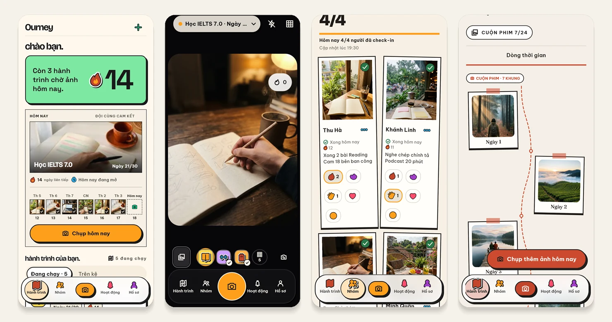

</div>

## Ourney là gì

Ourney giúp bạn ghi lại những việc muốn giữ đều bằng một tấm ảnh mỗi ngày: học tiếng Anh, chạy bộ, tập luyện, giữ dáng, một chuyến đi xa hay thói quen của riêng hai người. Không cần viết dài hay nhập nhiều biểu mẫu — mở máy ảnh, chụp một tấm là xong ngày hôm nay. Các tấm ảnh tự nối thành dòng thời gian theo đúng chủ đề bạn chọn, đi một mình hoặc đi chung cùng bạn bè. Ourney không chạy đồng hồ đếm ngược, không xếp hạng cơ thể và lỡ một hôm cũng không xóa mất hành trình của bạn.

## Cài đặt

Phiên bản hiện tại: **`v1.2.2`** (`1.2.2+5`).

- **Android:** tải trực tiếp [ourney.tech/Ourney.apk](https://ourney.tech/Ourney.apk) rồi mở tệp để cài. Nếu Google Play Protect hiện cảnh báo vì bản beta chưa lên Play Store, chọn *Chi tiết khác* → *Vẫn cài đặt*.
- **iOS:** đăng ký danh sách chờ beta trên [ourney.tech](https://ourney.tech). Nếu muốn cài thử sớm bằng máy tính, tải `Ourney-unsigned.ipa` ở trang [Releases](https://github.com/hofang42/Ourney/releases) và tự ký bằng Apple ID miễn phí theo hướng dẫn trong [docs/platform/ios.md](docs/platform/ios.md).

## Dùng thế nào

<table>
  <tr>
    <td align="center" width="33%">
      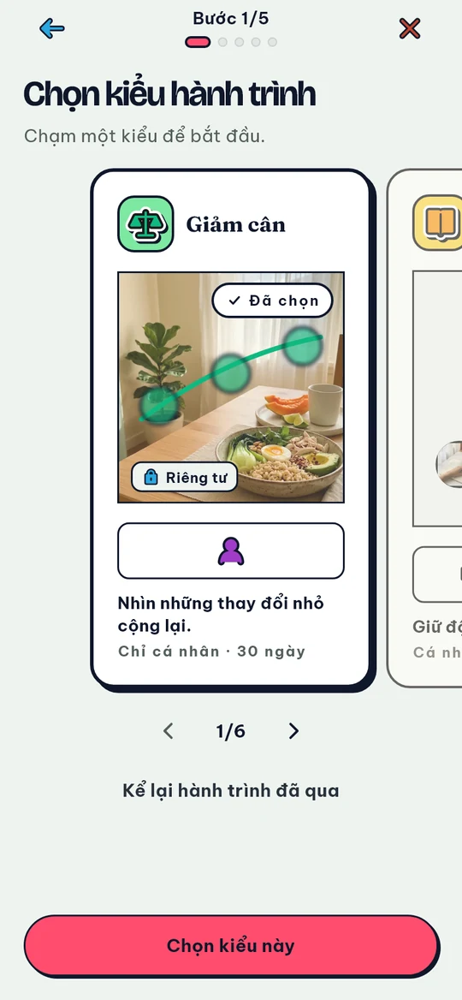<br>
      <b>1. Tạo hành trình</b><br>
      <sub>Chọn một trong 6 kiểu có sẵn, đặt thời lượng từ 7–365 ngày (hoặc mở không giới hạn với Chuyến đi / Tự đặt), đi một mình hay lập nhóm.</sub>
    </td>
    <td align="center" width="33%">
      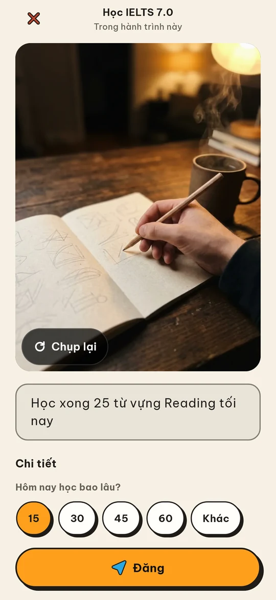<br>
      <b>2. Mỗi ngày chụp một tấm</b><br>
      <sub>Mở camera nền tối ngay từ thanh dưới, chụp mới hoặc lấy ảnh thư viện. Có thể thêm chú thích ngắn và chỉ số tuỳ chọn (phút học, km, địa điểm…).</sub>
    </td>
    <td align="center" width="33%">
      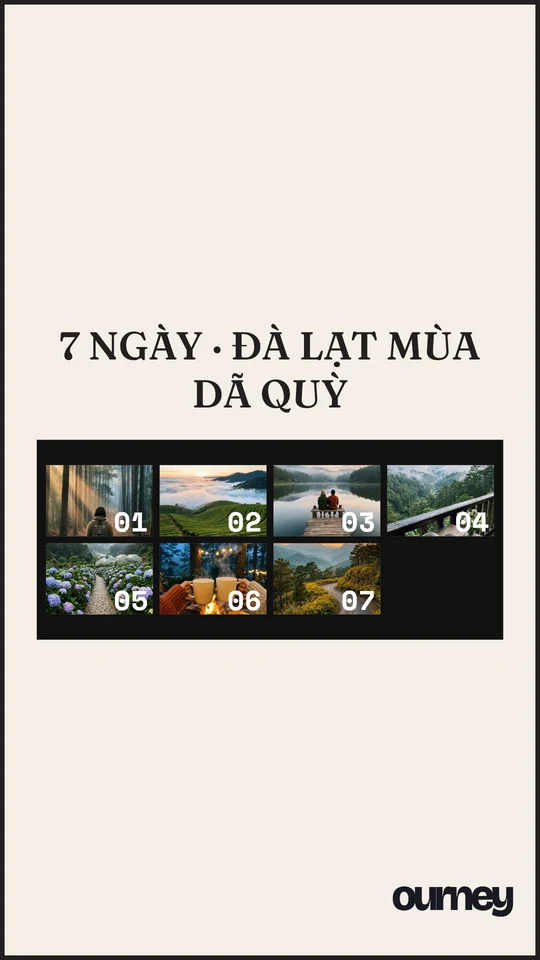<br>
      <b>3. Xem lại &amp; chia sẻ</b><br>
      <sub>Ngắm dòng thời gian đầy dần mỗi ngày, xem tổng kết Wrapped khi về đích, xuất thiệp 9:16 / 4:5 hoặc mở link chỉ đọc cho bạn bè.</sub>
    </td>
  </tr>
</table>

## Tính năng chính

- **6 giao diện theo chủ đề hành trình:** đổi hành trình là dòng thời gian và thiệp chia sẻ tự đổi theo ngay tại chỗ; hỗ trợ cả nền sáng, nền tối và 8 biểu tượng ứng dụng. Chụp nhiều ảnh trong ngày hoặc nhập ảnh cũ tự xếp theo ngày EXIF (*Kể lại hành trình đã qua*).
- **Nhóm nhỏ (≤ 10 người) & Cặp đôi:** mời bằng mã 8 ký tự, link `ourney.tech/j/<mã>`, mã QR hoặc `@username`. Cả nhóm xem tường ảnh hôm nay và thả 5 biểu cảm (`🔥`, `💪`, `👏`, `❤️`, `😂`), không xếp hạng cơ thể. Ở hành trình **Cặp đôi**, mỗi người tự chụp phần ảnh của mình và hai tấm được ghép cạnh nhau từng ngày. Có thêm danh sách bạn bè và nhắn tin trực tiếp.
- **Widget màn hình & nhắc nhở nhẹ nhàng:** 3 widget Màn hình chính (*Hôm nay*, *Chuỗi*, *Đồng đội*) trên Android (Jetpack Glance) và iOS (WidgetKit), widget Màn hình khóa (iOS), Live Activity / Dynamic Island (iOS 16.2+) và Cập nhật trực tiếp (Android). Chỉ nhắc vào ngày bạn chưa chụp (giờ nhắc riêng + nhắc nhẹ 21:00 khi đang có chuỗi), không đếm ngược.
- **Riêng tư mặc định:** số cân nặng ẩn dạng `••,•` và chỉ hiện khi *Giữ để xem*; ảnh giảm cân tự làm mờ khi chia sẻ. Trên widget và Màn hình khóa không bao giờ hiện số kg hay chú thích; có 4 chế độ ảnh (*Thông minh*, *Làm mờ*, *Ẩn ảnh*, *Rõ nét*) và tự ẩn tên hành trình trên Màn hình khóa khi có hành trình giảm cân. Hỗ trợ chặn, báo cáo và xóa tài khoản vĩnh viễn 3 bước (xác thực lại bằng OTP hoặc mật khẩu).
- **Thiệp chia sẻ, Wrapped & link công khai:** xuất poster 9:16 hoặc 4:5 theo phong cách riêng (có nút ẩn chữ `ourney` và làm mờ ảnh), xem tổng kết **Wrapped** khi kết thúc hành trình. Hành trình cá nhân đã kết thúc có thể bật link xem công khai chỉ đọc (`ourney.tech/p/<địa-chỉ>`), chọn địa chỉ dễ đọc hoặc trung tính và thu hồi bất cứ lúc nào; người xem có thể bấm *Làm theo*.
- **Lưu trên máy trước (offline-first):** ảnh và dữ liệu ghi vào SQLite (`drift`) trước rồi tự đồng bộ nền lên Supabase khi có mạng. Bản chạy không cần máy chủ vẫn dùng được đầy đủ hành trình cá nhân.

### 6 phong cách giao diện (ảnh chụp thực tế)

| Quiet Transformer *(Giảm cân)* | Accountability Squad *(Học tiếng Anh)* | Memory Collectors *(Chuyến đi)* |
| :---: | :---: | :---: |
| 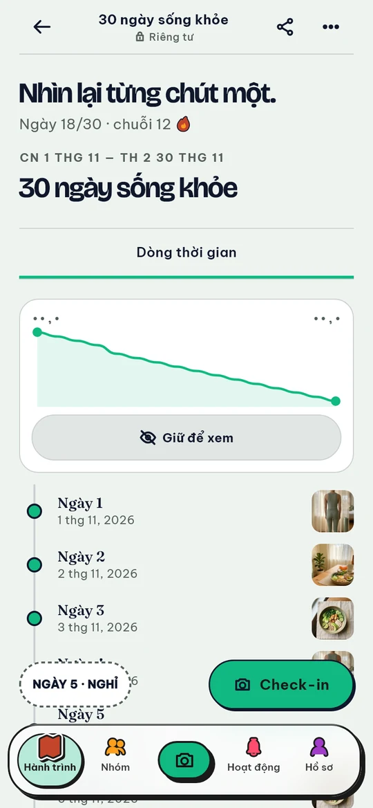 | 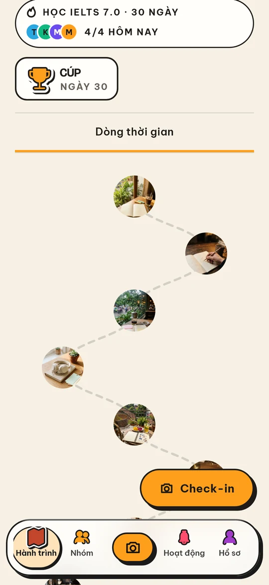 | 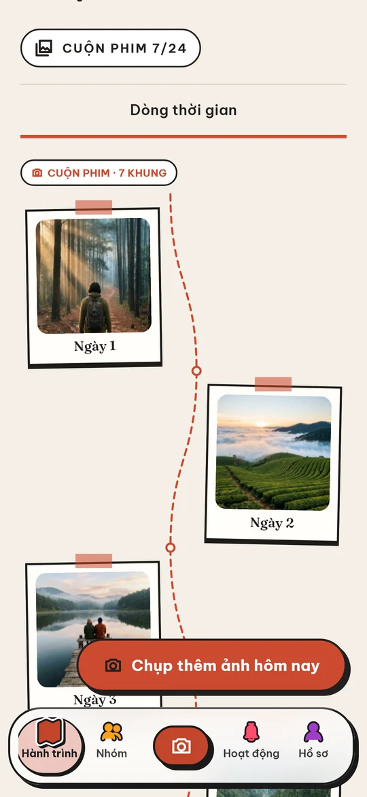 |
| Đường cong tiến độ che số `••,•` (giữ để xem), khung bóng mờ ảnh ngày đầu khi chụp | Con đường chữ S dẫn tới cúp cột mốc, chọn nhanh số phút học | Sổ lưu niệm ảnh Polaroid dán băng keo, gắn địa điểm, thiệp phim 35mm |

| Couple Rituals *(Cặp đôi)* | Aesthetic Flexer *(30 ngày tập luyện)* | Minimalist Habit *(Thói quen tự đặt)* |
| :---: | :---: | :---: |
| 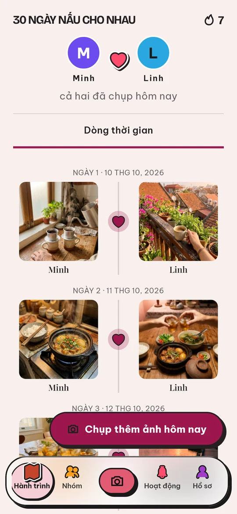 | 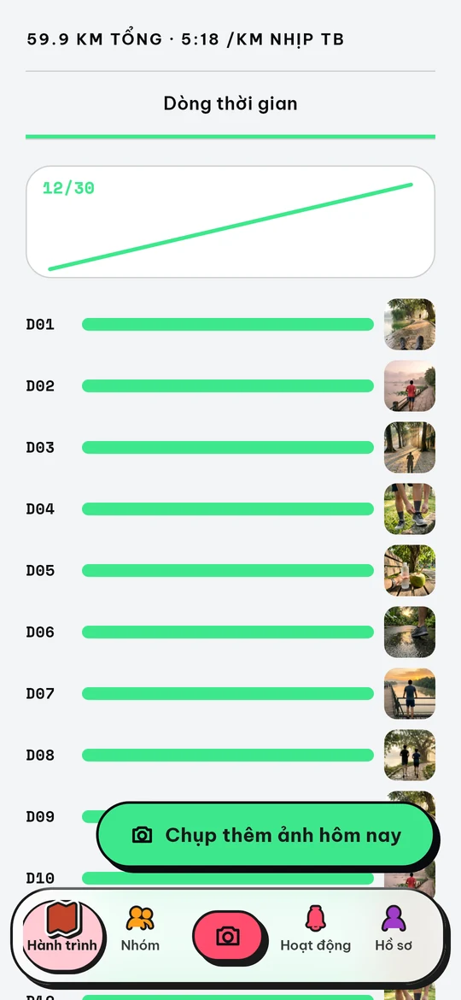 | 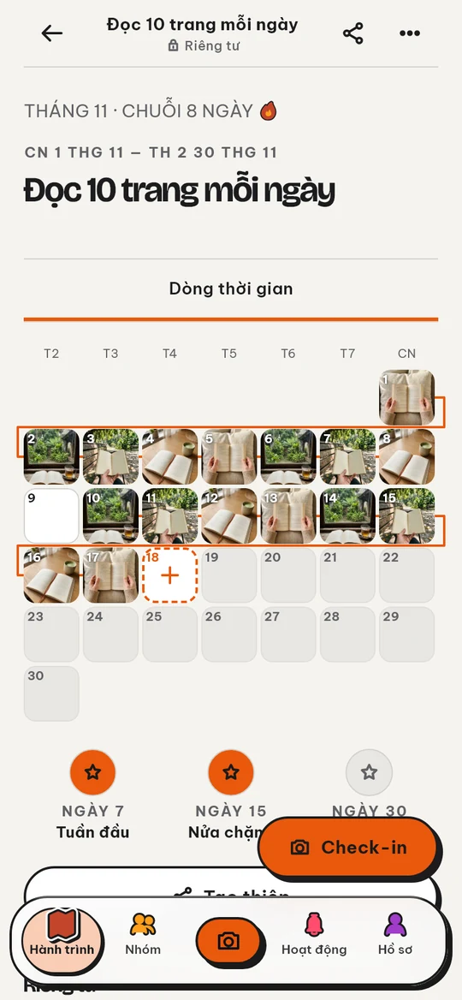 |
| Mỗi người tự đăng phần ảnh của mình, ghép cạnh nhau từng ngày | Biểu đồ buổi tập kèm quãng đường (km) và nhịp chạy | Lịch ảnh 7 cột nối liền các ngày đã chụp, đăng gọn không bắt buộc gõ chữ |

### Tiện ích màn hình & chế độ tối

<table>
  <tr>
    <td align="center" width="50%">
      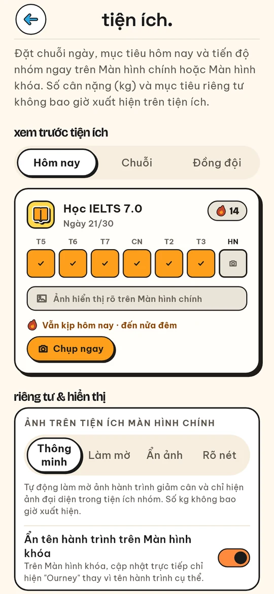<br>
      <sub>Xem trước widget <i>Hôm nay / Chuỗi / Đồng đội</i> và 4 chế độ riêng tư</sub>
    </td>
    <td align="center" width="50%">
      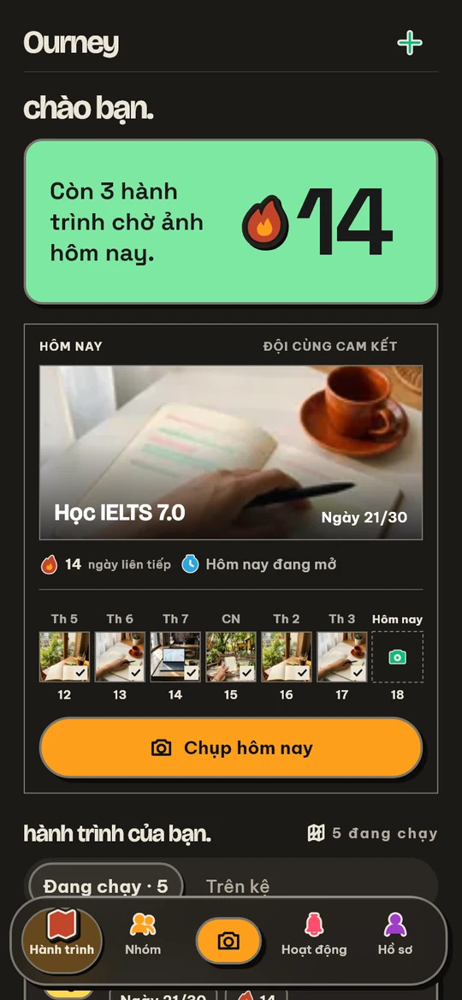<br>
      <sub>Hỗ trợ đầy đủ chế độ tối trên cả 6 phong cách</sub>
    </td>
  </tr>
</table>

---

## Cho nhà phát triển

### Cấu trúc repo

```text
apps/mobile/          Ứng dụng Flutter (iOS + Android, Jetpack Glance, WidgetKit)
apps/admin/           Trang quản trị kiểm duyệt & waitlist (React 19 + Vite, chỉ gọi RPC)
apps/landing/         Trang giới thiệu ourney.tech & trang mở link chia sẻ (/f, /j, /p)
packages/ourney_core/ Logic Dart thuần: domain model, tính chuỗi ngày, kiểm tra dữ liệu, mẫu
supabase/             Migration Postgres (RLS), RPC, 6 Edge Functions (Deno), kiểm thử pgTAP
scripts/              Script phát hành (preflight, metadata), đóng gói IPA, triển khai Supabase
docs/                 Đặc tả (SRS), hợp đồng dữ liệu, ADR, hướng dẫn nền tảng & runbook
```

### Công cụ cần có

- **Flutter `3.47.7`** (Dart `3.13.5`, xem [`.github/workflows/ci.yml`](.github/workflows/ci.yml) và [`apps/mobile/pubspec.yaml`](apps/mobile/pubspec.yaml))
- **Node.js `22`** (tối thiểu `20`) cho `apps/admin` và script kiểm tra metadata phát hành
- **JDK `17`** để đóng gói Android
- **Docker**, **Supabase CLI `2.121.0`** và **Deno `2.x`** nếu chạy máy chủ cục bộ hoặc kiểm thử `supabase/`

### Chạy ứng dụng

Chạy không cần máy chủ (dùng đủ mọi hành trình cá nhân trên máy):

```bash
cd apps/mobile
flutter pub get
flutter run
```

Chạy cùng Supabase cục bộ (điền các biến `SUPABASE_URL`, `SUPABASE_ANON_KEY`, tuỳ chọn `SUPPORT_EMAIL` từ tệp mẫu [`apps/mobile/env.example.json`](apps/mobile/env.example.json) — `apps/mobile/env.json` đã nằm trong `.gitignore`):

```bash
supabase start
cp apps/mobile/env.example.json apps/mobile/env.json
cd apps/mobile
flutter run --dart-define-from-file=env.json
```

Chạy trang quản trị (`apps/admin`, cấu hình hai biến môi trường `VITE_SUPABASE_URL` và `VITE_SUPABASE_ANON_KEY`, xem [docs/runbooks/admin-dashboard.md](docs/runbooks/admin-dashboard.md)):

```bash
cd apps/admin
npm ci
npm run dev
```

### Kiểm thử

CI ([`.github/workflows/ci.yml`](.github/workflows/ci.yml)) chạy 5 job trên mọi pull request và push lên `main`:

| Job | Lệnh | Thư mục |
|---|---|---|
| `core` | `dart pub get && dart analyze && dart test` | `packages/ourney_core` |
| `mobile` | `flutter pub get && dart run build_runner build -d && dart run tool/gen_l10n.dart && flutter analyze && dart analyze && flutter test` | `apps/mobile` |
| `admin` | `npm ci && npm run typecheck && npm run lint && npm test && npm run build` | `apps/admin` |
| `supabase` | `deno run --allow-read supabase/scripts/check-streak-vectors.ts && deno check supabase/functions/*/index.ts && deno test supabase/functions/public-journey/index_test.ts && supabase test db` | Thư mục gốc |
| `tooling` | `node scripts/release/metadata.mjs lint && find scripts -name '*.sh' -print0 \| xargs -0 shellcheck && bash scripts/tests/run.sh` | Thư mục gốc |

Lưu ý: các tệp sinh tự động (`*.g.dart`, l10n) được commit cùng mã nguồn; luôn chạy cả `dart analyze` trong `apps/mobile` để kích hoạt `riverpod_lint`.

### CI & phát hành

- [`.github/workflows/ci.yml`](.github/workflows/ci.yml): kiểm tra tĩnh, codegen và kiểm thử 5 thành phần.
- [`.github/workflows/android.yml`](.github/workflows/android.yml): đẩy tag `v*` sẽ kiểm tra metadata, đóng gói `Ourney.apk`, gắn vào GitHub Release, mirror sang `hofang42/ourney-releases` và cập nhật chính sách phiên bản Android (`scripts/release/publish-manifest.sh`).
- [`.github/workflows/ios.yml`](.github/workflows/ios.yml): đẩy tag `v*` sẽ đóng gói `Ourney-unsigned.ipa` (đã kiểm tra App Group cho widget) và gắn vào GitHub Release.
- [`.github/workflows/deploy-supabase.yml`](.github/workflows/deploy-supabase.yml): triển khai migration, Edge Functions và cấu hình Auth thủ công từ `main` (mặc định `dry_run: true`).

Trước khi gắn tag phát hành, cập nhật phiên bản trong [`apps/mobile/pubspec.yaml`](apps/mobile/pubspec.yaml) và [`apps/mobile/release-meta.json`](apps/mobile/release-meta.json), rồi chạy `bash scripts/release/preflight.sh vX.Y.Z`. Xem chi tiết tại [docs/runbooks/release.md](docs/runbooks/release.md).

### Tài liệu tham khảo

- [Đặc tả & phạm vi (SRS)](docs/SRS.md) · [Phân công (TASKS)](docs/TASKS.md) · [Quy tắc dự án (CLAUDE.md)](CLAUDE.md)
- [Hợp đồng dữ liệu](docs/contracts/schema.md) · [Hệ thống 6 phong cách](docs/06-adaptive-persona-ui-system.md) · [Camera nền tối dùng chung](docs/design-v2/camera-compose-redesign-2026-11-20.md)
- [Cài đặt iOS](docs/platform/ios.md) · [Cài đặt Android](docs/platform/android.md) · [Các runbook vận hành](docs/runbooks/)

## Bảo mật & đóng góp

- Không bao giờ commit khóa bí mật (`service_role`, keystore, chứng chỉ ký hay tệp env có giá trị thật). Mọi bảng Postgres mới phải bật RLS và kèm kiểm thử pgTAP.
- Báo lỗi hoặc đề xuất thay đổi qua [GitHub Issues](https://github.com/hofang42/Ourney/issues). Mở pull request thẳng vào `main`, dùng [Conventional Commits](https://www.conventionalcommits.org/) và chờ CI xanh; thay đổi giao diện cần kèm ảnh nền sáng và nền tối.
