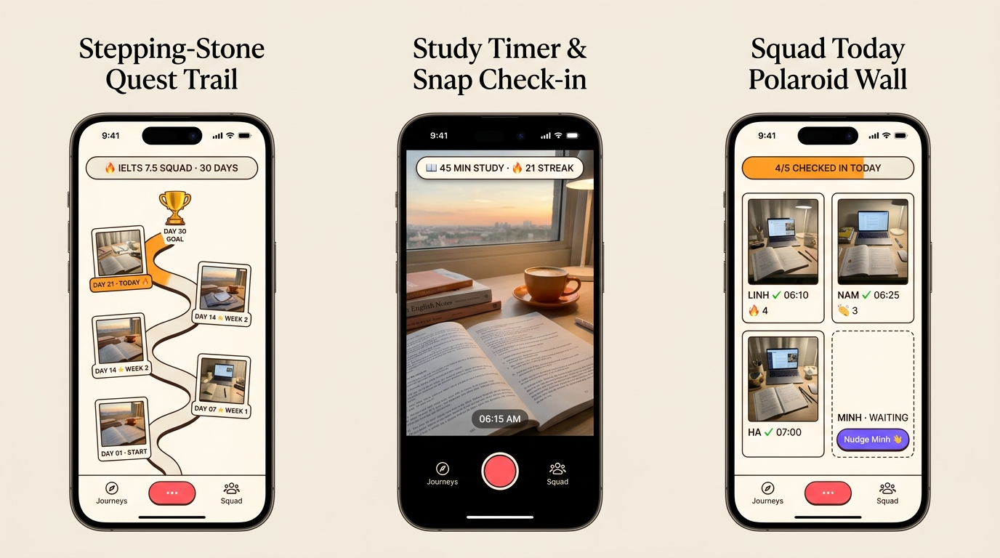
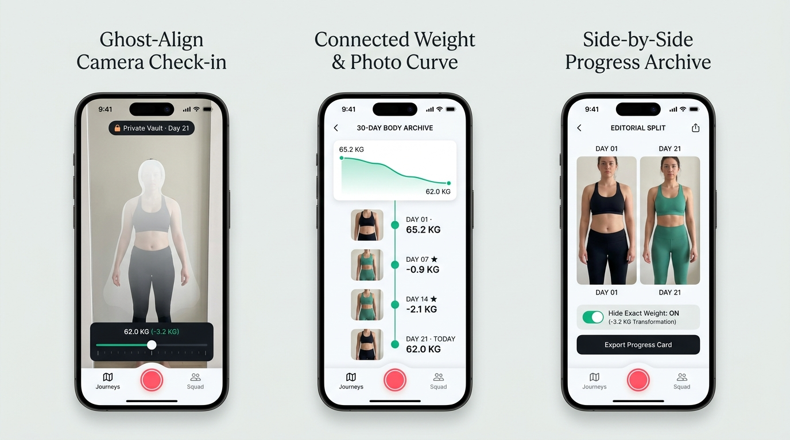
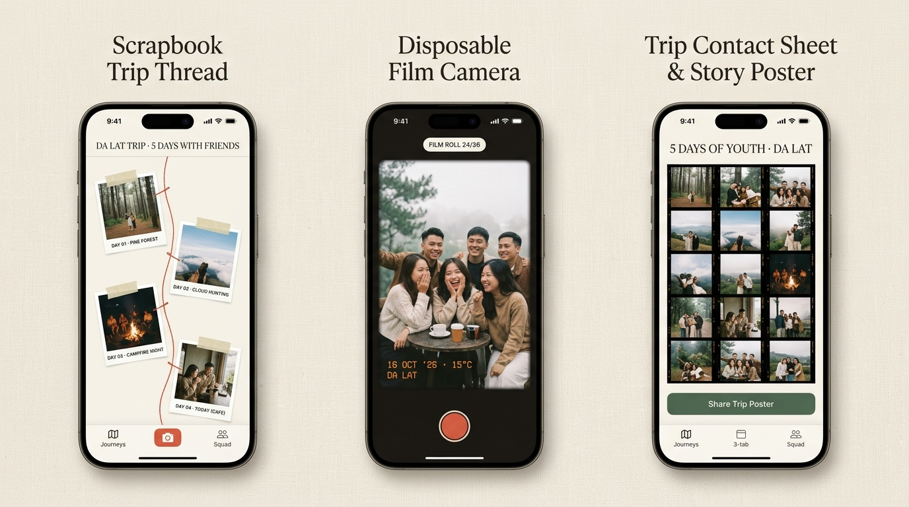
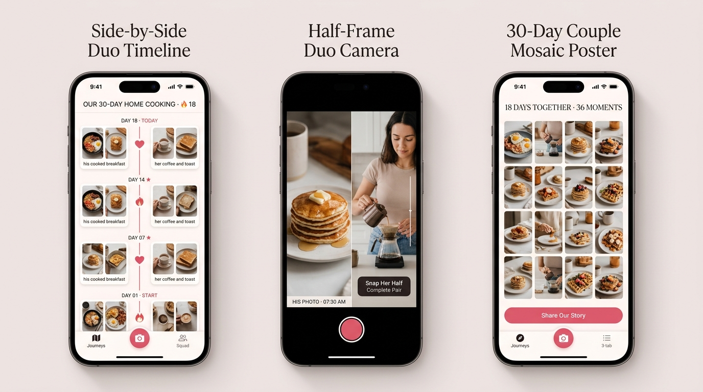
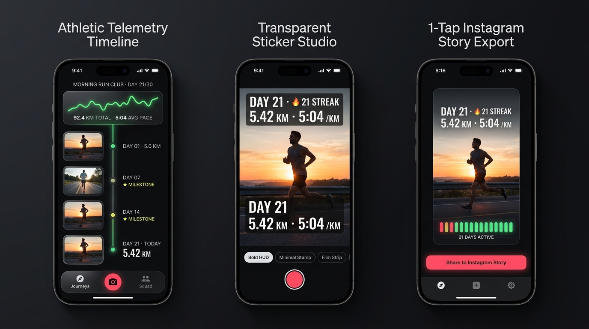
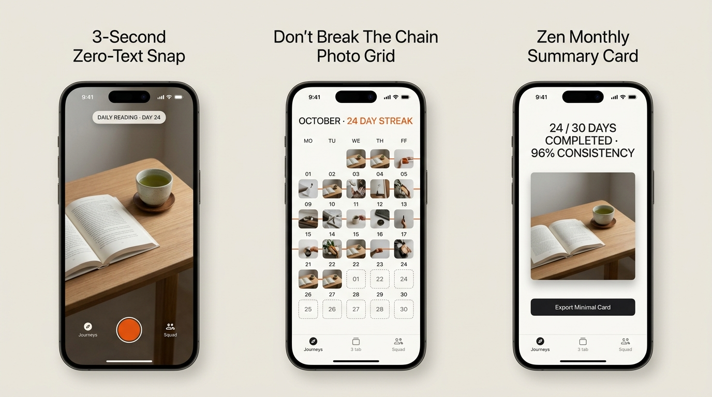
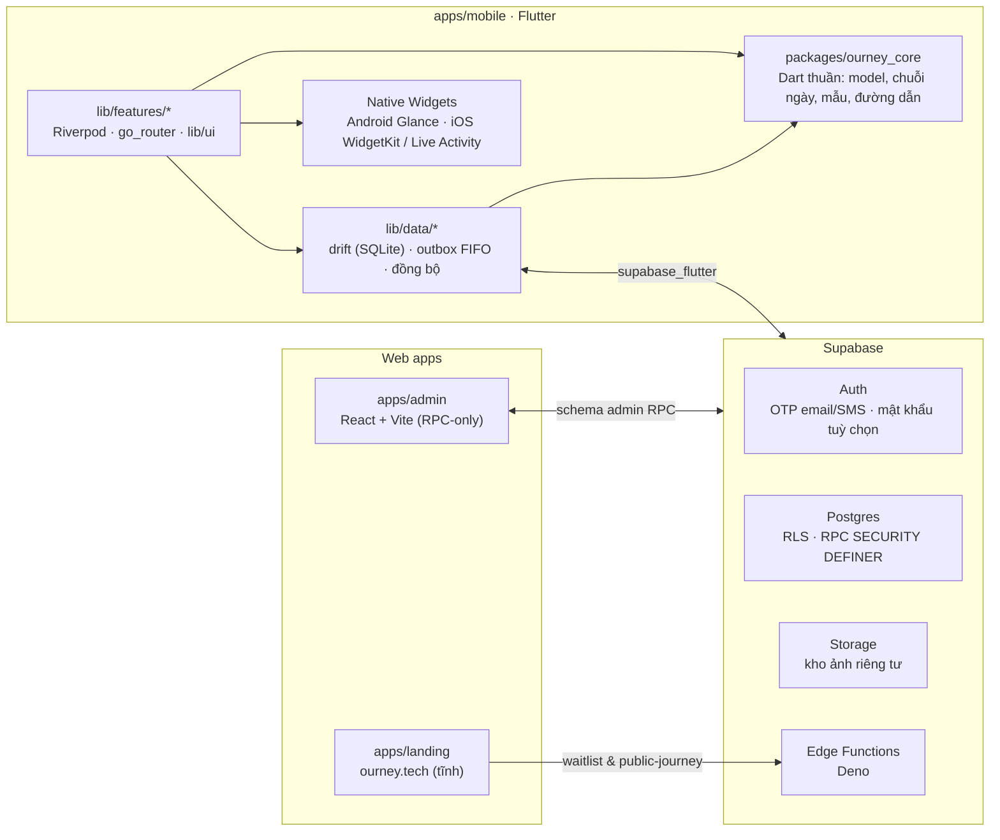

<div align="center">

# Ourney

**chụp một tấm. giữ một chuỗi. đi cùng nhau.**

Nhật ký ảnh mỗi ngày cho điều bạn muốn kiên trì, dù đi một mình hay đi cùng bạn bè.

[](https://github.com/hofang42/Ourney/actions/workflows/ci.yml)
[](https://github.com/hofang42/Ourney/actions/workflows/android.yml)
[](https://github.com/hofang42/Ourney/actions/workflows/ios.yml)


[Trang chủ (ourney.tech)](https://ourney.tech) · [Tải Android APK](https://ourney.tech/Ourney.apk) · [Tài liệu](docs/) · [Đặc tả](docs/SRS.md) · [Báo lỗi](https://github.com/hofang42/Ourney/issues)



<sub>Bản thiết kế tham khảo, chưa phải ảnh chụp từ ứng dụng.</sub>

</div>

## Giới thiệu

Ourney là nhật ký ảnh mỗi ngày dành cho những việc bạn muốn giữ đều: giảm cân, học tiếng Anh, tập luyện, một chuyến đi xa, thói quen của hai người hay bất kỳ mục tiêu nhỏ nào tự đặt. Thay vì bắt bạn viết dài hay điền nhiều bảng biểu, mỗi ngày bạn chỉ cần chụp một tấm ảnh. Những tấm ảnh đó nối tiếp nhau thành dòng thời gian của cả hành trình.

Bạn có thể đi một mình, rủ một nhóm bạn nhỏ (tối đa 10 người) hoặc tạo hành trình riêng cho hai người. Ourney không chạy đồng hồ đếm ngược, không xếp hạng kết quả cơ thể và không gây áp lực khi bạn lỡ một hôm — một ngày nghỉ không xóa hành trình.

Phiên bản hiện tại là **`v1.2.2`** (`1.2.2+5`, xem [`apps/mobile/pubspec.yaml`](apps/mobile/pubspec.yaml) và [`apps/mobile/release-meta.json`](apps/mobile/release-meta.json)).

## Tải và cài đặt

- **Android (APK):** tải trực tiếp tại [ourney.tech/Ourney.apk](https://ourney.tech/Ourney.apk) (chuyển hướng tới [bản phát hành mới nhất trên `hofang42/ourney-releases`](https://github.com/hofang42/ourney-releases/releases/latest/download/Ourney.apk)). Mở tệp `.apk` vừa tải để cài đặt; nếu Google Play Protect cảnh báo vì bản beta chưa lên Play Store, chọn *Chi tiết khác* → *Vẫn cài đặt*.
- **iOS:** đăng ký danh sách chờ beta tại [ourney.tech](https://ourney.tech). Thành viên nhóm hoặc người dùng muốn cài thử sớm có thể tải tệp `Ourney-unsigned.ipa` ở trang [Releases](https://github.com/hofang42/Ourney/releases) và tự ký bằng Apple ID miễn phí theo hướng dẫn ở [docs/platform/ios.md](docs/platform/ios.md).

## Tính năng hiện có

- **Chụp nhanh, lưu ngay trên máy.** Một màn hình camera nền tối dùng chung cho mọi hành trình, mở ngay từ nút chụp ở giữa thanh điều hướng dưới (giữ nút để mở vòng chọn nhanh hành trình). Hỗ trợ chụp nhiều ảnh trong một ngày, chọn ảnh từ thư viện, hoặc dùng mục *Kể lại hành trình đã qua* để nhập ảnh cũ và tự xếp theo ngày chụp EXIF. Dữ liệu được lưu vào SQLite (`drift`) trước rồi tự đồng bộ nền lên Supabase khi có mạng.
- **Sáu kiểu hành trình.** Chọn trong 6 kiểu có sẵn khi tạo mới: Giảm cân, Học tiếng Anh, 30 ngày tập luyện, Chuyến đi (có ô tìm kiếm địa điểm), Cặp đôi và Tự đặt; thời lượng từ 7 đến 365 ngày hoặc không giới hạn (với Chuyến đi và Tự đặt), kèm chỉ số theo dõi tuỳ chọn (cân nặng, phút học, quãng đường, nhịp chạy).
- **Đi cùng nhóm và bạn bè.** Mời vào nhóm (tối đa 10 người; cặp đôi là nhóm đúng 2 người) bằng mã 8 ký tự, đường link `ourney.tech/j/<mã>`, mã QR hoặc gửi lời mời trực tiếp qua `@username`. Người vào sau được tính tiến độ từ ngày tham gia. Trong nhóm, mọi người xem tiến độ hôm nay và thả 5 biểu cảm (`🔥`, `💪`, `👏`, `❤️`, `😂`), không có bảng xếp hạng kết quả cơ thể. Ứng dụng cũng có danh sách bạn bè (kết bạn qua link, QR hoặc tìm đúng `@username`) và nhắn tin trực tiếp.
- **Cặp đôi tự đăng ảnh.** Ở hành trình cặp đôi, mỗi người tự chụp và đăng phần ảnh của mình; hai tấm ảnh trong ngày được đặt cạnh nhau trên dòng thời gian. Khi người kia chưa vào nhóm, bạn có thể gửi lời mời ngay từ màn đăng ảnh.
- **Thiệp chia sẻ, Wrapped và link xem công khai.** Xuất thiệp khổ Story (9:16) hoặc Bài đăng (4:5) theo từng phong cách, có nút ẩn chữ `ourney` và làm mờ ảnh. Khi kết thúc hành trình, xem lại tổng kết **Wrapped** dạng trang story và xuất thẻ tổng kết. Với hành trình đã kết thúc, chủ hành trình có thể bật **link công khai chỉ để xem** (`ourney.tech/p/<địa-chỉ>`), chọn giữa địa chỉ dễ đọc có tên hành trình hoặc địa chỉ trung tính, và thu hồi hay đặt lại bất cứ lúc nào. Người xem có thể bấm *Làm theo* để tạo hành trình tương tự cho riêng mình.
- **Nhắc nhở và tiện ích màn hình (Widgets) nhẹ nhàng.** Đặt giờ nhắc riêng cho từng hành trình và bật/tắt lời nhắc buổi tối lúc 21:00 khi đang có chuỗi; ứng dụng chỉ nhắc vào ngày bạn chưa chụp, không đếm ngược và không thúc ép. Hỗ trợ 3 loại widget Màn hình chính trên cả **Android (Jetpack Glance)** và **iOS (WidgetKit)** — *Hôm nay*, *Chuỗi ngày*, *Đồng đội* — cùng widget Màn hình khóa (iOS), **Live Activity / Dynamic Island** (iOS 16.2+) và **Cập nhật trực tiếp** trên thanh trạng thái (Android). Khung giờ buổi tối tự mở trước giờ nhắc 30 phút (hoặc từ 18:00 khi đang có chuỗi) và tự tắt ngay khi bạn chụp xong.
- **Riêng tư mặc định và an toàn.**
  - Với hành trình giảm cân: số cân nặng mặc định ẩn khỏi người khác, hiển thị dạng `••,•` trên màn hình chính của bạn và chỉ hiện khi **nhấn giữ** (*Giữ để xem*); ảnh được làm mờ mặc định khi chia sẻ.
  - Trên widget và Màn hình khóa: không bao giờ hiển thị số kg hay chú thích; Màn hình khóa và Live Activity không hiện ảnh; có 4 chế độ ảnh Màn hình chính (*Thông minh*, *Làm mờ*, *Ẩn ảnh*, *Rõ nét*) và công tắc **ẩn tên hành trình trên Màn hình khóa / Dynamic Island** (chỉ hiện `"Ourney"`, tự bật sẵn khi có hành trình giảm cân).
  - Chặn người dùng và báo cáo ảnh, người dùng hoặc tin nhắn (nội dung bị báo cáo được ẩn ngay trên máy bạn; danh sách chặn đồng bộ với máy chủ).
  - Xóa tài khoản vĩnh viễn theo 3 bước, yêu cầu xác thực lại bằng **mã 6 số (OTP) hoặc mật khẩu**, xóa toàn bộ dữ liệu và ảnh trên máy chủ (kèm hàng đợi dọn bù) và chuyển quyền chủ nhóm cho thành viên vào sớm nhất nếu nhóm còn người khác.
- **Dùng không cần máy chủ & tiện ích khác.** Khi chạy bản chưa cấu hình máy chủ, mọi hành trình cá nhân vẫn dùng được đầy đủ. Hỗ trợ giao diện sáng/tối, tiếng Việt/tiếng Anh, đổi 8 biểu tượng ứng dụng, bảng góp ý tính năng trong ứng dụng và thông báo cập nhật phiên bản mới.

## Sáu phong cách giao diện

Mỗi loại hành trình mang một màu sắc và cách bày dòng thời gian, thiệp chia sẻ riêng. Khi chuyển giữa các hành trình, giao diện đổi ngay tại chỗ mà không khởi động lại ứng dụng hay camera; phong cách nào cũng có nền sáng và nền tối. Riêng màn hình camera dùng chung một giao diện nền tối cho cả sáu phong cách, chỉ đổi màu nhấn và bật thêm khung hỗ trợ với Giảm cân và Cặp đôi. Chi tiết xem ở [docs/06-adaptive-persona-ui-system.md](docs/06-adaptive-persona-ui-system.md) và [docs/design-v2/camera-compose-redesign-2026-11-20.md](docs/design-v2/camera-compose-redesign-2026-11-20.md).

| # | Phong cách | Dành cho | Dòng thời gian | Màn hình chụp & đăng ảnh | Thiệp chia sẻ |
|:-:|---|---|---|---|---|
| 1 | Quiet Transformer | Giảm cân | Đường cong cân nặng (che số `••,•`, nhấn giữ để xem) kèm trục cột mốc | Camera chung + bóng mờ ảnh ngày đầu để căn tư thế; nhập cân nặng ở màn đăng ảnh | Thẻ dọc nền trắng kèm ảnh làm mờ mặc định và số ngày đều đặn (số kg luôn ẩn) |
| 2 | Accountability Squad | Học tiếng Anh | Con đường chữ S dẫn tới chiếc cúp cột mốc | Camera chung theo màu nhấn; chọn số phút học ở màn đăng ảnh | Poster nền kem ghép lưới 4 ảnh nghiêng kèm con dấu cúp vàng |
| 3 | Memory Collectors | Chuyến đi | Sổ lưu niệm đường chỉ khâu với ảnh Polaroid dán băng keo | Camera chung theo màu nhấn; tìm và gắn địa điểm ở màn đăng ảnh | Tờ phim 35mm (contact sheet) đánh số khung ảnh cả chuyến đi |
| 4 | Couple Rituals | Cặp đôi (2 người) | Mỗi ngày ghép đôi ảnh do từng người tự đăng | Camera chung + ảnh gần nhất của người ấy dạng khung nhỏ PiP (chạm để phóng to); mời người ấy ngay từ màn đăng ảnh | Lưới ảnh ghép nhiều khung (chỉ hiển thị ảnh của chính bạn) |
| 5 | Aesthetic Flexer | 30 ngày tập luyện | Biểu đồ đường chạy/tập cùng các mốc buổi tập | Camera chung theo màu nhấn; nhập quãng đường (km) và nhịp chạy ở màn đăng ảnh | Ảnh tràn viền kèm hộp thông số và dải cột ngày đã tập |
| 6 | Minimalist Habit | Thói quen tự đặt | Lịch ảnh 7 cột nối liền các ngày đã chụp | Camera chung theo màu nhấn; đăng nhanh không bắt buộc gõ chữ | Thẻ nền trắng tối giản với số ngày đã chụp, tỷ lệ đều đặn và một khung ảnh |

<details>
<summary>Xem sáu bản thiết kế tham khảo</summary>
<br>

<sub>Lưu ý: phần màn hình chụp trong các ảnh thiết kế dưới đây đã được thay bằng một màn hình camera nền tối dùng chung từ bản cập nhật tháng 11/2026.</sub>

| | |
|:-:|:-:|
| <br>1 · Quiet Transformer | <br>2 · Accountability Squad |
| <br>3 · Memory Collectors | <br>4 · Couple Rituals |
| <br>5 · Aesthetic Flexer | <br>6 · Minimalist Habit |

</details>

## Kiến trúc

Ứng dụng di động được viết bằng Flutter, dùng chung mã nguồn cho iOS và Android, theo hướng lưu trên máy trước (offline-first) rồi đồng bộ lên Supabase. Bên cạnh đó, monorepo còn chứa trang giới thiệu `ourney.tech` và trang quản trị kiểm duyệt `admin.ourney.tech`.



| Thành phần | Công nghệ |
|---|---|
| Ứng dụng di động (`apps/mobile`) | Flutter 3.47.7, Dart 3.13.5, Riverpod, go_router, drift (SQLite), background_downloader, camera, flutter_image_compress, share_plus, flutter_local_notifications; widget viết bằng Kotlin/Jetpack Glance (Android) và SwiftUI/WidgetKit + ActivityKit (iOS) |
| Logic dùng chung (`packages/ourney_core`) | Dart thuần (không phụ thuộc Flutter): domain model, tính chuỗi ngày, kiểm tra dữ liệu, mẫu hành trình và đường dẫn chia sẻ |
| Máy chủ (`supabase/`) | Supabase: Postgres bật RLS trên mọi bảng, RPC `SECURITY DEFINER`, Storage riêng tư, 6 Edge Functions viết bằng Deno (`delete-account`, `public-journey`, `waitlist-signup`, `admin-action`, `notify-moderation`, `storage-purge-sweep`), kiểm thử bằng pgTAP |
| Trang quản trị (`apps/admin`) | React 19, Vite, TypeScript, Vitest — gọi duy nhất `schema admin` qua RPC (không truy vấn trực tiếp bảng dữ liệu người dùng, có audit log và cấp quyền xem ảnh báo cáo có thời hạn 5 phút) |
| Trang giới thiệu (`apps/landing`) | HTML/CSS/JS tĩnh triển khai trên Cloudflare Pages (`ourney.tech`), chuyển hướng tải `Ourney.apk`, form danh sách chờ beta và các trang mở link chia sẻ `/f`, `/j`, `/p` |
| Đóng gói | GitHub Actions: Ubuntu chạy CI và đóng gói Android APK; macOS đóng gói iOS unsigned IPA và chạy test widget trên simulator |

Trước khi sửa phần dữ liệu hay máy chủ, hãy đọc [hợp đồng dữ liệu](docs/contracts/schema.md) và [`packages/ourney_core/lib/src/models.dart`](packages/ourney_core/lib/src/models.dart).

## Cấu trúc thư mục

```text
.
├── apps/
│   ├── mobile/             # Ứng dụng Flutter cho iOS và Android
│   │   ├── lib/app/        #   khung ứng dụng, điều hướng, dock 5 tab
│   │   ├── lib/ui/         #   bộ UI kit, token màu sáng/tối, 6 skin
│   │   ├── lib/features/   #   mỗi tính năng một thư mục (xem lib/features/README.md)
│   │   ├── lib/personas/   #   bản dịch và hợp đồng dữ liệu cho 6 phong cách
│   │   ├── lib/data/       #   SQLite (drift), repository, outbox, đồng bộ
│   │   ├── lib/shared/     #   tiện ích và widget dùng chung (múi giờ, địa điểm...)
│   │   ├── android/        #   dự án Android và widget Jetpack Glance + Live Update
│   │   ├── ios/            #   dự án iOS và OurneyWidgets (WidgetKit + Live Activity)
│   │   └── release-meta.json # chính sách phiên bản và ghi chú phát hành VI/EN
│   ├── admin/              # Trang quản trị kiểm duyệt và waitlist (React + Vite)
│   └── landing/            # Trang giới thiệu ourney.tech và các trang mở deep link
├── packages/ourney_core/   # Logic Dart thuần: model, chuỗi ngày, validation, mẫu
├── supabase/               # Migration, RLS, RPC, Edge Functions, kiểm thử pgTAP
├── scripts/                # Script phát hành (metadata.mjs, preflight.sh), deploy, đóng gói IPA
├── docs/                   # Đặc tả, phân công, ADR, hợp đồng dữ liệu, runbook vận hành
└── .github/                # CI/CD, CODEOWNERS, mẫu pull request, cấu hình release notes
```

## Cài đặt và chạy thử cho lập trình viên

### Công cụ cần có

| Công cụ | Phiên bản | Dùng để |
|---|---|---|
| [Flutter](https://docs.flutter.dev/get-started/install) | 3.47.7 (Dart 3.13.5) | Chạy `apps/mobile` và `packages/ourney_core` |
| [Node.js](https://nodejs.org/) | 22 (tối thiểu 20) | Chạy `apps/admin` và kiểm tra metadata phát hành (`scripts/release/metadata.mjs`) |
| [Docker](https://docs.docker.com/get-docker/) và [Supabase CLI](https://supabase.com/docs/guides/local-development/cli/getting-started) | CLI 2.121.0 | Dựng máy chủ Supabase trên máy và chạy kiểm thử pgTAP |
| [Deno](https://docs.deno.com/runtime/getting_started/installation/) | 2.x | Kiểm tra kiểu và chạy test cho Edge Functions |
| JDK | 17 | Đóng gói bản Android |

Bạn không cần máy Mac để đóng gói iOS: workflow `ios.yml` trên GitHub Actions dựng sẵn bản `Ourney-unsigned.ipa`.

### Chạy ứng dụng không cần máy chủ

```bash
git clone https://github.com/hofang42/Ourney.git
cd Ourney/apps/mobile
flutter pub get
flutter run
```

Ở chế độ chỉ trên máy, các hành trình cá nhân hoạt động đầy đủ; đăng nhập, nhóm, bạn bè và link công khai cần kết nối máy chủ Supabase.

### Chạy cùng Supabase trên máy

```bash
# Tại thư mục gốc: dựng Postgres, Auth, Storage và áp migration trong supabase/
supabase start           # in ra API URL và anon key cục bộ

# Chép tệp mẫu rồi điền URL và anon key (apps/mobile/env.json đã có trong .gitignore)
cp apps/mobile/env.example.json apps/mobile/env.json

cd apps/mobile
flutter run --dart-define-from-file=env.json
```

Khi chạy trên điện thoại thật, đặt `SUPABASE_URL` là địa chỉ IP mạng LAN của máy đang chạy Docker. **Không bao giờ** đưa khóa `service_role` vào ứng dụng hay commit vào repo.

### Chạy trang quản trị (`apps/admin`)

```bash
cd apps/admin
npm ci
npm run dev
```

Cấu hình biến môi trường cục bộ theo hướng dẫn trong [docs/runbooks/admin-dashboard.md](docs/runbooks/admin-dashboard.md).

## Kiểm thử

Mỗi pull request và push lên `main` đều chạy 5 job trong [`ci.yml`](.github/workflows/ci.yml). Bạn nên chạy trước phần mình sửa ngay trên máy:

| Job CI | Lệnh | Thư mục |
|---|---|---|
| `core` | `dart pub get && dart analyze && dart test` | `packages/ourney_core` |
| `mobile` | `flutter pub get`<br>`dart run build_runner build -d`<br>`dart run tool/gen_l10n.dart`<br>`flutter analyze && dart analyze && flutter test` | `apps/mobile` |
| `admin` | `npm ci && npm run typecheck && npm run lint && npm test && npm run build` | `apps/admin` |
| `supabase` | `deno run --allow-read supabase/scripts/check-streak-vectors.ts`<br>`deno check supabase/functions/*/index.ts`<br>`deno test supabase/functions/public-journey/index_test.ts`<br>`supabase start && supabase test db` | Thư mục gốc |
| `tooling` | `node scripts/release/metadata.mjs lint`<br>`find scripts -name '*.sh' -print0 \| xargs -0 shellcheck`<br>`bash scripts/tests/run.sh` | Thư mục gốc |

Các tệp sinh tự động (bản dịch từ ARB, `*.g.dart`) được commit cùng mã nguồn; nếu chạy lại codegen mà phát sinh diff, CI sẽ báo lỗi. Luôn chạy cả `dart analyze` trong `apps/mobile` vì chỉ lệnh này mới kích hoạt `riverpod_lint`.

## Đóng gói và phát hành

| Workflow | Khi nào chạy | Kết quả |
|---|---|---|
| [`ci.yml`](.github/workflows/ci.yml) | Pull request, push lên `main`, hoặc chạy tay | Kiểm tra tĩnh và chạy kiểm thử cho `ourney_core`, `mobile`, `admin`, `supabase`, `tooling` |
| [`android.yml`](.github/workflows/android.yml) | Đẩy tag `v*` hoặc chạy tay (`workflow_dispatch`) | Kiểm tra metadata, đóng gói `Ourney.apk`, gắn vào GitHub Release, mirror sang `hofang42/ourney-releases` và chạy `scripts/release/publish-manifest.sh` cập nhật chính sách phiên bản Android |
| [`ios.yml`](.github/workflows/ios.yml) | Đẩy tag `v*` hoặc chạy tay (`workflow_dispatch`) | Đóng gói `Ourney-unsigned.ipa` (đã kiểm tra App Group cho widget), gắn vào GitHub Release; khi chạy tay có thêm bước chạy unit test widget trên iOS Simulator |
| [`deploy-supabase.yml`](.github/workflows/deploy-supabase.yml) | Chạy tay (`workflow_dispatch`), chỉ từ `main` | Áp migration, triển khai Edge Functions và cập nhật cấu hình đăng nhập lên Supabase hosted (mặc định `dry_run: true`) |

Quy trình phát hành bản mới (chi tiết tại [docs/runbooks/release.md](docs/runbooks/release.md)):

1. Tăng `version: X.Y.Z+N` trong [`apps/mobile/pubspec.yaml`](apps/mobile/pubspec.yaml) và cập nhật `min_supported`, `recommended`, ghi chú VI/EN trong [`apps/mobile/release-meta.json`](apps/mobile/release-meta.json), rồi merge vào `main`.
2. Trên `main` đã xanh CI, chạy kiểm tra trước khi gắn tag:
   ```bash
   bash scripts/release/preflight.sh vX.Y.Z
   ```
   Script gọi `node scripts/release/metadata.mjs check vX.Y.Z` để kiểm tra khớp phiên bản, `buildNumber` lớn hơn bản trước, ghi chú hợp lệ và ràng buộc `@min_client_version` của các migration.
3. Quản trị viên tạo và đẩy tag `vX.Y.Z` lên `origin` để workflow tự đóng gói và phát hành.

## Quy trình làm việc

1. **Nhận việc** và xem vùng phụ trách trong [docs/TASKS.md](docs/TASKS.md). Khi cần sửa sang phần của người khác, tách thành PR nhỏ và nhờ đúng người phụ trách xem giúp.
2. **Đặt tên nhánh** theo dạng `feat/<mã>-<tên-ngắn>`, `fix/...`, `docs/...`, `chore/...`.
3. **Viết commit** theo chuẩn [Conventional Commits](https://www.conventionalcommits.org/), ví dụ `feat(journeys): ...` hoặc `fix(widgets): ...`.
4. **Mở pull request** thẳng vào `main` theo [mẫu có sẵn](.github/pull_request_template.md), nêu rõ làm gì, vì sao và đã kiểm thử ra sao. Thay đổi giao diện cần kèm ảnh nền sáng và nền tối.
5. **Gộp vào `main`** khi CI xanh và các góp ý đã được xử lý.

Một số nguyên tắc bắt buộc (xem thêm [docs/SRS.md](docs/SRS.md) và [CLAUDE.md](CLAUDE.md)):

- Không bao giờ commit khóa bí mật (`service_role`, khóa SMTP, keystore, token phát hành).
- Mọi bảng dữ liệu mới đều phải bật RLS và có kiểm thử pgTAP.
- Không xếp hạng người dùng theo kết quả cơ thể.
- Giao diện phải hỗ trợ cả nền sáng lẫn nền tối (trừ màn camera nền tối cố định), dùng bộ biểu tượng thiết kế riêng của Ourney thay vì emoji hay icon mặc định, và giữ chữ tiếng Việt không bị tràn hay mất dấu.

## Làm việc cùng Claude Code

Repo đã được cấu hình sẵn cho [Claude Code](https://claude.com/claude-code). Tệp [`CLAUDE.md`](CLAUDE.md) ghi các quy tắc giao diện và kiến trúc bắt buộc, còn thư mục [`.claude/skills/`](.claude/skills/README.md) chứa các kỹ năng dùng trong dự án:

| Kỹ năng | Dùng khi |
|---|---|
| `/recall [mã việc]` | Bắt đầu hoặc làm tiếp một việc: đọc mô tả việc, nhật ký và bài học cũ |
| `/design-ref <phong cách> <màn>` | Xem chi tiết từng màn trong bản thiết kế tham khảo |
| `/ui-bug-scan [màn hoặc thư mục]` | Quét lỗi UI/UX theo nhiều kích thước màn hình, sáng/tối, cỡ chữ và ngôn ngữ |
| `/pr-check [mã việc]` | Chạy đúng các kiểm tra CI liên quan và soạn mô tả pull request |
| `/wrap-up` | Cuối phiên làm việc: ghi nhật ký công việc, commit và bằng chứng kiểm thử |
| `/lesson [lỗi]` | Ghi lại nguyên nhân lỗi và đề xuất test chặn lặp lại |

Khi chạy trên cloud, hook [`.claude/hooks/session-start.sh`](.claude/hooks/session-start.sh) tự cài đúng phiên bản Flutter trong `ci.yml` và chạy `pub get`.

## Thành viên

| Thành viên | Phụ trách ([TASKS mục 1](docs/TASKS.md#1-phân-công-và-thư-mục)) |
|---|---|
| [@hofang42](https://github.com/hofang42) | Chủ dự án. Phong cách Quiet Transformer và Aesthetic Flexer |
| [@thydynh03](https://github.com/thydynh03) | Phần nền dùng chung: theme, thanh điều hướng, khung phong cách, widget dùng chung |
| [@nguyenductien-qnm](https://github.com/nguyenductien-qnm) | Phong cách Accountability Squad và Memory Collectors |
| [@lken1514](https://github.com/lken1514) | Phong cách Couple Rituals và dữ liệu nhóm theo ngày |
| [@zacknguyn](https://github.com/zacknguyn) | Phong cách Minimalist Habit, trang hành trình và luồng tạo hành trình |

## Tài liệu

| Tài liệu | Nội dung |
|---|---|
| [SRS.md](docs/SRS.md) | Đặc tả yêu cầu, phạm vi và cách tổ chức dự án |
| [TASKS.md](docs/TASKS.md) | Phân công thư mục, người review và các đầu việc |
| [03-design-system.md](docs/03-design-system.md) | Màu sắc, phông chữ, chuyển động và thiệp chia sẻ |
| [06-adaptive-persona-ui-system.md](docs/06-adaptive-persona-ui-system.md) | Sáu phong cách giao diện, bảng màu sáng/tối và chuyển hành trình mượt |
| [design-v2/camera-compose-redesign-2026-11-20.md](docs/design-v2/camera-compose-redesign-2026-11-20.md) | Quyết định thiết kế camera nền tối dùng chung và màn đăng ảnh |
| [contracts/](docs/contracts/) | Hợp đồng dữ liệu, chia sẻ và bộ kiểm thử chuỗi ngày |
| [adr/](docs/adr/) | Các quyết định kiến trúc đã chốt (iOS tối thiểu, email hỗ trợ, dock) |
| [platform/](docs/platform/) | Ghi chú cài đặt và đóng gói cho iOS và Android |
| [runbooks/](docs/runbooks/) | Hướng dẫn vận hành: phát hành, Supabase hosted, admin dashboard, waitlist, dọn Storage |
| [01](docs/01-analysis.md) · [02](docs/02-requirements-v2.md) · [04](docs/04-implementation-plan-v1.md) · [05](docs/05-platform-plan-ios-android.md) | Phân tích, yêu cầu chi tiết và kế hoạch triển khai |

## Giấy phép

Dự án hiện chưa chọn giấy phép mã nguồn; repo chưa có tệp `LICENSE`.
