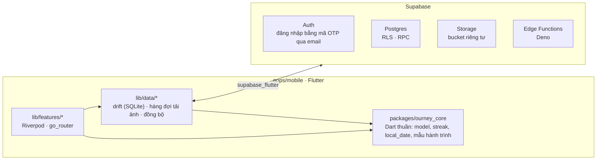

<div align="center">

# Ourney

**Locket cho mục tiêu.** Mỗi ngày chụp một tấm ảnh để chứng minh mình vẫn đang đi tiếp: giảm cân, học tiếng Anh, tập luyện, đi du lịch hay bất cứ mục tiêu nào bạn tự đặt ra. Đi một mình cũng được, rủ cả nhóm bạn thân càng vui. Chạm mốc thì xuất share card khoe lên mạng như Strava.

[](https://github.com/hofang42/Ourney/actions/workflows/ci.yml)
[](https://github.com/hofang42/Ourney/actions/workflows/android.yml)
[](https://github.com/hofang42/Ourney/actions/workflows/ios.yml)


[Tài liệu](docs/) · [SRS](docs/SRS.md) · [Phân công](docs/TASKS.md) · [Báo lỗi](https://github.com/hofang42/Ourney/issues)


<sub>Ảnh thiết kế tham khảo, chưa phải ảnh chụp từ app.</sub>

</div>

## Ourney là gì?

Strava, Duolingo hay Polarsteps đều rất giỏi trong mảng riêng của mình, nhưng chưa có app nào gom đủ ba thứ vào một chỗ: **đủ loại hành trình**, **bằng chứng mỗi ngày** và **nhóm bạn thân**. Ourney mượn thói quen chụp nhanh của Locket, BeReal rồi gắn nó vào một mục tiêu có thời hạn. Có streak phải giữ, có nhóm đang chờ mình check-in, nên ngày nào cũng có lý do để mở app.

Hiện nhóm đang hoàn thiện bản beta `v0.1.0`. Code đã đủ các yêu cầu P1 trong [SRS](docs/SRS.md), CI đang xanh, đã có sẵn file `.ipa` chưa ký và `.apk`. Những việc còn lại nằm trong [docs/TASKS.md](docs/TASKS.md).

## App làm được gì

| Tính năng | Mô tả |
|---|---|
| **Check-in thật nhanh** | Mở app là vào thẳng camera, chụp và đăng trong tối đa 3 chạm, mỗi hành trình một ảnh mỗi ngày. App nén ảnh ngay trên máy và lưu lại trước, có mạng thì tự tải lên, rớt mạng giữa chừng cũng không mất ảnh |
| **Hành trình** | Có sẵn 4 mẫu (Giảm cân, Học tiếng Anh, 30 ngày tập luyện, Chuyến đi) hoặc tự đặt. Đi một mình hay theo nhóm đều được, muốn theo dõi thêm chỉ số như cân nặng, số phút học thì bật lên. Cả hành trình hiện thành một lịch ảnh, kèm streak và phần trăm hoàn thành |
| **Nhóm** | Mời bạn bằng mã 8 ký tự hoặc link `ourney://join/<code>`, mỗi nhóm tối đa 10 người. Màn "Hôm nay" cho biết ai đã check-in, ai chưa, mọi người thả reaction cho nhau. App không xếp hạng ai giảm được nhiều cân hơn, chỉ ghi nhận ai đều đặn |
| **Khoe thành quả** | Share card cỡ story (1080×1920) và cỡ feed (1080×1350), tạo ngay trên máy. Hành trình một mình còn chia sẻ được bằng link chỉ xem |
| **Riêng tư** | Hành trình giảm cân mặc định ẩn số kg và làm mờ ảnh khi chia sẻ. Có báo cáo, chặn người dùng, điều khoản sử dụng. Xoá tài khoản là xoá thật, kể cả ảnh trên server |
| **Nhắc nhở** | Thông báo theo giờ bạn chọn cho từng hành trình. Tới 21:00 mà chưa check-in thì app nhắc streak sắp mất |
| **Không cần server** | Chưa cấu hình backend thì app vẫn chạy đủ các hành trình một mình (local-only mode) |

Danh sách yêu cầu đầy đủ, kèm mã FR/NFR, ở [docs/SRS.md](docs/SRS.md) mục 3 và 4. Những gì hẹn sang các bản sau thì xem mục 7.

## Sáu phong cách giao diện

Mỗi kiểu hành trình có một phong cách riêng: màu sắc, timeline, màn chụp và share card đều khác nhau. Chuyển sang hành trình khác thì giao diện đổi theo ngay tại chỗ, không phải tải lại app hay bật lại camera. Màn nào cũng có cả nền sáng lẫn nền tối. Chi tiết thiết kế ở [docs/06-adaptive-persona-ui-system.md](docs/06-adaptive-persona-ui-system.md).

| # | Persona | Dành cho | Timeline | Màn chụp | Chia sẻ |
|:-:|---|---|---|---|---|
| 1 | Quiet Transformer | Giảm cân | Đường cong cân nặng nối với ảnh các mốc | Ảnh ngày đầu hiện mờ phía sau để đứng đúng dáng | Ảnh ngày đầu đặt cạnh ảnh hôm nay |
| 2 | Accountability Squad | Học tiếng Anh | Con đường dẫn tới chiếc cúp ngày 30 | Hiện số phút học và streak | Bức tường Polaroid của cả nhóm |
| 3 | Memory Collectors | Đi du lịch | Sổ scrapbook, ảnh Polaroid dán băng keo | Giống máy film dùng một lần | Contact sheet kiểu phim 35mm |
| 4 | Couple Rituals | Cặp đôi (nhóm 2 người) | Mỗi ngày một cặp ảnh của hai người | Nửa khung là ảnh người kia, nửa còn lại để mình chụp | Poster ghép ảnh của hai người |
| 5 | Aesthetic Flexer | 30 ngày tập luyện | Biểu đồ neon và các mốc tập | Sticker chỉ số kiểu Strava | Story 9:16 kèm dải ngày đã tập |
| 6 | Minimalist Habit | Thói quen tự đặt | Lịch ảnh "đừng để đứt chuỗi" | Chạm một lần là xong, không phải gõ chữ | Thẻ tổng kết tối giản |

<details>
<summary>Xem 6 bảng thiết kế</summary>
<br>

| | |
|:-:|:-:|
| <br>1 · Quiet Transformer | <br>2 · Accountability Squad |
| <br>3 · Memory Collectors | <br>4 · Couple Rituals |
| <br>5 · Aesthetic Flexer | <br>6 · Minimalist Habit |

</details>

## Kiến trúc

App Flutter chia làm ba lớp: giao diện theo từng tính năng, lớp dữ liệu lưu trên máy rồi đồng bộ lên Supabase, và gói `ourney_core` chứa phần logic viết bằng Dart thuần để hai lớp kia cùng dùng.



| Phần | Dùng gì |
|---|---|
| App | Flutter 3.47.7 / Dart 3.13, Riverpod, go_router, drift, camera, flutter_image_compress, share_plus, flutter_local_notifications |
| Logic dùng chung | `packages/ourney_core`, viết bằng Dart thuần nên test được ngay trên Linux. Đây là "hợp đồng" giữa giao diện và dữ liệu |
| Backend | Supabase: Postgres bật RLS cho mọi bảng, RPC `SECURITY DEFINER`, Storage riêng tư dùng signed URL, Edge Functions viết bằng Deno, test bằng pgTAP |
| Build | GitHub Actions: Ubuntu chạy test và build Android, macOS build iOS. Cả nhóm không ai cần máy Mac |

Trước khi động vào dữ liệu hay backend, hãy đọc hợp đồng dữ liệu ở [docs/contracts/schema.md](docs/contracts/schema.md) và `packages/ourney_core/lib/src/models.dart`.

## Thư mục trong repo

```
.
├── apps/mobile/            # App Flutter cho iOS và Android
│   ├── lib/app/            #   khung app, router, theme (persona), provider
│   ├── lib/features/       #   mỗi tính năng một thư mục (quy ước ở lib/features/README.md)
│   ├── lib/data/           #   drift, repository, đồng bộ
│   ├── lib/shared/         #   widget dùng chung của design system
│   └── assets/             #   font, bảng thiết kế persona
├── packages/ourney_core/   # Model, streak, kiểm tra dữ liệu, mẫu hành trình (Dart thuần)
├── supabase/               # Migration, RLS, RPC, Edge Functions, test pgTAP
├── scripts/                # Script phát hành, deploy Supabase, GitHub, đóng gói IPA
├── docs/                   # SRS, phân công, ADR, hợp đồng dữ liệu, runbook
└── .github/                # CI/CD, CODEOWNERS, template PR
```

## Cài đặt và chạy thử

### Cần cài sẵn

| Công cụ | Phiên bản | Để làm gì |
|---|---|---|
| [Flutter](https://docs.flutter.dev/get-started/install) | 3.47.7 (Dart 3.13.5) | Chạy app và `ourney_core` |
| [Docker](https://docs.docker.com/get-docker/) + [Supabase CLI](https://supabase.com/docs/guides/local-development/cli/getting-started) | CLI 2.121.0 | Dựng backend trên máy |
| [Deno](https://docs.deno.com/runtime/getting_started/installation/) | 2.x | Kiểm tra Edge Functions |
| JDK | 17 | Build bản Android |

Không cần máy Mac: bản iOS do GitHub Actions build.

### Chạy thử không cần server

```bash
git clone https://github.com/hofang42/Ourney.git
cd Ourney/apps/mobile
flutter pub get
flutter run
```

Ở chế độ này (local-only), bạn dùng được đầy đủ các hành trình một mình, chỉ chưa có tính năng nhóm.

### Chạy với Supabase trên máy

```bash
# Ở thư mục gốc của repo: Docker dựng Postgres, Auth, Storage và áp migration trong supabase/
supabase start           # in ra API URL và anon key

# Chép file mẫu rồi điền URL và anon key vào (env.json đã nằm trong .gitignore)
cp apps/mobile/env.example.json apps/mobile/env.json

cd apps/mobile
flutter run --dart-define-from-file=env.json
```

Nếu chạy trên điện thoại thật, đặt `SUPABASE_URL` là địa chỉ IP LAN của máy đang chạy Docker. **Tuyệt đối không** đưa `service_role` key vào app hay commit lên repo.

### Cài bản build sẵn

- **Android:** tải file `.apk` ở mục [Releases](https://github.com/hofang42/Ourney/releases), hoặc trong artifact của workflow `Android (APK)`.
- **iOS:** tải `Ourney-unsigned.ipa` rồi tự ký bằng Apple ID miễn phí, làm theo [docs/platform/ios.md](docs/platform/ios.md).

## Kiểm tra trước khi mở PR

CI chạy bốn nhóm kiểm tra dưới đây (xem [`ci.yml`](.github/workflows/ci.yml)). Bạn sửa phần nào thì chạy phần đó trên máy trước khi mở PR.

| Phần | Lệnh | Chạy ở |
|---|---|---|
| Logic dùng chung | `dart pub get && dart analyze && dart test` | `packages/ourney_core` |
| App | `flutter pub get`<br>`dart run tool/gen_l10n.dart`<br>`dart run build_runner build -d`<br>`flutter analyze && dart analyze && flutter test` | `apps/mobile` |
| Backend | `supabase start && supabase test db`<br>`deno check supabase/functions/*/index.ts` | Thư mục gốc |
| Script | `find scripts -name '*.sh' -print0 \| xargs -0 shellcheck`<br>`bash scripts/tests/run.sh` | Thư mục gốc |

File sinh tự động (l10n, `*.g.dart`) phải commit kèm: nếu chạy lại codegen mà file thay đổi thì CI sẽ báo lỗi. Nhớ chạy cả `dart analyze`, vì chỉ lệnh này mới chạy `riverpod_lint`, còn `flutter analyze` thì không.

## Build và phát hành

| Workflow | Khi nào chạy | Kết quả |
|---|---|---|
| [`ci.yml`](.github/workflows/ci.yml) | Mỗi PR và mỗi lần push lên `main` | Kiểm tra và chạy test cho core, app, Supabase, script |
| [`android.yml`](.github/workflows/android.yml) | Push lên `main` hoặc tạo tag `v*` | File APK bản release (chưa có keystore thì ký bằng debug key) |
| [`ios.yml`](.github/workflows/ios.yml) | Push lên `main` hoặc tạo tag `v*` | File `Ourney-unsigned.ipa` |
| [`deploy-supabase.yml`](.github/workflows/deploy-supabase.yml) | Bấm chạy tay, chỉ từ `main` | Áp migration, deploy Edge Functions và cấu hình Auth trên Supabase hosted (mặc định chỉ chạy thử) |

Muốn phát hành, admin tạo tag `v*`, workflow sẽ tự đính kèm IPA và APK vào GitHub Release. Các bước chi tiết ở [docs/runbooks/release.md](docs/runbooks/release.md). Dựng server thật thì xem [docs/runbooks/hosted-supabase.md](docs/runbooks/hosted-supabase.md).

## Cách làm việc chung

1. **Nhận việc** trong [docs/TASKS.md](docs/TASKS.md). Mỗi người phụ trách một vùng thư mục (mục 2; riêng giai đoạn Persona UI xem mục 7.1). Cần sửa sang vùng của người khác thì tách PR nhỏ và nhờ người đó review.
2. **Đặt tên nhánh** theo dạng `feat/<mã task>-<tên ngắn>` (hoặc `fix/...`, `chore/...`), ví dụ `feat/Z1-chain-grid`.
3. **Commit** theo [Conventional Commits](https://www.conventionalcommits.org/), ví dụ `feat(journeys): ...`, `fix(camera): ...`.
4. **Mở PR** theo [template](.github/pull_request_template.md): làm gì, vì sao, đã test thế nào. Có sửa giao diện thì kèm ảnh hoặc video trên iPhone và Android.
5. **Merge** khi CI xanh và mọi comment đã xử lý xong. Người review theo cặp ghi trong TASKS, cố gắng phản hồi trong 24 giờ.

Mấy luật bất di bất dịch ([SRS](docs/SRS.md) mục 6.4):

- Không commit secret (`service_role`, key SMTP, keystore, Apple ID). Secret để trong GitHub Secrets hoặc `env.json`.
- Tạo bảng mới phải có RLS và test pgTAP. Repo để public, anon key vốn công khai, nên RLS là lớp bảo vệ duy nhất.
- Không xếp hạng người dùng theo kết quả cơ thể.
- Dùng thư viện hay API mới thì dẫn link tài liệu trong PR.
- Giao diện phải đúng cả nền sáng lẫn nền tối, không dùng chữ hay emoji thay cho icon hệ thống, chữ tiếng Việt không được tràn hay mất dấu ([CLAUDE.md](CLAUDE.md)).

## Dùng Claude Code trong dự án

Repo đã cấu hình sẵn cho [Claude Code](https://claude.com/claude-code):

- [`CLAUDE.md`](CLAUDE.md) ghi các luật UI/UX bắt buộc: theme, thanh điều hướng 3 tab, responsive, 6 persona.
- [`.claude/skills/`](.claude/skills/README.md) chứa các skill riêng của dự án, gọi bằng `/<tên skill>`.

| Skill | Dùng lúc nào |
|---|---|
| `/recall [mã task]` | Bắt đầu hoặc làm tiếp một task: gợi lại task, nhật ký và bài học cũ |
| `/design-ref <persona> <màn>` | Làm giao diện persona: cắt và phóng to đúng màn trong bảng thiết kế |
| `/pr-check [mã task]` | Trước khi mở PR: chạy đúng các job CI liên quan và soạn sẵn nội dung PR |
| `/wrap-up` | Cuối buổi: ghi nhật ký gồm task, commit, bằng chứng test |
| `/lesson [lỗi]` | Khi Claude làm sai: ghi lại bài học và đề xuất test để lỗi không lặp lại |

Khi chạy trên cloud, Claude Code tự cài đúng phiên bản Flutter mà CI đang dùng nhờ hook [`.claude/hooks/session-start.sh`](.claude/hooks/session-start.sh).

## Thành viên

| Thành viên | Việc ở bản v0.1.0 | Phần Persona UI ([TASKS mục 7](docs/TASKS.md#7-giai-đoạn-2--persona-ui-mỗi-người-trọn-persona)) |
|---|---|---|
| [@hofang42](https://github.com/hofang42) | Chủ dự án, dựng server, phát hành | Persona 1 Quiet Transformer, Persona 5 Aesthetic Flexer |
| [@thydynh03](https://github.com/thydynh03) | Kiểm thử trên iPhone, giao diện, truy vết yêu cầu | Phần nền dùng chung: theme, thanh điều hướng, khung persona, Hub, màn tạo hành trình |
| [@lken1514](https://github.com/lken1514) | Android, chạy nền, thông báo, phần native | Persona 4 Couple Rituals, Persona 6 Minimalist Habit |
| [@nguyenductien-qnm](https://github.com/nguyenductien-qnm) | Web, backend, vận hành | Persona 2 Accountability Squad, Persona 3 Memory Collectors |

## Tài liệu nên đọc

| File | Nội dung |
|---|---|
| [SRS.md](docs/SRS.md) | **Đọc đầu tiên.** Ourney là gì, phạm vi bản v1, các yêu cầu và cách cả nhóm làm việc |
| [TASKS.md](docs/TASKS.md) | Ai làm gì, ai phụ trách thư mục nào, ai review cho ai, lịch làm việc |
| [03-design-system.md](docs/03-design-system.md) | Màu, font, chuyển động, share card |
| [06-adaptive-persona-ui-system.md](docs/06-adaptive-persona-ui-system.md) | 6 persona, bảng màu sáng/tối, cách đổi hành trình mà không phải tải lại app |
| [contracts/](docs/contracts/) | Hợp đồng dữ liệu giữa app và backend |
| [adr/](docs/adr/) | Các quyết định kiến trúc đã chốt: phiên bản iOS tối thiểu, email hỗ trợ, văn bản pháp lý |
| [platform/](docs/platform/) | Ghi chú riêng cho iOS và Android |
| [runbooks/](docs/runbooks/) | Hướng dẫn vận hành: Supabase hosted, phát hành |
| [01](docs/01-analysis.md) · [02](docs/02-requirements-v2.md) · [04](docs/04-implementation-plan-v1.md) · [05](docs/05-platform-plan-ios-android.md) | Phân tích thị trường, yêu cầu chi tiết, kế hoạch triển khai, kế hoạch cho từng nền tảng |

## Giấy phép

Dự án chưa chọn giấy phép, repo chưa có file `LICENSE`.
