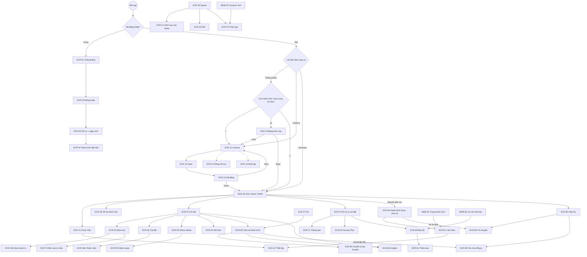

# Ourney — Software Design Specification (UI/UX)

> **Phiên bản 0.5** · 2026-10-26 · Áp dụng toàn bộ danh sách thay đổi của [08-SDS-review.md](08-SDS-review.md) §9 và các quyết định khách hàng: D1–D25 (§1.5), vòng 2 R2-01…R2-22 (§1.6), vòng 3 Q1–Q25 (§1.7), vòng 4 S1–S39 — chia sẻ hành trình đã trải qua (solo, nhóm, cặp đôi) và công khai có thống kê (§1.8, chi tiết ở [09-journey-sharing.md](09-journey-sharing.md)).
> **Phạm vi tài liệu:** chỉ giao diện, màn hình, luồng đi và trạng thái. **Không** mô tả logic code, API hay cơ sở dữ liệu.
> **Người đọc:** designer và các AI dựng giao diện (Figma Make, v0, Stitch, Claude…). Mỗi màn có ID dạng `SCR-xx` để trích riêng khi đưa cho AI.
> **Quan hệ với tài liệu khác:** nếu mâu thuẫn với [SRS.md](SRS.md) hoặc [06-adaptive-persona-ui-system.md](06-adaptive-persona-ui-system.md), tài liệu này thắng **về mặt thiết kế**. Nhãn `[v1]`, `[v2]`, `[Plus]`, `[Soon]` ở §1.4.

---

## 0. Cách đưa tài liệu này cho AI

1. Luôn gửi kèm **§2 (nguyên tắc)**, **§3 (design system của phần vỏ)**, **Phụ lục C (dữ liệu mẫu)** và **token của phong cách** (§6.3) đang dùng.
2. Gửi từng màn một: ID màn + mục mô tả + board tham khảo trong `apps/mobile/assets/design_personas/` (nếu có). **Đọc §6.1 trước:** board cũ có lỗi, chỉ dùng để tham khảo bố cục.
3. Mỗi màn xuất: **Light + Dark**, khổ **390×844** (chuẩn), **320** (máy nhỏ), **430** (Pro Max), và **tablet** (§12) nếu màn có bản tablet. Kiểm tra cả **chữ phóng 1.35×**.
4. Chữ trên giao diện: **tiếng Anh là chính, tiếng Việt là ngôn ngữ phụ**. Trong tài liệu này, chữ UI viết dạng `"English" / "Tiếng Việt"`. Bảng chuỗi chuẩn ở Phụ lục B.
5. **Màu sắc:** các mã màu trong tài liệu là **giá trị khởi điểm**. Màu chốt sẽ do Figma Make đề xuất (Q14–Q16), nhưng phải giữ các **ràng buộc** ở §3.1 và §6.3: mọi cặp chữ/nền ≥ 4.5:1, có `onAccent` và `accentInk`, các phong cách khác tông rõ ràng.

---

## 1. Tổng quan sản phẩm

### 1.1 Một câu
**Ourney là nơi lưu giữ hành trình của bạn bằng ảnh, rồi kể lại nó thật đẹp trên mạng xã hội.** Đi một mình, cùng nhóm bạn hoặc cùng người yêu.

### 1.2 Ourney là gì và không là gì
| Là | Không là |
|---|---|
| Cuốn album/nhật ký ảnh cho từng mục tiêu, chuyến đi, giai đoạn | Mạng xã hội: không feed, không follow người lạ, không khám phá, không đếm follower công khai. **Ngoại lệ duy nhất:** chủ tự bật `Show counts` cho một hành trình công khai thì người xem thấy lượt thích + lượt làm theo của hành trình đó; lượt xem luôn chỉ chủ thấy (S22) |
| Công cụ biến hành trình thành thiệp, video, link đẹp để **khoe ra ngoài** (Instagram, TikTok, Facebook, Zalo, Threads) | Nơi so bì kết quả: không bảng xếp hạng theo cân nặng, tiền… |
| Không gian riêng của một nhóm nhỏ (≤ 10) hoặc một cặp đôi | Ứng dụng chat chung: chỉ có trò chuyện 1-1 **bắt đầu từ một câu trả lời ảnh** trên hành trình được chia sẻ (S17) |
| Nơi **chia sẻ hành trình đã trải qua** cho bạn bè hai chiều, cho người khác **làm theo** lộ trình đó, và cho chủ biết câu chuyện đã **đến với bao nhiêu người** — áp cho cả solo, nhóm, cặp đôi (S1–S39) | |

### 1.3 Người dùng
| Nhóm | Đặc điểm | Hệ quả thiết kế |
|---|---|---|
| **Gen Z (18–27)** | Quen Locket/BeReal/TikTok, thích nhanh, sticker, khoe | Camera là trung tâm, nút to, chuyển động có lực, sticker |
| **9x / trung niên (28–45)** | Có những hành trình đáng nhớ (con lớn, sửa nhà, chuyến đi, giảm cân), coi trọng lưu trữ và riêng tư | Bố cục sạch, chữ rõ, icon có nhãn, dễ tìm lại hành trình cũ, riêng tư rõ ràng, có giọng `Gentle` |

Người dùng phải **từ 13 tuổi trở lên**; dưới 18 tuổi không bật được link công khai (R2-07).

### 1.4 Nhãn đợt phát hành và rủi ro
| Nhãn | Nghĩa |
|---|---|
| `[v1]` | Bản đầu, chạy được khi chưa có tài khoản Apple trả phí |
| `[v2]` | Cần tài khoản Apple trả phí hoặc làm sau v1: push, nudge, widget, universal link, Sign in with Apple, Live Activity |
| `[Plus]` | Thuộc gói trả phí **Ourney Plus** |
| `[Soon]` | Chỉ vẽ chỗ (nhãn "Coming soon"), chưa có chức năng. Không ẩn, không bấm được |

> Tất cả đều phải được **thiết kế** ngay bây giờ. Nhãn chỉ dùng để lên lịch làm.
>
> **Rủi ro đã biết:** ở `[v1]` chưa có push, nên Squad không báo được khi bạn bè check-in. Squad v1 dựa vào việc người dùng tự mở app. Nút `Nudge` được vẽ ở trạng thái `[Soon]`.

### 1.5 Quyết định vòng 1 (D1–D25)
> Các dòng có ghi "→" đã được quyết định vòng sau làm rõ hoặc thay thế.

| # | Quyết định |
|---|---|
| D1 | Ourney là nơi lưu trữ và chia sẻ hành trình ra mạng xã hội. **Không** làm mạng xã hội |
| D2 | Bản đầu có **10 phong cách**: 6 hiện có + Skincare/Glow-up, Mang thai & em bé, Thú cưng, Cải tạo nhà/DIY. Sau này có thêm |
| D3 | Phong cách **gắn cứng theo mẫu**. Cho người dùng tự đổi phong cách là `[Soon]` |
| D4 | **Cặp đôi là một mẫu riêng**, luôn đúng 2 người. Nhóm bạn 2 người **không** tự chuyển sang giao diện cặp đôi |
| D5 | Mỗi ngày đăng **nhiều ảnh/clip**. Ô ngày hiện ảnh bìa **kèm số đếm ở góc** kiểu Locket |
| D6 | Check-in gồm ảnh/clip, caption ≤ 140 ký tự, một cảm xúc, sticker có sẵn |
| D7 | Dữ liệu thêm: địa điểm + thời tiết, đồng hồ học, số liệu tập luyện, tối đa 3 chỉ số tự đặt |
| D8 | → D16 |
| D9 | Mở app: còn hành trình chưa check-in thì hiện bảng chọn hôm nay → SCR-10. → R2-03 thêm cài đặt |
| D10 | Plus mở khóa video recap không watermark và **chất lượng gốc**. → R2-04: miễn phí không giới hạn số ảnh |
| D11 | Kết thúc hành trình: video recap, thiệp tổng kết + cất lên kệ, mùa 2, sách ảnh in `[Soon]` |
| D12 | Thiết bị: điện thoại iOS + Android, widget, trang web xem link, máy tính bảng |
| D13 | **Tiếng Anh chính, tiếng Việt phụ** |
| D14 | Phần vỏ: **"Sạch, cao cấp" + "Năng động Gen Z"** |
| D15 | Có nhập hành trình đã qua. Quá khứ không tính chuỗi. Ảnh thư viện **chụp hôm nay** vẫn tính |
| D16 | Che ảnh với người chưa check-in do **người đăng quyết định cho ảnh của mình**. → Q9: áp cho mọi ngày |
| D17 | Clip tối đa **5 giây** cho mọi người. Dài hơn là Plus `[Soon]` |
| D18 | **Không giới hạn** số ảnh/clip mỗi ngày |
| D19 | **Không giới hạn** số hành trình đang chạy (§5.8) |
| D20 | Mang thai & em bé dùng quy tắc riêng tư **như mọi hành trình**. → R2-06 thêm cảnh báo khi bật link |
| D21 | Cải tạo nhà có **khu vực do người dùng tự tạo** trong một hành trình |
| D22 | Không có tạm dừng hành trình. Có **streak freeze**. → R2-01, Q3 (§7) |
| D23 | Giá Ourney Plus **chưa chốt** |
| D24 | Giọng văn **trẻ trung, lầy lội**. → R2-13: có chế độ `Gentle` |
| D25 | Board 4 phong cách mới do **AI vẽ** (Phụ lục A) |

### 1.6 Quyết định vòng 2 (R2-01…R2-22)
| # | Tóm tắt |
|---|---|
| R2-01 | Hành trình nhóm/cặp đôi có **một chuỗi chung**: kỳ được tính khi ≥ 1 thành viên check-in. Cả nhóm đủ mặt 7 ngày liền → hành trình +1 freeze. Cuối hành trình có thống kê chuỗi từng người |
| R2-02 | Tab phải **luôn là Squad**. Chưa có nhóm thì là trang mời gọi. **Kệ nằm trong Hub** (`Active | Shelf`) |
| R2-03 | Cài đặt `Open app on`: bảng hôm nay (mặc định) / camera / Hub. Đóng bảng mà không chọn → Hub |
| R2-04 | Miễn phí: **không giới hạn ảnh**, nén ~1080px. Plus: chất lượng gốc. Không bao giờ chặn đăng |
| R2-05 | **Nhịp linh hoạt** cho mọi mẫu: hằng ngày / X lần mỗi tuần / hằng tuần / hằng tháng |
| R2-06 | Link với mẫu nhạy cảm: giữ D20, thêm **sheet cảnh báo** khi bật và **ảnh xem trước link tự làm mờ** |
| R2-07 | **Ngày sinh khi đăng ký** (≥ 13; dưới 18 không có link công khai) và lý do báo cáo **Child safety** |
| R2-08 | Mẫu nhạy cảm: widget **ảnh mờ**, thông báo **không có tên hành trình**. Bật lại được |
| R2-09 | Vòng đời nhóm theo SRS. Mùa 2 gửi **lời mời**, thành viên tự chấp nhận |
| R2-10 | **Không** đăng một ảnh vào nhiều hành trình |
| R2-11 | Kết thúc chưa đạt mục tiêu: vẫn ăn mừng, **giọng ghi nhận nỗ lực**, không confetti lớn, gợi ý mùa 2 |
| R2-12 | Link mời mở **trang web mời** có mã 8 ký tự; cài app xong tự dán mã |
| R2-13 | Cài đặt giọng `Playful` (mặc định) / `Gentle`. Mẫu nhạy cảm luôn giọng ấm |
| R2-14 | Viên chụp **trông 56×40 nhưng vùng chạm ≥ 56×48**. Chữ 12–13pt chỉ cho nhãn phụ |
| R2-15/16 | 4 phong cách mới phải khác tông rõ; chữ trên nút phải đạt AA. → Q14–Q16: Figma Make đề xuất màu chốt |
| R2-17 | Đổi hành trình **giữ nguyên ống kính**; Glow Ritual chỉ gợi ý dùng camera trước |
| R2-18 | Tối đa 4–5 font trang trí có dấu tiếng Việt. → Q17 đã duyệt 5 font |
| R2-19 | **Vẽ lại board lỗi bằng AI** + prompt dark cho 10 phong cách (Phụ lục A) |
| R2-20 | **Không có bộ lọc camera.** "Look" của phong cách chỉ là lớp nhãn phủ |
| R2-21 | Chip trên camera **theo phong cách**: chip sáng (3, 6) hoặc kính tối (còn lại), luôn có viền + bóng |
| R2-22 | Giá Plus vẫn mở |

### 1.7 Quyết định vòng 3 (Q1–Q25)
| # | Tóm tắt |
|---|---|
| Q1 | Giờ cảnh báo chuỗi do **người dùng chọn** (mặc định 21:00). Ngày kết thúc **00:00**. Theo **giờ hiện tại của điện thoại** |
| Q2 | Chuỗi đếm **theo kỳ** của nhịp. Lịch theo đơn vị nhịp (ngày/tuần/tháng), có nút đổi. Mặc định: Mang thai = hằng tuần, Em bé = hằng tháng, còn lại = hằng ngày |
| Q3 | Solo: **quỹ freeze chung** của người dùng. Nhóm: quỹ riêng của hành trình, chỉ từ thưởng 7 ngày đủ mặt (tối đa 3). Lỡ nhiều kỳ: dùng liên tiếp. Cùng lúc lỡ nhiều hành trình: ưu tiên chuỗi dài nhất |
| Q4 | Ô thành viên trên tường nhóm **hiện chuỗi cá nhân nhỏ**; chuỗi chung ở trên cùng |
| Q5 | Sau khi đăng: **không tự chuyển**, có nút `Next` và `Done` |
| Q6/Q7 | **Bỏ chế độ khách.** Bắt buộc đăng nhập |
| Q8 | Cặp đôi có người rời: **giữ chỗ**, người còn lại vẫn chụp nửa của mình, mời lại được |
| Q9 | "Hide until they post" áp cho **mọi ngày** người xem chưa check-in |
| Q10 | Hành trình đã kết thúc **mở lại/gia hạn được trong 7 ngày** |
| Q11 | Xóa ảnh duy nhất của một ngày: **vẫn giữ chuỗi** |
| Q12 | Trang link **không lên Google**; công tắc link **mặc định tắt** |
| Q13 | Clip miễn phí nén **1080p**, Plus giữ gốc |
| Q14–Q16 | **Màu chốt do Figma Make đề xuất.** Tài liệu giữ màu khởi điểm + ràng buộc |
| Q17 | Duyệt 5 font: Fraunces, Baloo 2, Space Mono, Barlow Condensed, Patrick Hand |
| Q18 | Glow Ritual: **lưới tuần + cặp trước/sau ghim trên đầu**. Paw Growth: **thước đo nằm ngang** |
| Q19 | % trên thiệp Zen = ngày xong / **tổng mục tiêu** (24/30 = 80%) |
| Q20 | Xong hết hôm nay mà bấm nút chụp: mở SCR-10 trạng thái **"All done"** |
| Q21 | `Start journey` ngay: thời lượng **theo gợi ý của mẫu** (§6.2) |
| Q22 | Giá Plus vẫn mở |
| Q23 | **Không** chuyển ảnh sang hành trình khác |
| Q24 | Giọng `Playful/Gentle` **chỉ áp cho thông báo** |
| Q25 | Công tắc riêng tư màn khóa/widget ở **cả hai nơi**: mặc định toàn cục + ghi đè từng hành trình |

### 1.8 Quyết định vòng 4 — chia sẻ hành trình (S1–S39)
> Lý do, luồng và đề xuất dữ liệu: [09-journey-sharing.md](09-journey-sharing.md). Màn hình: §5.9.

| # | Tóm tắt |
|---|---|
| S1 | Ba phần: **kể lại** hành trình cũ (SCR-28), **chia sẻ** hành trình đã đi, **làm theo** lộ trình của người khác |
| S2–S4 | **Bạn bè hai chiều** (phải `Accept`). Kết bạn bằng link/QR hoặc đúng @username. Danh sách bạn ở **Hồ sơ**; số bạn chỉ mình thấy |
| S5 | **Không có feed.** Chỉ thấy kệ của mình và hành trình được mời xem |
| S6–S7 | Hai mức: `Friends` (tick sẵn tất cả bạn; **mẫu nhạy cảm không tick sẵn ai**) và `Public link` |
| S8 | Hub có segment thứ ba **`Shared with me`** |
| S9 | Đang chạy: chỉ `Friends`. **Đã xong / trên kệ** mới bật được `Public link` và `Do this journey` |
| S10 | `Public link` giữ Q12 (noindex, mặc định tắt), R2-06 (cảnh báo + ảnh xem trước mờ), R2-07 (khóa 13–17) |
| S11 | Trước khi chia sẻ: ẩn bớt ảnh/kỳ, ẩn số liệu, viết lời kể |
| S12 | Hành trình kể lại: nhãn `Imported` / `Kể lại`, không hiện chuỗi |
| S13–S14 | Bạn bè: thả cảm xúc + trả lời bằng ảnh/clip (chỉ chủ thấy). Người xem trên web chưa đăng nhập: chỉ xem + `Do this journey` + `Open the app to like`. Người lạ có tài khoản: S23–S24 |
| S15 | `Do this journey` chỉ sao chép **khung lộ trình** (mẫu, thời lượng, nhịp, tên chỉ số, tiêu đề), không ảnh/số liệu |
| S16–S17 | **Hộp thư** (icon trên header Hub) gộp trả lời, lời mời xem, lời mời kết bạn; **chat 1-1 qua lại** |
| S18 | Thu hồi cho tất cả hoặc **gỡ từng người**; bản làm theo của người khác vẫn giữ |
| S19–S21 | Hành trình có `Public link` **tự có thống kê**: lượt xem (chỉ là số), lượt thích (chủ thấy tên người thích), lượt làm theo. Xem ở SCR-24/SCR-82 → **SCR-88 Insights**, và tổng trong Hồ sơ (chỉ chủ thấy) |
| S22 | `Show counts` theo hành trình, **mặc định tắt**: người xem thấy lượt thích + lượt làm theo, **không** thấy lượt xem |
| S23–S24 | Người lạ **phải có tài khoản** mới thích được; được thích, `Do this journey`, gửi lời mời kết bạn. Không trả lời ảnh, không chat |
| S25–S26 | `Let anyone react` theo hành trình. Người lạ thích → lưu vào `Shared with me` → `Saved` |
| S27 | Lời mời kết bạn từ người lạ vào mục riêng "From your public journeys", không chấm đỏ; công tắc `Allow friend requests from viewers` (mặc định bật); rate limit |
| S28 | Giảm cân, glow-up: 3 công tắc công khai **mặc định tắt** + cảnh báo. **Em bé: người lạ không bao giờ thích / mời kết bạn được** |
| S29–S31 | **Nhóm/cặp đôi chia sẻ được ra ngoài.** Thành viên nào cũng đề nghị được; mỗi thành viên nhận yêu cầu đồng ý (SCR-89). Chia sẻ có hiệu lực ngay, **ảnh của ai chưa đồng ý thì ẩn**; ai cũng rút ảnh mình được bất cứ lúc nào; người mới vào nhận yêu cầu |
| S32 | Mỗi thành viên chia sẻ cho **bạn bè của mình**. **Link công khai, `Show counts`, công tắc công khai, lời kể** do **chủ nhóm**. Mọi thành viên xem Insights. Link vẫn chỉ khi đã xong |
| S33–S34 | Trả lời ảnh trên hành trình nhóm → tới **người đã chia sẻ cho mình** (hoặc tác giả ảnh nếu là bạn). Người xem chỉ thấy tên thành viên đã đồng ý |
| S35 | Làm theo hành trình nhóm/cặp đôi → hành trình **cùng kiểu**, mình làm chủ, mở SCR-42 mời người |
| S36–S39 | "Based on {name}'s journey" ở SCR-22 (bỏ được) · không giới hạn bạn, giữ tin nhắn · `Let anyone react` mặc định bật · 20 lời mời kết bạn từ trang công khai / ngày. **Chat 1-1 làm đủ ở v1** |

---

## 2. Nguyên tắc thiết kế

1. **Ảnh là nhân vật chính.** Chrome lùi lại, ảnh chiếm diện tích lớn nhất. Phần vỏ trung tính để 10 phong cách tự tỏa sáng.
2. **Nhanh như Locket, đẹp như Apple Journal.** Camera và nút chụp có năng lượng Gen Z. Mọi thứ còn lại sạch, nhiều khoảng trắng.
3. **Ít chạm để check-in.** Caption, cảm xúc, sticker là **tùy chọn**, không chặn nút đăng. Cam kết:

   | Đường vào | Số chạm tới khi đăng xong |
   |---|---|
   | Mở app, còn đúng 1 hành trình chưa xong (camera mở thẳng) | **2** (chụp → Post) |
   | Chạm vòng "Today" ở Hub, hoặc chạm widget | **2–3** (vòng → chụp → Post) |
   | Mở app, ≥ 2 hành trình chưa xong (bảng hôm nay) | **3** (chọn dòng → chụp → Post) |
   | Từ dock khi ≥ 2 hành trình chưa xong | **4** (dock → chọn dòng → chụp → Post) |

4. **Riêng tư hiển thị rõ ràng.** Mọi hành trình luôn có nhãn ai đang thấy (CMP-08). Dữ liệu nhạy cảm (cân nặng, tiền, ảnh cơ thể) mặc định ẩn khi chia sẻ ra ngoài theo §9.2. Ảnh trẻ em theo D20 (như mọi hành trình), có cảnh báo khi bật link (R2-06).
5. **Một khung app, nhiều phong cách.** Khung điều hướng và vị trí các nút **không bao giờ đổi**. Đổi hành trình chỉ đổi màu, kiểu dòng thời gian, lớp phủ camera và thiệp. Mượt tại chỗ, không tải lại, không khởi động lại camera, không lật ống kính.
6. **Ăn mừng sự đều đặn, không so kết quả.** Không xếp hạng ai giảm nhiều cân hơn.
7. **Dễ đọc với mọi lứa tuổi.** Chữ nội dung ≥ 15pt (body 16pt). Vùng chạm ≥ 48dp. **Ngoại lệ duy nhất:** phần hiển thị có thể nhỏ hơn (viên chụp 56×40, chip 36) **khi vùng chạm vô hình vẫn ≥ 48dp** (R2-14). Icon điều hướng luôn có nhãn chữ, **không ẩn nhãn** kể cả ở 1.35×.
8. **Emoji và icon (quy tắc chính xác):**
   - Emoji **được dùng** trong: nội dung chữ (copy, thông báo, ví dụ "14 days is still 14 days 💪"), thanh reaction, lửa 🔥 cạnh số chuỗi, huy hiệu mẫu hành trình, sticker, và nút **`Nudge 👋`** (ngoại lệ duy nhất trên nút, theo CLAUDE.md §4).
   - Emoji **không bao giờ** làm icon trong chip, nút, HUD, dock, ô trạng thái. Dùng **icon vector nét mảnh** (khóa, sách, check, bông tuyết, loa…).
   - Không chữ giữ chỗ (`"..."`, `"[+]"`, `"3-tab"`).

---

## 3. Design system của phần vỏ (Ourney Shell)

Phần vỏ là mọi màn **không thuộc riêng một hành trình**: Hub, Squad, hồ sơ, cài đặt, onboarding, paywall, trang web. Các màn thuộc một hành trình dùng token của phong cách đó (§6.3) nhưng giữ nguyên chữ, khoảng cách và component của phần vỏ.

### 3.1 Màu (giá trị khởi điểm; màu chốt do Figma Make đề xuất)

**Ràng buộc bắt buộc (không đổi dù màu thay đổi):**
- Chữ thường trên mọi nền: **≥ 4.5:1**. Icon, viền, vòng chỉ báo đứng một mình: **≥ 3:1**.
- Chữ trên nền màu luôn dùng token `on*`. Chữ có màu luôn dùng token `*Ink`. **Màu nhấn (`brand`, `primaryAccent`) không bao giờ làm chữ trực tiếp.**
- Số chuỗi ngày luôn dùng `ink`; chỉ icon lửa mang màu `streak`.
- Camera và trình xem ảnh **luôn nền tối** ở cả hai chế độ. Trạng thái không bao giờ chỉ dựa vào màu.

| Token | Light | Dark | Dùng cho |
|---|---|---|---|
| `bg` | `#FAFAF7` | `#0B0B0E` | Nền màn |
| `surface` | `#FFFFFF` | `#16161B` | Thẻ, sheet |
| `surfaceSunken` | `#F1F1EC` | `#101014` | Ô nhập, ô ngày trống, ô trung tính |
| `line` | `#E6E6E0` | `#26262D` | Đường kẻ 1px |
| `ink` | `#111114` | `#F4F4F6` | Chữ chính, số chuỗi |
| `inkMuted` | `#5E5E66` | `#A1A1AA` | Chữ phụ |
| `brand` | `#FF3B5C` *(hoặc phương án A `#E11D48`, Figma Make chọn)* | `#FF5C78` | Nút chụp, CTA chính, logo |
| `onBrand` | `#111114` *(nếu `brand` = `#E11D48` thì `#FFFFFF`)* | `#111114` | Chữ/icon trên `brand` (5.41 / 4.70 / 6.33) |
| `brandInk` | `#C81A3E` | `#FF8FA3` | Chữ/link màu thương hiệu (≥ 5.05 kể cả trên `surfaceSunken`) |
| `streak` | `#D97706` | `#FFB547` | **Chỉ icon lửa** (3.05 / 11.19). Số chuỗi dùng `ink` |
| `freeze` | `#0284C7` | `#7DD3FC` | Icon bông tuyết, họa tiết băng (luôn kèm icon + chữ) |
| `success` | `#16A34A` | `#3DE88C` | Icon/viền đã xong (luôn kèm icon check) |
| `successInk` | `#15803D` | `#3DE88C` | Chữ màu xanh "Done" (≥ 4.80) |
| `warning` | `#B45309` | `#FBBF24` | Chuỗi sắp đứt, đang chờ tải |
| `danger` | `#DC2626` | `#F87171` | Xóa, báo cáo |
| `plusGold` | nền `#C08A1E` + chữ `#111114` · viền/icon `#A87A14` | `#E8B649` | Huy hiệu Ourney Plus |
| `plusGoldInk` | `#8F6410` | `#E8B649` | Chữ màu vàng Plus |
| `scrim` | `#000000` 60% | `#000000` 60% | Lớp phủ ảnh để chữ trắng đọc được (5.74 trên ảnh trắng) |

**Nhóm `cameraChrome`** (chip và nhãn đè lên camera/ảnh, R2-21):
| Token | Giá trị | Dùng cho |
|---|---|---|
| `chipDark` | `#111114` 72% + viền `#FFFFFF` 24% 1px + bóng `0 2 8 rgba(0,0,0,.35)`, chữ trắng | Phong cách 1, 2, 4, 5, 7, 8, 9, 10 (≥ 7.56 kể cả trên ảnh trắng) |
| `chipLight` | `#FFFFFF` 88% (phong cách 3: `#F5F2EB` 90%) + viền `#000000` 12% 1px + cùng bóng, chữ `ink` | Phong cách 3, 6 (≥ 11.70 kể cả trên ảnh đen) |

### 3.2 Chữ
| Vai trò | Font | Cỡ / dòng / độ đậm |
|---|---|---|
| Display XL (số lớn trên thiệp, chuỗi) | Bricolage Grotesque *(hoặc font trang trí của phong cách)* | 64–120 / 1.0 / 800 |
| Title 1 | Bricolage Grotesque | 30 / 1.2 / 700 |
| Title 2 | Bricolage Grotesque | 22 / 1.25 / 700 |
| Headline | Be Vietnam Pro | 17 / 1.35 / 600 |
| Body | Be Vietnam Pro | 16 / 1.45 / 400 |
| Callout | Be Vietnam Pro | 15 / 1.4 / 500 |
| Caption | Be Vietnam Pro | 13 / 1.35 / 500 — **chỉ nhãn phụ** (giờ chụp, nhãn ô, đếm ký tự) |
| Overline | Be Vietnam Pro | 12 / 1.3 / 700, +6% — **chỉ nhãn phụ in hoa** |

**Font trang trí đã duyệt (Q17)** — tất cả là Google Fonts, giấy phép OFL, có subset `vietnamese`:
| Font | Kiểu | Dùng cho |
|---|---|---|
| **Fraunces** (variable) | Serif tạp chí | 1 Quiet Transformer (wght 500, sắc) · 4 Couple Rituals (wght 500, SOFT 100) · 7 Glow Ritual (wght 300, opsz 144) · 3 Memory Collectors (tiêu đề) |
| **Baloo 2** | Tròn | 8 Little Milestones (600) · 9 Paw Growth (800) |
| **Space Mono** | Mono, dáng máy đánh chữ | 3 Memory Collectors (tem ngày, tem phim) · 10 Blueprint (số đo, nhãn bản vẽ). Chỉ cho tem/số |
| **Barlow Condensed** | Grotesque hẹp | 5 Aesthetic Flexer (số HUD, km, pace), 600–700, số tabular |
| **Patrick Hand** | Viết tay | 8 Little Milestones: nhãn sticker ngắn ≤ 24 ký tự |

- Phong cách 2, 6 và phần vỏ dùng Bricolage Grotesque. Body mọi nơi là Be Vietnam Pro.
- **Kiểm dấu bắt buộc** ở mọi độ đậm đang dùng: chuỗi `Ệ Ữ Ấ Ẩ Ở Ỹ đ — Bé Na · Đà Lạt · Tuần 24`, line-height ≥ 1.3.
- Mọi chữ do người dùng nhập cắt bằng "…" khi tràn.

### 3.3 Khoảng cách, bo góc, đổ bóng
- Thang khoảng cách: 4 · 8 · 12 · 16 · 20 · 24 · 32 · 48.
- Lề màn: 16dp (< 360), 20dp (360–409), 24dp (410–599). Màn **1 cột** trên tablet: nội dung tối đa 520dp ở giữa. Màn 2 cột: §12.
- Bo góc: chip 999 · ô ảnh nhỏ 10 · thẻ 20 · sheet 28 · khung camera 32.
- Bóng phần vỏ rất nhẹ (`0 1 2 rgba(0,0,0,.04), 0 8 24 rgba(0,0,0,.06)`). Dark mode không dùng bóng, tách lớp bằng `surface` sáng hơn.

### 3.4 Chuyển động
| Sự kiện | Chuyển động | Rung |
|---|---|---|
| Chạm nút | thu về 0.96 trong 110ms | – |
| Mở màn | trượt + mờ dần 280ms, `easeOutCubic` | – |
| Ảnh lưới → xem ảnh | hero zoom từ ô | – |
| Đổi hành trình | màu chuyển 320ms, bố cục cross-fade 260ms, camera **không** tắt, **không** lật ống kính | selection |
| Chụp | chớp trắng 100ms, nút chụp nảy | medium |
| Đăng xong | "đóng dấu" 600ms (1.15 → 1), số chuỗi lăn +1 | success |
| Mốc 7 / 30 / 100 / về đích | confetti 1.5–2s theo màu phong cách | success |
| Kết thúc chưa đạt mục tiêu | không confetti; số lớn hiện dần | light |
| Chuỗi sắp đứt | lửa nhấp nháy chậm | warning |

**Giới hạn chuyển động:** không nhấp nháy quá 3 lần/giây. Hiệu ứng lặp (lửa, vòng sáng, glow) **tối đa 3 chu kỳ rồi dừng**. Khi bật **Giảm chuyển động**: thay toàn bộ bằng mờ dần 200ms, không confetti, trạng thái động thành **tĩnh + chữ** (ví dụ "Ends in 3h").

### 3.5 Bộ component dùng chung
| ID | Component | Mô tả | Ở chữ 1.35× |
|---|---|---|---|
| CMP-01 | **Dock 3 tab** | Luôn đúng 3 mục: trái `Journeys` (icon **bản đồ gập**), giữa **nút chụp**, phải **`Squad`** (icon hai người) — **luôn là Squad** (R2-02). Nút giữa: ở camera là nút tròn **76pt** màu `primaryAccent` viền trắng mảnh; ở màn khác là viên **56×40** màu `primaryAccent`, icon máy ảnh màu `onAccent`, **vùng chạm ≥ 56×48**. Ở Hub/Squad/cài đặt viên dùng `brand`/`onBrand`. Nhãn trái/phải luôn hiện. Dock cao ≥ 64 + safe area, nền `surface` 92% + blur | Nhãn xuống tối đa 2 dòng, dock cao lên, không ẩn nhãn |
| CMP-02 | Nút chính | Cao 52 (thường) / 44 (gọn), capsule, chữ Headline màu `onAccent`/`onBrand`. Gờ dưới khi phong cách yêu cầu | Cao theo chữ, chữ xuống 2 dòng |
| CMP-03 | Nút viên thuốc | Cao hiển thị 36–40, **vùng chạm ≥ 48** | Cao theo chữ |
| CMP-04 | Chip hành trình | Icon mẫu + tên + chevron. Trên camera dùng `cameraChrome`, nơi khác `surfaceSunken` | Tên cắt "…", tối đa 60% bề rộng |
| CMP-05 | Thẻ hành trình | Ảnh bìa mới nhất · tên · huy hiệu phong cách (chấm màu + tên mẫu) · CMP-17 · lửa + số chuỗi · trạng thái kỳ này (icon check + "Done" / vòng rỗng + "Not yet") · CMP-08 · hàng avatar nếu nhóm | Ảnh bìa thấp lại, chữ không chồng ảnh |
| CMP-06 | Ô lịch (Day/Week/Month cell) | Vuông, bo 10. Có ảnh: ảnh bìa + **huy hiệu số** góc trên phải nếu > 1 ảnh, icon play nếu ảnh bìa là clip. **Ô lỡ:** viền nét đứt `line`. **Ô trung tính** (kỳ không bắt buộc, nhịp X lần/tuần): `surfaceSunken` trơn, không viền đứt. **Ô freeze:** họa tiết băng + icon bông tuyết `freeze`. **Tương lai:** `surfaceSunken` nhạt. **Hôm nay/kỳ này chưa chụp:** viền `accentInk` nét đứt + icon `+`. **Ảnh bị che** (Hide until they post): mờ + icon khóa | Huy hiệu số giữ nguyên, ô không co dưới 40dp |
| CMP-07 | Huy hiệu chuỗi | Icon lửa vector (`streak`) + số (`ink`) + đơn vị kỳ ("21 days" / "5 weeks"). Trạng thái: đang cháy · sắp đứt (nhấp nháy theo §3.4 + chữ "Ends in 3h") · **được freeze cứu** (lửa + icon bông tuyết, "Saved by a freeze") · đã đứt (xám, "0") | Đơn vị xuống dòng |
| CMP-08 | Nhãn riêng tư | `Private` (khóa) · `Squad` (hai người) · `Couple` (hai trái tim) · `Link on` (dây xích) · **`Friends · 5`** (người + dấu cộng, S6) — icon vector + chữ. Có thể ghép: `Friends · 5` + `Link on` | Chỉ còn icon + tooltip khi quá hẹp |
| CMP-09 | Thanh reaction | 🔥 💪 👏 ❤️ 😂 + đếm. Giữ để xem ai đã thả | Cuộn ngang |
| CMP-10 | Sticker | Viên bo tròn đặt trên ảnh, kéo/xoay/phóng được. **Luôn có nền đặc hoặc `chipDark`/`chipLight`**, viền 1px, bóng. Cao tối thiểu 28pt. Tránh vùng an toàn Story (trên 250px, dưới 340px). Danh sách §8.4 | Không áp (theo pixel ảnh) |
| CMP-11 | Bộ chọn cảm xúc | 6 mặt vector theo màu phong cách + nhãn: Great · Good · Okay · Tired · Low · Proud | 2 hàng × 3 |
| CMP-12 | Banner trạng thái | Offline ("You're offline. We'll upload when you're back."), đang tải (n ảnh, chạm mở **Upload queue**), lỗi tải (`Retry`) | Chữ xuống dòng |
| CMP-13 | Sheet đáy | Tay nắm, tiêu đề, nội dung, nút. Bo trên 28 | Kéo lên toàn màn |
| CMP-14 | Ổ khóa Plus | Huy hiệu `PLUS` (nền `plusGold`, chữ `#111114`) + icon khóa. Chạm → SCR-60 | – |
| CMP-15 | Trạng thái rỗng | Minh họa nét đơn giản theo màu phong cách + 1 câu + 1 nút | – |
| CMP-16 | Skeleton | Khối xám bo góc nhấp nháy nhẹ (tĩnh khi Giảm chuyển động) | – |
| CMP-17 | Tiến độ hành trình | Theo nhịp: "Day 12 / 30" · "Week 6 / 12" · "Month 4 / 12" · "This week 2/3". Thanh + %. Hành trình mở chỉ hiện "Day 12" | Thanh xuống dòng dưới chữ |
| CMP-18 | Avatar | Tròn, viền 2px `surface`. Chồng tối đa 4 rồi "+6". Vòng trạng thái: liền = đã chụp kỳ này, nét đứt = chưa | – |
| CMP-19 | Ô freeze | Icon bông tuyết vector (`freeze`) + số lượt ("3 left"). Chạm mở giải thích | – |
| CMP-20 | Sheet **Upload queue** | Danh sách ảnh: đang chờ / đang tải (thanh %) / lỗi (lý do + `Retry`), nút `Retry all`. Lỗi vĩnh viễn (file hỏng): `Remove` | Kéo toàn màn |

### 3.6 Giọng văn
**Trẻ trung, lầy lội, nhưng không bao giờ chê bai** — như một đứa bạn thân hay cà khịa nhưng luôn đứng về phía mình.

| Nên | Không nên |
|---|---|
| "Chuỗi 21 ngày sắp toang rồi 🔥 cứu nó một tấm đi" / "Your 21-day streak is about to flop 🔥 save it with one snap" | Trêu cân nặng, ngoại hình, tiền bạc, con cái |
| "Ngày 12 rồi nè, khoe một tấm coi" | Câu dài, giọng hành chính ("Vui lòng thực hiện check-in") |
| "Chuỗi về 0 rồi. Không sao, mình bắt đầu lại nhé" | Câu gây tội lỗi khi lỡ ngày |
| "Freeze vừa cứu bạn một bàn thua" | Tiếng lóng khó hiểu với người 35–45 tuổi |

- Tiếng Việt xưng **"bạn"**. Tiếng Anh casual (contractions; chữ thường được phép trong thông báo).
- **Chỉ thông báo** có cài đặt giọng `Playful` (mặc định) / `Gentle` (Q24). Chữ trong app luôn dùng một giọng: lầy nhẹ, rõ nghĩa.
- **Giọng ấm cố định** (không đùa) cho: mẫu nhạy cảm (giảm cân, glow-up, mang thai & em bé), báo cáo/chặn, xóa tài khoản, lỗi thanh toán, cổng tuổi.
- Nút hành động luôn rõ nghĩa, không đùa trên nút ("Post", "Delete").

---

## 4. Kiến trúc thông tin

### 4.1 Sơ đồ màn hình

Dock (CMP-01) có mặt ở Hub, Camera, Squad: `Journeys` → SCR-20 · nút giữa → SCR-10/SCR-11 theo §5.2 · `Squad` → SCR-40.

### 4.2 Các bề mặt khác
| Bề mặt | ID |
|---|---|
| Widget màn hình chính / màn khóa | WGT-01…05 (§11) |
| Trang web | WEB-01…05 (§13) |
| Thông báo | NTF-01…16 (§10) |
| Tablet | §12 |

### 4.3 Thời điểm xin quyền
Mỗi quyền có **sheet giải thích của Ourney trước** hộp thoại hệ thống, và trạng thái "đã từ chối" có nút mở Cài đặt hệ thống.
| Quyền | Khi nào xin |
|---|---|
| Camera | Ngay sau khi tạo hành trình đầu tiên (SCR-04) |
| Thông báo | Sau check-in đầu tiên (SCR-13): "Want a nudge tomorrow at 21:00?" |
| Ảnh (thư viện) | Lần đầu chạm nút thư viện hoặc vào SCR-28. Có trạng thái quyền **một phần** của iOS (`Select more photos`) |
| Vị trí | Lần đầu bật `Add location & weather` |
| Dán (iOS) | Khi tự dán mã mời ở SCR-43 |

---

## 5. Danh sách màn hình chi tiết

> Mỗi màn: **Mục đích · Bố cục (trên → dưới) · Trạng thái · Ghi chú**. "Phong cách" = token của hành trình đang chọn.

### 5.1 Lần đầu dùng

#### SCR-01 Onboarding `[v1]`
- ≤ 3 trang. Mỗi trang: minh họa lớn (60% chiều cao) + Title 1 + 1 dòng Body + chấm trang + `Continue`. Góc phải trên: `Skip`.
  1. "One photo at a time. A whole story." / "Từng tấm ảnh. Cả một câu chuyện." Hình: lưới ảnh lấp dần.
  2. "Any journey. Alone, with others, or with your person." Hình: 10 thẻ phong cách xếp quạt.
  3. "Turn it into something worth sharing." Hình: thiệp story + video recap.
- Chip chọn ngôn ngữ (English / Tiếng Việt) trên cùng trang 1, mặc định theo máy. Chưa xin quyền nào ở đây.

#### SCR-02 Đăng nhập `[v1]` (+ Apple/Google `[v2]`)
- Logo, "Save your journeys", `Continue with Apple` `[v2]`, `Continue with Google` `[v2]`, đường kẻ "or", ô email + `Send code`. Bước 2: 6 ô OTP, đếm ngược gửi lại 60s, `Use a different email`.
- Trạng thái: sai mã (rung ô + chữ `danger`), mã hết hạn, mất mạng, gửi quá nhiều lần.
- Link `Terms` · `Privacy` ở đáy. **Không có chế độ khách** (Q6): phải đăng nhập mới dùng được app.

#### SCR-03 Tạo hồ sơ `[v1]`
- Avatar (chạm để chụp/chọn), `Display name`, `Username` (kiểm tra trùng trực tiếp: icon check/x + chữ), **`Date of birth`** (bộ chọn ngày; dòng phụ "We use this to keep Ourney safe. Not shown to anyone."). `Continue`.
- **Dưới 13 tuổi:** màn chặn, giọng ấm: "Ourney is for people 13 and up" / "Ourney dành cho người từ 13 tuổi". Nút `Got it` đăng xuất.
- **13–17 tuổi:** dùng bình thường; mọi công tắc link công khai bị khóa với chú thích "Public links are for 18+".

#### SCR-04 Hành trình đầu tiên `[v1]`
- "What's your first journey?". Lưới 2 cột **10 thẻ mẫu** + thẻ `Custom` + link `I was invited` (→ **SCR-43**, điểm nhập mã duy nhất).
- Ngay dưới tiêu đề, một thẻ ngang nổi bật (S1): **`Retell a past journey`** / **`Kể lại một hành trình đã qua`** + dòng phụ "Already did it? Turn old photos into a story" / "Đã đi rồi? Biến ảnh cũ thành một câu chuyện" → SCR-28. Người có sẵn ảnh cũ thấy giá trị ngay, không phải chờ 30 ngày.
- Đến từ link `Do this journey` (WEB-01): bỏ qua lưới mẫu, mở thẳng SCR-87.
- Chọn mẫu → SCR-22 (chế độ nhanh). Tạo xong → xin quyền camera (§4.3) → mở camera.

### 5.2 Check-in

**Nút chụp ở dock mở gì:** 0 hành trình → SCR-21; đúng 1 hành trình chưa xong kỳ này → SCR-11 của hành trình đó; ≥ 2 chưa xong → SCR-10; **tất cả đã xong** → SCR-10 trạng thái "All done" (Q20).

#### SCR-10 Bảng chọn hôm nay ("Today") `[v1]`
- **Khi nào:** mở app (nếu `Open app on` = Today picker) mà còn ≥ 2 hành trình chưa xong kỳ này; hoặc chạm nút chụp ở dock (xem trên).
- **Dạng:** sheet đáy, camera mờ phía sau (đã khởi động sẵn). Cao ~60% khi ≤ 5 dòng, kéo lên toàn màn khi nhiều hơn.
- **Header:** "Today" / "Hôm nay" + "5 left" / "Còn 5" + vòng tiến độ "7/12 done" · bên phải: nút **`Open my journeys`** (→ Hub).
- **Ô tìm kiếm** (khi > 5 dòng).
- **Các mục:**
  - **Pinned** (tối đa 5, người dùng ghim).
  - **At risk**: chuỗi sắp đứt (đã qua giờ cảnh báo người dùng chọn — mặc định 21:00; với nhịp tuần/tháng: ngày cuối của kỳ chưa đạt), chữ `warning` "Ends in 3h" / "Ends Sunday".
  - **Squad is waiting**: nhóm/cặp đôi có người đã chụp, avatar nhỏ "3/5 done".
  - **Everything else**: theo giờ nhắc.
- **Mỗi dòng:** chấm màu phong cách + icon mẫu, tên, CMP-17, CMP-07. Vuốt trái: `Pin` / **`Hide for today`** / `Ẩn hôm nay` (phụ đề "Still counts as missed" / "Vẫn tính là lỡ").
- Chạm một dòng → sheet trượt xuống, camera mở với phong cách đó.
- **Đóng sheet** (vuốt xuống / chạm nền) mà không chọn → **Hub**.
- **Trạng thái "All done"** (Q20): minh họa + "All done for today 🎉" / "Xong hết hôm nay rồi 🎉" + danh sách mọi hành trình để `Add more`.
- Chỉ còn 1 hành trình chưa xong → bỏ qua sheet, mở thẳng camera.

#### SCR-11 Camera `[v1]`
- **Nền tối toàn màn.** Khung ngắm bo 32, tỉ lệ 3:4.
- **Không có bộ lọc màu** (R2-20). Camera hiển thị và lưu ảnh **nguyên bản**. "Look" của phong cách (film, tem ngày, HUD) chỉ là **lớp nhãn phủ**, không chỉnh màu ảnh.
- **Lớp trên khung:**
  - Chip hành trình (CMP-04, `cameraChrome` theo phong cách). Chạm → SCR-10 gọn có tìm kiếm.
  - Cạnh chip: "2 today" (số ảnh kỳ này).
  - **HUD riêng của phong cách** (§6.4), chip theo `chipDark`/`chipLight`.
- **Vuốt ngang trên khung** để chuyển sang hành trình chưa xong kế tiếp (hai chiều). Hiện **chấm chỉ báo trang** dưới chip và **tên hành trình đích trượt vào** trong 260ms; HUD và màu đổi theo. **Ống kính giữ nguyên** (R2-17), người dùng tự bấm lật.
- **Hàng điều khiển:** thư viện (trái) · **nút chụp 76pt** (giữa) · lật camera (phải). Phía trên: flash, hẹn giờ 3s, lưới căn (icon vector).
- **Nút chụp:** chạm = ảnh. Giữ = clip, vòng chạy quanh nút, **tối đa 5s** (dài hơn `[Plus]` `[Soon]`). Nhả tay thì dừng.
- **Ghost overlay** (ảnh mờ lần trước của một số phong cách) chỉ là **lớp xem trước**, **không bao giờ** lưu vào ảnh.
- **Ảnh từ thư viện:** chọn nhiều được. Ảnh có nhãn `From library` trong album. Sau khi chọn, **một sheet gộp theo ngày**: "3 photos from today · 2 from Oct 18 → Add to their days". Ảnh chụp hôm nay tính như ảnh chụp trong app (cả chuỗi). Ảnh ngày cũ thêm vào đúng ngày, **không** cứu chuỗi. Ảnh không có ngày chụp: hỏi một lần, mặc định hôm nay.
- **Trạng thái:** chưa cấp quyền camera (minh họa + `Allow camera` + `Choose from library`); quyền ảnh một phần (`Select more photos`); camera lỗi; hành trình đã kết thúc (khóa chụp, `Reopen` nếu còn trong 7 ngày hoặc `Start season 2`); chưa có hành trình (CTA tạo).

#### SCR-12 Soạn check-in `[v1]`
- **Header:** `Retake` (trái) · **tên hành trình + nhãn riêng tư CMP-08** (giữa, để không đăng nhầm) · `Post` (phải, cũng có nút Post lớn ở đáy).
- Ảnh/clip vừa chụp (đặt sticker lên được). Thanh công cụ: `Aa` caption · cảm xúc · sticker · chỉ số (nếu có) · `+` chụp thêm vào cùng kỳ.
- Caption: một dòng, ≤ 140 ký tự, gợi ý theo mẫu, đếm ký tự khi còn ≤ 20.
- Cảm xúc: CMP-11, chọn 1 hoặc không.
- Chỉ số: tối đa 3 ô (`Weight 62.0 kg`, `Minutes 45`…), điền sẵn giá trị gần nhất. Chỉ số ẩn có icon khóa và **không bao giờ** thành sticker hiển thị cho người khác.
- Nhóm/cặp đôi: công tắc **`Hide until they post`** (mặc định lấy từ SCR-26, đổi được cho từng ảnh).
- Nút **`Post`** luôn bật (CMP-02, `primaryAccent`/`onAccent`). **Một ảnh chỉ thuộc một hành trình** (R2-10): không có tùy chọn đăng sang hành trình khác.
- Ảnh đầu tiên của kỳ tự thành ảnh bìa (đổi trong SCR-25). Đóng mà chưa đăng: `Discard photo?`.

#### SCR-13 Đã đăng `[v1]`
- Ảnh thu nhỏ bay vào ô kỳ này trên một lưới mini. Hiệu ứng "đóng dấu" theo phong cách. Số chuỗi lăn +1 (chỉ ở ảnh đầu tiên của kỳ).
- Nhóm/cặp đôi: "You're the 3rd to check in today" + avatar người đã xong.
- **Không tự chuyển màn** (Q5). Hai nút: **`Next: Daily English`** (khi còn hành trình chưa xong; mở camera của hành trình đó) và **`Done`** (→ Hub). Hết hành trình chưa xong thì chỉ có `Done`.
- **Mốc 7/30/100/về đích:** confetti + thẻ "Day 30! 🎉" + `Share this milestone` (→ SCR-50) + `Later`.
- Lần check-in đầu tiên: sheet xin quyền thông báo (§4.3).

#### SCR-14 Đồng hồ học `[v1]`
- Mở từ HUD Accountability Squad hoặc `Start session` ở SCR-24. Vòng tròn đếm giờ (Display XL), `Pause` / `Finish`. Chọn trước: 25 · 45 · 60 phút · tự do. Tắt màn hình vẫn chạy. Live Activity `[v2]`.
- `Finish` → camera với sticker "45 MIN STUDY" gắn sẵn, chỉ số "Minutes" điền sẵn.

#### SCR-15 Ghi buổi tập `[v1]`
- Sheet: loại (Run · Gym · Yoga · Ride · Swim · Other), km, thời gian, pace tự tính, ghi chú. `Import from Health` `[v2]`. Kết quả thành sticker + chỉ số.

### 5.3 Hành trình

#### SCR-20 Journeys Hub `[v1]`
- Token Shell. Mỗi thẻ mang màu phong cách của nó.
- **Bố cục:**
  1. Header (56dp): "Journeys" (Title 1) + tìm kiếm + **`+`** (menu: `New journey` · `Retell a past journey`) + **hộp thư** (icon khay thư vector, chấm đỏ + số khi có mục chưa đọc → SCR-85, S16) + avatar (→ SCR-70). Header vẫn tối đa 3 icon + avatar; ở khổ 320 tìm kiếm thu vào trong segment.
  2. **Segment** (44dp): **`Active` | `Shelf` | `Shared with me`** / `Đang chạy` | `Trên kệ` | `Được chia sẻ` (R2-02, S8). Segment thứ ba chỉ hiện khi đã có ít nhất một hành trình được chia sẻ cho mình (có chấm khi có hành trình mới). Ở chữ 1.35× hoặc khổ 320: segment cuộn ngang, không cắt chữ.
  3. *(Active)* **Dải "Today"** (96dp): vòng ảnh kiểu story cuộn ngang. Vòng có viền màu phong cách = chưa chụp kỳ này; có icon check = đã xong. Chưa xong xếp trước. Chạm vòng chưa xong → camera. Cuối dải: "+8" → SCR-10.
  4. *(Active)* Nút **`Sort & filter`** (khi ≤ 6 hành trình thì gập; > 6 thì hiện hàng chip): lọc `All` · `Today left` · `Solo` · theo loại mẫu; sắp `Needs a snap` (mặc định) · `Recently updated` · `Longest streak` · `A–Z`; kiểu xem **thẻ lớn** / **danh sách gọn** (64dp/dòng) / **lưới 2 cột**.
  5. *(Active)* **Pinned** (≤ 5): JourneyCard lớn, ảnh bìa 16:10.
  6. *(Active)* **Đang chạy**: phần còn lại theo kiểu xem.
  7. *(Shelf)* Nội dung **SCR-27**.
  8. *(Shared with me)* Hai nhóm:
     - **From friends:** hành trình bạn bè chia sẻ cho mình, mới nhất trước: CMP-05 rút gọn (ảnh bìa, tên, avatar + tên chủ, phong cách, "Finished Oct 30" hoặc "Day 12 · live", nhãn `Imported` nếu là kể lại), chấm "New" khi có ảnh mới từ lần xem trước. Nhấn giữ: `Hide from my list`.
     - **Saved** (S26): hành trình công khai của người lạ mà mình đã thả thích. Nhấn giữ: `Remove` (đồng thời bỏ thích). Link bị tắt/reset: thẻ mờ "No longer available" rồi tự biến mất.
     - Chạm → SCR-84. Rỗng cả hai nhóm: không hiện segment.
- Nhiều hành trình (> 6): tự chuyển sang danh sách gọn. Nhấn giữ thẻ: `Pin` · `Mute reminders` · `End` · `Share`. Thư mục do người dùng đặt tên `[v2]`.
- **Trạng thái:** 0 hành trình (minh họa + "Start your first journey" + 10 mẫu cuộn ngang + nút phụ `Retell a past journey` → SCR-28); offline; skeleton; tìm không thấy.

#### SCR-21 Chọn mẫu `[v1]`
- "What are you working on?". Lưới thẻ mẫu (2 cột; tablet 3–4): ảnh xem trước của phong cách, tên, 1 dòng mô tả, nhãn "Solo · Group" / "Couple only" / "Solo only".
- **Xem trước trực tiếp:** chạm thẻ → màn đổi sang phong cách đó (320ms), thẻ mở sheet xem trước 3 ảnh mẫu (dòng thời gian · camera · thiệp) + `Start this journey`.
- Nhóm: "Popular" · "Body & health" · "Learning" · "Love & family" · "Places & things" · "Habits". Ô tìm kiếm. Thẻ cuối `Custom journey`. Thẻ `More styles coming` `[Soon]`.

#### SCR-22 Thiết lập hành trình `[v1]`
- **Chế độ nhanh (mặc định):** tên (gợi ý theo mẫu) + icon · **`Start journey`**. Phía trên nút: dòng "Style can't be changed later" / "Phong cách không đổi được sau khi tạo".
- **`More options`** (gập; giá trị mặc định ghi rõ bên phải mỗi dòng):
  1. **Ai cùng đi:** `Just me` · `With others` / `Cùng mọi người` (≤ 10) · *(Couple: chỉ `With my person`)*. Quiet Transformer chọn `With others`: dòng nhắc một lần "Photos show to your group right away unless you turn on Hide until they post".
  2. **Thời lượng:** 7 · 14 · 21 · 30 · 66 · 100 · 365 ngày · tùy chọn · `No end date`. Mặc định theo mẫu (§6.2). Ngày bắt đầu (mặc định hôm nay).
  3. **Nhịp** (R2-05): `Daily` · `X times a week` (stepper 1–6) · `Weekly` · `Monthly`. Mặc định theo mẫu (§6.2).
  4. **Chỉ số** (0–3): tên, đơn vị, công tắc `Hide from others`.
  5. **Dữ liệu tự động:** `Add location & weather` (mặc định tắt, trừ Chuyến đi).
  6. **Nhắc nhở:** giờ nhắc; `Streak alert` (giờ, mặc định 21:00).
  7. **Riêng tư:** ai thấy (`Only me` / `Squad` / `Couple`); `Hide my photos until others post` (nhóm/cặp đôi, mặc định tắt). **Không có** công tắc link ở đây: link công khai chỉ bật được khi hành trình đã xong (S9); chia sẻ cho bạn bè làm ở SCR-82.
- **Đến từ `Do this journey`** (SCR-87): mọi ô điền sẵn theo khung lộ trình nguồn, dòng nhỏ dưới tên "Based on {name}'s journey" / "Theo hành trình của {name}" (bỏ được, S36), hành trình nhóm/cặp đôi thì chọn sẵn `With others` / `With my person` và tạo xong mở SCR-42 (S35), chế độ `More options` mở sẵn để xem lại.
  8. **Khu vực** (chỉ Blueprint Makeover): thêm khu vực (gõ hoặc gợi ý Kitchen, Bedroom, Living room, Bathroom, Balcony, Garden…).
- Tạo nhóm/cặp đôi xong → SCR-42.

#### SCR-24 Chi tiết hành trình `[v1]`
- Màu và dòng thời gian theo phong cách (§6.4).
- **Header:** quay lại · tên (cắt "…") · CMP-08 · chia sẻ · "⋯" (SCR-26). Nút chia sẻ mở sheet 2 dòng: `Make a card or video` (→ SCR-50) · `Share this journey` (→ SCR-82; với nhóm/cặp đôi, lần đầu gửi yêu cầu đồng ý tới các thành viên khác — SCR-89).
- **Khối thống kê:** CMP-17 · chuỗi hiện tại · chuỗi dài nhất · số khoảnh khắc · CMP-19 (lượt freeze). Có chỉ số: biểu đồ nhỏ chỉ số chính (nếu không ẩn). **Nhóm:** hiện **chuỗi chung** + dòng "Kept alive by 3 of 5 today".
- **Kiểu xem** (segmented): `Story` (dòng thời gian của phong cách) · `Calendar` (CMP-06, có nút đổi **Day / Week / Month**, mặc định theo nhịp — §7.2) · `Map` (icon **ghim địa điểm**, khi có địa điểm) · `Stats`.
- **Nhóm/cặp đôi:** hàng avatar + "Today 3/5" → SCR-41.
- **Nút nổi:** `Check in` (kỳ này chưa chụp) hoặc `Add more`.
- **Trạng thái:** mới (kỳ đầu chưa chụp: ô chờ + lời mời); **đã kết thúc** (chỉ đọc; banner "Completed Oct 30" + `Reopen` kèm "6 days left to reopen" khi còn trong 7 ngày (Q10) + `Watch recap` + `Share this journey` + `Start season 2`); **đang được chia sẻ** (dòng dưới khối thống kê "Shared with 5 friends · Link on" → SCR-82; khi link bật thêm dòng "1.2k views · 340 ❤️ · 28 started" → SCR-88, chỉ chủ thấy; ảnh đã ẩn khi chia sẻ có icon mắt gạch nhỏ ở góc ô); đang chờ tải (icon mây trên ô).

#### SCR-25 Album của kỳ `[v1]`
- Trình xem toàn màn nền tối. Vuốt ngang qua các ảnh/clip của ngày (hoặc tuần/tháng) đó, thanh chỉ số kiểu story ở trên. Vuốt dọc xuống để đóng.
- Lớp thông tin: "Day 12 · Tue, Oct 22", giờ chụp, caption, cảm xúc, sticker, chỉ số, địa điểm/thời tiết, `From library`.
- Nhóm: tên + avatar người đăng, CMP-09. Ảnh bị che (người đăng bật Hide, mình chưa chụp kỳ đó): mờ + icon khóa + "Snap yours to see".
- Nút **lưới** (góc phải trên): chuyển sang lưới ảnh của kỳ, **chọn nhiều** → `Delete` / `Save to Photos`.
- Menu "⋯": `Set as cover` · `Edit` (→ SCR-25a) · `Save to Photos` · `Delete` · (ảnh người khác) `Report` · `Block`. **Không có** "chuyển sang hành trình khác" (Q23).
- **Xóa:** hộp thoại "Delete this photo?" (xóa nhiều: "Delete 3 photos?"). Xóa ảnh duy nhất của ngày **vẫn giữ chuỗi** (Q11).
- Dải ảnh bìa các kỳ khác ở đáy để nhảy kỳ.

#### SCR-25a Sửa check-in `[v1]`
- Giống SCR-12 nhưng không có `Retake`: sửa caption, cảm xúc, sticker (thêm/xóa/kéo), chỉ số, công tắc Hide. `Save` / `Cancel`. Không đổi được ngày và hành trình.

#### SCR-26 Cài đặt hành trình `[v1]`
- Tên, icon, thời lượng (gia hạn khi còn chạy; đã kết thúc thì chỉ qua `Reopen` trong 7 ngày), **nhịp**, chỉ số, nhắc nhở (giờ nhắc, giờ cảnh báo chuỗi), vị trí & thời tiết.
- **Riêng tư:** ai thấy · **`Sharing`** → SCR-82 (dòng tóm tắt "Not shared" / "5 friends · Link off") · `Hide my photos until others post` · `Blur photos when sharing` · `Hide metrics when sharing`. Công tắc link nằm trong SCR-82 và chỉ bật được khi hành trình đã xong (S9).
- **Màn khóa & widget** (ghi đè mặc định toàn cục, Q25): `Show photos on widgets` · `Show journey name in notifications`. Mẫu nhạy cảm mặc định tắt cả hai.
- **Khu vực** (Blueprint): thêm, đổi tên, sắp xếp, đánh dấu xong.
- **Thành viên** → SCR-26a.
- **Streak freeze:** số lượt, lịch sử ngày đã dùng, giải thích — bản **solo**: "Your freezes: 2 every month (5 with Plus) · +1 for every 7-day streak (keep up to 3 bonus)"; bản **nhóm**: "This journey's freezes: +1 when the whole squad checks in 7 days straight (keep up to 3)".
- **Kết thúc / rời / xóa:**
  - `End journey` (owner).
  - `Leave` (thành viên): xác nhận "Your photos will be hidden from the group. Rejoin anytime to bring them back." Owner rời: thêm dòng "Ownership passes to {earliest member}".
  - `Delete journey` (đỏ, xác nhận 2 bước) **chỉ hiện khi nhóm còn mỗi owner** (solo luôn hiện). Còn người khác: chỉ `End journey` + chú thích "You can delete once everyone else has left".
- `Change style` `[Soon]`.

#### SCR-26a Thành viên `[v1]`
- Danh sách: avatar, tên, vai trò (Owner/Member), ngày tham gia, chuỗi cá nhân. Owner: `Remove`, `Rotate invite code`, `Invite`. Lời mời mùa 2 đang chờ: nhãn "Invited".
- Hành trình đang được chia sẻ ra ngoài (S29–S31): mỗi dòng thêm nhãn nhỏ `Sharing` / `Waiting` / `Private` theo trạng thái đồng ý. Thành viên mới vào thấy thẻ SCR-89 ngay lần đầu mở hành trình.
- **Couple có một người rời** (Q8): ô người kia thành **chỗ trống** "Waiting for {name}" + `Invite again` / `Invite someone`. Người còn lại vẫn chụp nửa của mình.

#### SCR-27 Kệ (nội dung segment `Shelf` của SCR-20) `[v1]`
- Lưới **bìa album** 3:4 như kệ sách: ảnh bìa, tên, khoảng ngày, "28/30 days", màu gáy theo phong cách.
- Lọc: năm, loại mẫu, solo/nhóm/cặp đôi. Tìm theo tên. Chạm → SCR-24 chỉ đọc.
- Bìa đang được chia sẻ có huy hiệu nhỏ (icon hai người = bạn bè, dây xích = link). Nhấn giữ bìa: `Share this journey` (→ SCR-82) · `Edit story` (→ SCR-83).
- Ô đầu kệ: **`+ Retell a past journey`** (→ SCR-28).
- Rỗng: "Your finished journeys live here" + `Retell a past journey`.

#### SCR-28 Kể lại hành trình đã qua `[v1]`
- Tên màn "Retell a past journey" / "Kể lại một hành trình đã qua" (trước đây "Import a past journey").
- **Bước 1:** mẫu + tên. **Bước 2:** khoảng ngày. **Bước 3:** chọn ảnh — **thanh tiến độ** khi nhập nhiều, ảnh trùng có nhãn "Already added", lưới hiển thị theo từng tháng. Ảnh tự xếp vào ngày theo ngày chụp, kéo thả đổi ngày được. **Bước 4:** `Save to shelf` hoặc `Continue this journey from today`. **Bước 5** (chỉ khi `Save to shelf`): thẻ "Want to share this story?" → `Write the story & share` (→ SCR-83) · `Not now`.
- Nhãn `Imported` / `Kể lại`, **người xem cũng thấy** (S12). Phần quá khứ **không** tính chuỗi ("Imported days: 42", chuỗi bắt đầu từ 0), người xem không thấy số chuỗi. Ảnh chụp hôm nay thì hôm nay được tính.

### 5.4 Squad

#### SCR-40 Squad `[v1]`
- Token Shell. Tiêu đề "Squad".
- **Đã có nhóm:** danh sách hành trình nhóm và cặp đôi. Mỗi thẻ: tên, màu phong cách, hàng CMP-18 có vòng trạng thái, "3/5 checked in", ảnh mới nhất. Nút `Join with code` · `Start a group journey`. **Thẻ lời mời mùa 2** (khi có): "Lan invited you to Season 2 of IELTS Sprint" + `Accept` / `Decline`.
- **Chưa có nhóm — trang mời gọi** (R2-02): minh họa một tường Squad mẫu + 3 thẻ lớn:
  - `Bring a friend` / `Rủ bạn đi cùng` → SCR-21 (lọc mẫu cho nhóm, chọn sẵn `With others`).
  - `Bring your person` / `Rủ người ấy` → SCR-22 mẫu Couple.
  - `Enter invite code` / `Nhập mã mời` → SCR-43.

#### SCR-41 Hôm nay của nhóm `[v1]`
- Giao diện **theo phong cách** (Accountability Squad = tường Polaroid, Couple = diptych…). Mặc định chung:
  - Trên cùng: **chuỗi chung** CMP-07 + thanh "4/5 checked in today".
  - Lưới ô thành viên (2 cột; tablet 3–4): ảnh bìa kỳ này + số đếm, tên, giờ chụp, icon check, **chuỗi cá nhân nhỏ** (Q4), reaction.
  - Người chưa chụp: ô viền nét đứt "Minh · waiting" + **`Nudge 👋`** `[v2]` (v1 hiện ở trạng thái `[Soon]`; v2: mỗi người một lần mỗi ngày, trạng thái "Nudged").
  - **Ảnh của người bật "Hide until they post"** mà mình chưa chụp **kỳ đó**: ô mờ + icon khóa + "Snap yours to see Linh's 👀" + `Check in`. Áp cho **mọi ngày** (Q9): xem lại ngày cũ mà mình không chụp thì ảnh đó vẫn bị che.
- Chuyển ngày: mũi tên hoặc vuốt. Không bảng xếp hạng.

#### SCR-42 Mời `[v1]`
- Mã 8 ký tự (Display) + `Copy`, `Share invite link` (link mở WEB-04), mã QR `[v2]`. "Up to 10 people · 4 joined" (Couple: "Invite your person"). Owner: `Rotate code`.

#### SCR-43 Tham gia `[v1]`
- Ô 8 ký tự. Nếu clipboard có mã: **sheet giải thích** ("We'll paste the code you copied") → hộp thoại dán của iOS → điền mã; từ chối thì về ô nhập tay.
- Thẻ xem trước: tên, phong cách, chủ nhóm, số người, ngày thứ mấy → `Join journey`.
- Lỗi: mã sai, nhóm đầy, đã bị chặn, hành trình đã kết thúc.

### 5.5 Chia sẻ & kết thúc

#### SCR-50 Share Studio `[v1]`
- Trên: xem trước lớn. Dưới: tab định dạng:
  | Tab | Nội dung |
  |---|---|
  | `Story` | 9:16 (1080×1920), vùng an toàn trên 250px, dưới 340px |
  | `Post` | 4:5 (1080×1350) |
  | `Video` | SCR-56. Có watermark miễn phí; bỏ watermark và 4K `[Plus]` |
  | `Link` | Hành trình **đã xong** (S9): mở phần `Public link` của SCR-82 (nhóm/cặp đôi: chỉ chủ nhóm bật, S32). Hành trình đang chạy: tab hiện "Links open when this journey is finished. You can share it with friends now." + `Share with friends` |
- Dải kiểu thiệp: đầu tiên là thiệp đặc trưng của phong cách (§6.4), sau đó mẫu chung (Big number · Grid · Before/After · Calendar).
- Tùy chọn: chọn ảnh, `Hide metrics`, `Blur photos`, `Show my handle`, `Hide stickers`, nền sáng/tối.
- Nút: `Share` · `Instagram Stories` `[v2]` · `Save`.
- Nhóm/cặp đôi: thiệp/video chỉ dùng ảnh của mình, trừ thành viên đã bật "Allow my photos in squad cards". Link công khai của nhóm theo S32 (chủ nhóm bật, chỉ ảnh của thành viên đã đồng ý chia sẻ).

#### SCR-55 Kết thúc hành trình `[v1]`
- **Khi nào:** đến kỳ cuối, hoặc `End journey`.
- **Đạt mục tiêu:** confetti, "30 days · 47 moments", ảnh đầu và cuối, chuỗi dài nhất, % hoàn thành.
- **Chưa đạt mục tiêu** (R2-11; dưới 100% số kỳ): không confetti lớn, số lớn "14 days", câu "14 days is still 14 days 💪" / "14 ngày vẫn là 14 ngày 💪"; `Start season 2` là thẻ đầu.
- **Nhóm:** thêm bảng **thống kê chuỗi từng thành viên** (chuỗi dài nhất, số kỳ đã chụp) — trình bày như ghi nhận, không xếp hạng (sắp theo tên).
- **Thẻ hành động:**
  1. `Watch your recap` → SCR-56.
  2. `Make a summary card` → SCR-50.
  3. `Put it on the shelf` → hiệu ứng album bay vào kệ.
  4. **`Share this journey`** → SCR-83 rồi SCR-82 (solo). Dòng phụ "Let friends see it, or let anyone do it too" / "Cho bạn bè xem, hoặc để người khác làm theo".
  5. `Start season 2` → hành trình mới kế thừa tên, chỉ số, nhịp, liên kết "Season 1". Thành viên cũ nhận **lời mời** (SCR-40), không tự thêm.
  6. `Reopen` (trong 7 ngày, Q10).
  7. `Order a photo book` `[Soon]`.

#### SCR-56 Video recap `[v1]` (bỏ watermark `[Plus]`)
- Player dọc 9:16. Mẫu: `1 second a day` · `Before → After morph` · `Beat montage` · `Grid build-up`. Nhạc nền có sẵn.
- Tùy chọn: 15s / 30s / 60s, có chữ ngày/chỉ số hay không, che chỉ số.
- Đang dựng: thanh tiến độ "Making your recap…", rời màn được, xong báo NTF-08.
- 1080p có watermark "Made with Ourney" (miễn phí); 4K không watermark `[Plus]`.

### 5.6 Gói trả phí

#### SCR-60 Ourney Plus `[Plus]`
- Nền theo phong cách đang mở hoặc Shell. "Keep every moment in full quality".
- Quyền lợi (icon vector + 1 dòng):
  - Recap videos without watermark, up to 4K.
  - Original-quality photos and clips (free: compressed ~1080px, still unlimited).
  - 5 streak freezes every month (instead of 2).
  - Longer clips, 15s+ `[Soon]`.
  - *(chừa chỗ: phong cách cao cấp, sách ảnh giảm giá…)*
- Gói tháng / năm (nhãn tiết kiệm %), dùng thử 7 ngày nếu có. **Giá giữ chỗ** `$X.XX / month` · `$XX.XX / year`; bố cục chịu được đổi giá và USD/VND.
- `Start free trial`, `Restore purchase`, `Terms`, `Privacy`. Không chặn khi mở app; chỉ hiện khi chạm CMP-14 hoặc từ SCR-70.
- **Quản lý gói:** trạng thái, ngày gia hạn, nút quản lý trên store. Không có thanh dung lượng.

### 5.7 Hồ sơ, cài đặt, an toàn

#### SCR-70 Hồ sơ & cài đặt `[v1]`
- Đầu trang: avatar, tên, @username, `Edit profile`. "5 journeys · 312 moments · longest streak 41".
- **Dòng `Friends`** (S4) → SCR-80: "12 friends · 2 requests" — con số **chỉ chủ tài khoản thấy**, không hiện ở bất kỳ đâu cho người khác. Nút nhỏ `Add` → SCR-81.
- **Dòng `Your stories`** (S21, chỉ khi có ≥ 1 hành trình bật link): "Your stories reached 1.2k people · 340 ❤️ · 28 started" — chỉ chủ thấy. Chạm → danh sách hành trình công khai, mỗi dòng mở SCR-88.
- Thẻ Plus (nếu chưa có).
- **Nhóm cài đặt:**
  - Account: email, phương thức đăng nhập.
  - **Open app on:** `Today picker` (mặc định) · `Camera` · `Journeys`.
  - Appearance: `System` / `Light` / `Dark`.
  - Language: English / Tiếng Việt.
  - Notifications → SCR-71.
  - Privacy: mặc định cho hành trình mới (vị trí & thời tiết, làm mờ khi chia sẻ, cho phép ảnh của tôi trong thiệp nhóm).
  - **Lock screen & widgets** (mặc định toàn cục, Q25): `Show photos on widgets` · `Show journey names in notifications` — với mẫu nhạy cảm, mặc định tắt.
  - Storage & quality: "Standard (~1080px)" hoặc "Original" `[Plus]` (CMP-14), `Download all my data`.
  - Blocked users.
  - Help & contact · Terms · Privacy · Community guidelines.
  - `Sign out` · `Delete account` (đỏ; gõ "DELETE"; giải thích dữ liệu và ảnh bị xóa thật).

#### SCR-71 Thông báo `[v1]`
- Bật/tắt theo hành trình, giờ nhắc, **giờ cảnh báo chuỗi** (mặc định 21:00), **`Tone`: `Playful` / `Gentle`** (chỉ thông báo), nudge `[v2]`, reaction `[v2]`, tin sản phẩm.

#### SCR-72 Báo cáo & chặn `[v1]`
- Lý do: **Child safety** (lên đầu khi nội dung thuộc Little Milestones) · Spam · Nudity · Harassment · Self-harm · Something else (+ ô chữ). Gửi xong: "Thanks. We'll review within 24 hours. You won't see this anymore."
- Chặn: xác nhận + hệ quả (ẩn nội dung của nhau, không vào chung nhóm mới, **hủy kết bạn, mất quyền xem hành trình đã chia sẻ cho nhau, ẩn cuộc trò chuyện, không gửi lại lời mời kết bạn được**).
- Báo cáo được cả **tin nhắn** (SCR-86, nhấn giữ) và **người dùng** (SCR-80, SCR-86). Store yêu cầu báo cáo + chặn với tính năng nhắn tin.

### 5.8 Khi có rất nhiều hành trình (D19)
Mọi màn liệt kê hành trình phải dùng được với **1, 5, 20 và 50 hành trình**. Thiết kế mẫu cho cả bốn mức.

| Chỗ | Cách xử lý |
|---|---|
| SCR-10 Bảng hôm nay | Mục Pinned · At risk · Squad is waiting · Everything else. Tìm kiếm khi > 5. Vuốt `Hide for today` |
| SCR-20 Hub | Dải Today cuộn ngang, `Sort & filter`, 3 kiểu xem, tự sang danh sách gọn khi > 6, ghim ≤ 5, thư mục `[v2]` |
| SCR-11 Camera | Chip mở danh sách rút gọn có tìm kiếm. Vuốt ngang chuyển hành trình (có chấm chỉ báo + tên đích) |
| SCR-13 Đã đăng | "4 left today" + `Next: {journey}` + `Done` |
| Thông báo | Từ 4 hành trình trở lên, gộp nhắc cùng giờ (NTF-11) |
| Widget | Chọn hành trình, hoặc chế độ "Next up" tự đổi sang hành trình chưa xong |
| SCR-20 `Shared with me` | Danh sách gọn khi > 6, tìm theo tên hành trình hoặc tên bạn |
| SCR-80 Bạn bè | Tìm kiếm khi > 10 bạn; SCR-82 danh sách chọn bạn có `Select all` / `Clear` |

### 5.9 Bạn bè, chia sẻ hành trình, hộp thư & thống kê (S1–S39)
> Áp dụng cho hành trình **solo** (gồm hành trình kể lại), **nhóm và cặp đôi**. Khác biệt của nhóm/cặp đôi ghi ở từng màn và ở SCR-89 (S29–S35). Lý do và quy tắc: [09-journey-sharing.md](09-journey-sharing.md).

#### SCR-80 Bạn bè `[v1]`
- Mở từ SCR-70. Token Shell. Tiêu đề "Friends" / "Bạn bè" + `Add` (→ SCR-81).
- **Lời mời đang chờ** (trên cùng, khi có): avatar, tên, @username, `Accept` / `Decline`. Lời mời mình đã gửi: nhãn "Requested" + `Cancel`.
- **Danh sách bạn:** avatar, tên, @username, dòng phụ "Shares 2 journeys with you" nếu có. Chạm → sheet bạn: hành trình bạn ấy chia sẻ cho mình (→ SCR-84), hành trình mình chia sẻ cho bạn ấy (gỡ được từng cái), `Message` (→ SCR-86 nếu đã có cuộc trò chuyện), `Remove friend`, `Block`, `Report`.
- Tổng số bạn hiện ở tiêu đề phụ, **chỉ mình thấy** (S4). Không có danh sách "bạn chung".
- `Remove friend`: xác nhận "You'll stop seeing each other's shared journeys." / "Hai bạn sẽ không còn thấy hành trình đã chia sẻ cho nhau."
- Rỗng: minh họa + "Share journeys with the people who were there" + `Add friends`.

#### SCR-81 Thêm bạn `[v1]`
- Ba cách (S3), xếp dọc:
  1. **`Share my invite link`** (→ share sheet hệ thống, link mở WEB-05) + `Copy`.
  2. **Mã QR của tôi** (chạm phóng to) + `Scan a code` (xin quyền camera đúng lúc, §4.3).
  3. **Tìm theo username:** ô "@username", chỉ trả về khi **khớp chính xác**; kết quả: avatar + tên + `Add friend`. Không gợi ý, không tìm theo tên.
- Trạng thái: không tìm thấy ("No one with that username"), đã là bạn, đã gửi, bị chặn (hiện như "không tìm thấy"), gửi quá nhiều lần.

#### SCR-82 Chia sẻ hành trình `[v1]`
- Sheet đáy (CMP-13) kéo được lên toàn màn. Mở từ SCR-24, SCR-26, SCR-27, SCR-55.
- **Đầu sheet:** thẻ xem trước nhỏ của hành trình (ảnh bìa câu chuyện, tiêu đề câu chuyện) + `Edit story` (→ SCR-83). Chưa có lời kể: SCR-83 mở trước.
- **Khối `Friends`** (S6–S7):
  - Danh sách bạn có ô tick. Mặc định **tick tất cả**; **mẫu nhạy cảm (1, 7, 8): không tick ai** + dòng giọng ấm "Pick who sees this. Nobody is selected yet." / "Chọn người được xem. Chưa ai được chọn."
  - `Select all` · `Clear` · tìm kiếm (khi > 10).
  - Bạn đã được chia sẻ: nhãn "Can see" + `Remove` (gỡ từng người, S18).
  - Nút `Share with {n} friends` / `Chia sẻ cho {n} bạn`. Hành trình **đang chạy**: dòng phụ "They'll see new photos as you post" / "Bạn bè sẽ thấy ảnh mới khi bạn đăng".
- **Khối `Public link`** (S9–S10):
  - **Đang chạy:** khối mờ, icon khóa + "Links open when this journey is finished" / "Link mở khi hành trình kết thúc". Không bấm được.
  - **Đã xong / trên kệ:** công tắc (mặc định tắt). Bật → mẫu nhạy cảm hiện **sheet cảnh báo** (§9.4). Bật rồi: link + `Copy link` · `Share` · `Reset link` · `Preview` (→ WEB-01), dòng "Anyone with the link can view it and do this journey too" / "Ai có link đều xem được và làm theo được".
  - **Khi link bật, thêm 3 công tắc** (S22, S25, S27; mặc định theo S28):
    | Công tắc | Mặc định | Mẫu 1, 7 | Mẫu 8 (em bé) |
    |---|---|---|---|
    | `Show counts` — "Show likes and follow-alongs to viewers" | Tắt | Tắt, bật có cảnh báo | Tắt, bật có cảnh báo |
    | `Let anyone react` — "People with an Ourney account can like it" | Bật (S38) | Tắt, bật có cảnh báo | **Khóa tắt** + "Only friends can react to baby journeys" |
    | `Allow friend requests from viewers` | Bật | Tắt, bật có cảnh báo | **Khóa tắt** |
  - Dòng thống kê nhỏ "1.2k views · 340 ❤️ · 28 started" (chỉ chủ thấy) → SCR-88.
  - 13–17 tuổi: khóa + "Public links are for 18+".
- **Đáy:** `Stop sharing` (đỏ chữ) — xác nhận "Everyone loses access. People who started this journey keep theirs." / "Mọi người mất quyền xem. Ai đã làm theo vẫn giữ hành trình của họ."
- Không có bạn nào: khối Friends thành "Add friends to share with them" + `Add friends` (→ SCR-81).
- **Hành trình nhóm/cặp đôi** (S29–S32):
  - **Khối `Squad consent`** trên cùng: hàng avatar thành viên với trạng thái `Agreed` (check) · `Waiting` (đồng hồ) · `Declined` (gạch) + dòng "Only photos of people who agreed are shared" / "Chỉ ảnh của người đã đồng ý được chia sẻ". Lần đầu chia sẻ: nút `Ask the squad` gửi yêu cầu (SCR-89) tới mọi người còn lại; người đề nghị tự tính là `Agreed`. `Remind` cho người `Waiting` (mỗi người một lần mỗi ngày).
  - **Khối `Friends`**: ai cũng dùng được, danh sách là **bạn bè của chính mình**; dòng phụ "{n} friends of other members can also see this".
  - **Khối `Public link`**, 3 công tắc công khai và `Edit story`: **chỉ chủ nhóm** chỉnh được; thành viên khác thấy trạng thái chỉ đọc "Managed by {owner}".
  - Dòng của chính mình: `Remove my photos from sharing` / `Rút ảnh của tôi khỏi chia sẻ` (S31).

#### SCR-83 Chuẩn bị câu chuyện `[v1]`
- Trình chỉnh toàn màn theo phong cách của hành trình. Header: `Cancel` · "Your story" · `Save`.
- **Lời kể** (S11): `Story title` (≤ 60, mặc định tên hành trình), `Intro` (≤ 300, gợi ý theo mẫu: "Why I started…"), `What I learned` (≤ 300, tùy chọn), `Cover photo` (chọn từ ảnh của hành trình).
- **Ẩn ảnh:** lưới lịch (CMP-06) với chế độ chọn. Chạm ô → ẩn cả kỳ (ô có mắt gạch + mờ); mở kỳ để ẩn từng ảnh. Người xem thấy kỳ ẩn là **ô trống trơn** (không nét đứt, không ghi "lỡ").
- **Ẩn số liệu:** công tắc `Hide metrics` (mặc định bật với Quiet Transformer, Glow Ritual, Blueprint — §9.2) · `Hide captions` · `Blur photos in link previews`.
- `Preview as a friend` → SCR-84 ở chế độ xem trước (dải "Preview" trên cùng).
- Lưu xong quay về SCR-82.

#### SCR-84 Hành trình được chia sẻ (người xem) `[v1]`
- Giống SCR-24 **chỉ đọc**, theo phong cách của hành trình. Header: quay lại · tên câu chuyện · avatar + tên chủ · "⋯" (`Report`, `Hide from my list` / `Remove from saved`).
- **Hai chế độ người xem:**
  | | **Bạn bè được chia sẻ** | **Người lạ có tài khoản** (mở link công khai trong app, S23–S24) |
  |---|---|---|
  | Thả cảm xúc | Có | Chỉ khi chủ bật `Let anyone react`; thích xong → lưu vào `Saved` (S26) |
  | `Reply` bằng ảnh / chat | Có | **Không** |
  | `Do this journey` | Khi đã xong | Có (link chỉ có ở hành trình đã xong) |
  | `Add friend` | – | Nút viên dưới tên chủ, chỉ khi chủ bật `Allow friend requests from viewers`; sau khi gửi: "Requested" |
- **Đầu trang:** ảnh bìa câu chuyện, tiêu đề, intro (xem thêm), "What I learned" (gập), CMP-17, chuỗi (**ẩn với hành trình kể lại**, thay bằng nhãn `Imported` + khoảng ngày), số khoảnh khắc. Hành trình đang chạy: nhãn "Live · Day 12". Chủ bật `Show counts` (S22): dòng "❤️ 340 · 28 people did this journey" — **không bao giờ hiện lượt xem**.
- **Kiểu xem:** `Story` · `Calendar` (không có `Stats` chi tiết số liệu nếu chủ ẩn số).
- **Trên từng ảnh** (SCR-25 ở chế độ người xem): CMP-09 thả cảm xúc (theo bảng trên) · **`Reply`** (chỉ bạn bè; icon camera nhỏ) → camera gọn chụp ảnh/clip ≤ 5s (hoặc chọn từ thư viện) + caption ≤ 140 → gửi vào SCR-86. Dòng nhỏ "Only {name} sees your reply" / "Chỉ {name} thấy câu trả lời của bạn".
- **Nút nổi:** `Do this journey` / `Làm theo` (→ SCR-87) — **chỉ khi hành trình đã xong** (S9). Đang chạy: không có nút.
- Không có nút chia sẻ lại. Không thấy **ai** đã thích hay trả lời; chỉ thấy tổng số thích khi chủ bật `Show counts`.
- **Hành trình nhóm/cặp đôi** (S30, S33–S34): header có hàng avatar **chỉ của thành viên đã đồng ý** + "Shared by {name}". Kỳ không còn ảnh nào sau khi ẩn ảnh người chưa đồng ý: ô trống trơn. Hiện chuỗi chung; không hiện thống kê chuỗi từng người. `Reply` trên ảnh của thành viên khác: dòng nhỏ "Your reply goes to {sharer}" (hoặc tới tác giả nếu tác giả là bạn của mình).
- **Trạng thái:** bị thu hồi / hết là bạn / link bị tắt hoặc reset ("This journey is private now"); ảnh mới (chấm "New" trên ô); offline (ảnh đã cache).

#### SCR-85 Hộp thư `[v1]`
- Mở từ icon hộp thư trên header Hub (S16). Token Shell. Tiêu đề "Inbox" / "Hộp thư".
- **Bộ lọc chip:** `All` · `Replies` · `Invites`.
- **Các loại dòng** (mới nhất trước, chưa đọc in đậm + chấm):
  - **Cuộc trò chuyện:** avatar người kia + ảnh nhỏ của khoảnh khắc được trả lời, "Nam replied to Day 12 of Daily Reading", tin cuối, giờ. Chạm → SCR-86.
  - **Cảm xúc:** gộp theo hành trình, "Hà and 3 others reacted to Daily Reading" → SCR-24 cuộn tới ảnh. Cảm xúc từ **người lạ** trên hành trình công khai **không** tạo dòng ở đây (xem trong SCR-88), để hộp thư không bị ngập.
  - **Lời mời xem hành trình:** "Linh shared 'Da Lat in 5 photos' with you" + `View` (→ SCR-84).
  - **Lời mời kết bạn:** avatar + `Accept` / `Decline` ngay trên dòng.
  - **Yêu cầu đồng ý chia sẻ** (nhóm/cặp đôi, S29): "Nam wants to share IELTS 7.5 Squad outside the squad" + `Review` (→ SCR-89). Có chấm đỏ, tính vào số chưa đọc.
- **Mục "From your public journeys"** (S27): dòng gập cuối danh sách, **không có chấm đỏ, không tính vào số chưa đọc**: "8 requests from people who saw Hoi An 2024". Mở ra: mỗi lời mời có avatar, tên, @username, "Saw Hoi An 2024 · 2d", `Accept` / `Decline`, "⋯" (`Block`, `Report`). Có `Decline all`.
- Vuốt trái dòng trò chuyện: `Mute` · `Delete conversation` (chỉ xóa phía mình).
- Rỗng: "Replies and invites from friends land here" / "Câu trả lời và lời mời từ bạn bè sẽ ở đây".
- `[v1]` chưa có push: số chưa đọc chỉ cập nhật khi mở app (chấm trên icon hộp thư + segment). Push NTF-13…16 là `[v2]`.

#### SCR-86 Trò chuyện `[v1]`
- Chat 1-1 (S17), gắn với **một hành trình**. Header: quay lại · avatar + tên · tên hành trình (chạm → SCR-24 / SCR-84) · "⋯" (`Mute`, `Block`, `Report`).
- **Tin đầu tiên luôn là câu trả lời ảnh/clip**, hiển thị kèm ảnh gốc được trả lời (khung nhỏ phía trên, chạm mở SCR-25).
- Bong bóng: chữ (≤ 500), ảnh, clip ≤ 5s. Giờ gửi, trạng thái `Sent` / `Seen`. Nhấn giữ tin: `Copy` · `Delete for me` · (tin người kia) `Report`.
- Thanh nhập: camera · thư viện · ô chữ · `Send`. Không có sticker, không có tin thoại.
- **Chỉ đọc** khi hết là bạn hoặc hành trình bị thu hồi: thanh nhập thay bằng "You can't reply to this conversation" / "Bạn không thể trả lời cuộc trò chuyện này".
- Giọng ấm cố định ở các dòng hệ thống (báo cáo, chặn) theo §3.6.

#### SCR-87 Làm theo `[v1]`
- Mở từ SCR-84 hoặc WEB-01 (qua cài app → đăng nhập → SCR-04 chuyển thẳng tới đây).
- Thẻ "Start your own {template}" theo phong cách nguồn: tên mẫu, thời lượng, nhịp, chỉ số (chỉ tên + đơn vị), ảnh bìa câu chuyện của người gốc (chỉ để nhận ra, không sao chép).
- Danh sách "What you'll get" / "Bạn sẽ có": cùng phong cách · cùng nhịp · cùng chỉ số. Dòng "Your photos and numbers start fresh" / "Ảnh và số liệu của bạn bắt đầu từ đầu".
- `Start this journey` → SCR-22 điền sẵn (S15). `Change something` mở SCR-22 ở `More options`.
- **Nguồn là nhóm/cặp đôi** (S35): thẻ ghi "A squad journey — you'll invite your own people" / "Hành trình nhóm — bạn sẽ mời người của mình"; tạo xong → SCR-42. Không sao chép thành viên.
- Link đã thu hồi giữa chừng: vẫn tạo được từ khung đã tải, không hiện ảnh bìa nguồn.

#### SCR-88 Insights `[v1]`
- Thống kê **một** hành trình công khai (S19–S21), **chỉ chủ thấy**. Mở từ dòng thống kê ở SCR-24, SCR-82 hoặc từ `Your stories` ở SCR-70. Token Shell, chấm màu phong cách ở tiêu đề.
- **Ba ô số lớn:** `Views` (người xem duy nhất) · `Likes` · `Started this journey`. Dưới mỗi ô: "+56 this week".
- **Biểu đồ cột theo ngày** (7 ngày / 30 ngày / từ khi bật link) cho lượt xem và lượt thích.
- **Tách nguồn thích:** "Friends 42 · Others 298".
- **Danh sách người thích** (S20): avatar, tên, @username, cảm xúc đã thả, giờ; nhãn "Friend" với bạn bè. Người lạ: nút `Add friend` nếu chưa là bạn, "⋯" (`Block`, `Report`). Chặn thì lượt thích của họ biến mất khỏi tổng.
- **Không có danh sách người xem** — chỉ con số, kèm dòng "Views are counted, not listed. Nobody knows you saw their journey either." / "Lượt xem chỉ được đếm, không ghi tên. Bạn xem hành trình của người khác cũng vậy."
- **Lối tắt cài đặt:** 3 công tắc `Show counts` · `Let anyone react` · `Allow friend requests from viewers` (cùng giá trị với SCR-82).
- **Trạng thái:** link vừa bật ("Share your link to start counting" + `Share`); link đã tắt (số giữ lại, dòng "Link off · counts paused"); `Reset link` không xóa số đã đếm.
- Không có so sánh với hành trình của người khác, không có xếp hạng.
- **Nhóm/cặp đôi** (S32): mọi thành viên mở được; 3 công tắc chỉ chủ nhóm đổi được. Lượt thích tách thêm theo ảnh của từng thành viên, chỉ người đó thấy danh sách người thích ảnh của mình.

#### SCR-89 Yêu cầu đồng ý chia sẻ (nhóm/cặp đôi) `[v1]`
- Sheet đáy mở từ hộp thư (SCR-85) hoặc thẻ trên SCR-41. Giọng ấm, rõ ràng.
- Tiêu đề: "{name} wants to share {journey} outside the squad" / "{name} muốn chia sẻ {journey} ra ngoài nhóm".
- Giải thích 3 gạch đầu dòng: ai sẽ xem được (bạn bè của các thành viên; link công khai nếu chủ nhóm bật khi hành trình đã xong) · **chỉ ảnh của người đồng ý** được hiện · rút lại được bất cứ lúc nào.
- Xem trước: lưới nhỏ **ảnh của chính mình** sẽ được chia sẻ.
- Nút: `Share my photos` / `Chia sẻ ảnh của tôi` (chính) · `Not now` / `Để sau` (giữ `Waiting`) · `Keep my photos private` / `Giữ riêng ảnh của tôi` (→ `Declined`, người đề nghị chỉ thấy trạng thái, không có thông báo riêng).
- Đã đồng ý: mở lại từ SCR-26 → `Sharing` → `Remove my photos from sharing`.
- Mẫu nhạy cảm (Little Milestones gia đình): thêm dòng cảnh báo giọng ấm về ảnh trẻ em; người lạ vẫn không thích/mời kết bạn được (S28).

---

## 6. Mười phong cách (Persona Skins)

### 6.1 Cách đọc và board tham khảo
Mỗi phong cách có **4 phần**: token màu (light/dark), **dòng thời gian** (kiểu `Story` của SCR-24), **HUD camera** (lớp phủ SCR-11), **thiệp đặc trưng** (mẫu đầu SCR-50). Phong cách có nhóm còn có **Today Wall** (SCR-41). Khung (header, dock, nút) **không đổi**.

- **Không có bộ lọc camera** (R2-20): mọi "look" chỉ là nhãn/khung phủ.
- **Board 1–6** (`apps/mobile/assets/design_personas/persona_<n>_*.jpg`) **đang được vẽ lại** (R2-19, Phụ lục A). Trong lúc chờ, dùng board cũ **chỉ để tham khảo bố cục** và **không chép**:
  - nhãn `3-tab`, `3 tab`, `...` trong dock; dock có bánh răng hoặc thiếu nhãn;
  - nút chụp tròn ở màn không phải camera (phải là viên 56×40);
  - emoji làm icon (📖, 🏆, 🔒 trong chip);
  - "His/Her", "HIS PHOTO", "Snap Her Half" (dùng tên hiển thị);
  - lịch 5 cột, ngày nhảy/lặp, "MO TU WE TH FF";
  - "24/30 · 96%" (đúng là 80% theo Q19), "Flim Strip", "CAMPFIRE 10GNT", status bar 9:16;
  - heatmap phân biệt chỉ bằng màu (phải là ô đặc vs ô rỗng);
  - camera thiếu hàng điều khiển (thư viện · chụp · lật), ảnh bị chỉnh màu kiểu film.
- **Board 5** hiện chỉ có bản dark; bản light vẽ theo Phụ lục A.
- **Board 7–10** chưa có; vẽ theo Phụ lục A.

### 6.2 Mẫu → phong cách
| # | Phong cách | Mẫu (EN / VI) | Ai cùng đi | Chỉ số gợi ý | Nhịp mặc định | Thời lượng mặc định | Mặc định riêng tư |
|:-:|---|---|---|---|---|---|---|
| 1 | Quiet Transformer | Weight loss / Giảm cân | Solo (nhóm được) | Weight kg, Waist cm | Daily | 30 ngày | Ẩn số, làm mờ khi chia sẻ; **nhạy cảm** |
| 2 | Accountability Squad | Daily study / Học mỗi ngày | Solo/Nhóm | Minutes, Pages | Daily | 30 ngày | Nhóm |
| 3 | Memory Collectors | Trip / Chuyến đi | Nhóm/Solo | – (vị trí + thời tiết bật sẵn) | Daily | 7 ngày | Nhóm |
| 4 | Couple Rituals | Couple / Tình yêu đôi ta | **Chỉ cặp đôi** | Tùy chọn | Daily | 100 ngày | Hai người |
| 5 | Aesthetic Flexer | Workout & running / Tập luyện & chạy bộ | Solo/Nhóm | km, pace, minutes | Daily | 30 ngày | Không ẩn |
| 6 | Minimalist Habit | Custom habit / Thói quen tự đặt | Solo/Nhóm | 0–3 tự đặt | Daily | 30 ngày | Riêng tư |
| 7 | **Glow Ritual** | Skincare & glow-up / Chăm da & thay đổi | **Chỉ solo** | Products, Sleep h | Daily | 60 ngày | Riêng tư, làm mờ khi chia sẻ; **nhạy cảm** |
| 8 | **Little Milestones** | Pregnancy & baby / Mang thai & em bé | Solo/Cặp đôi/Gia đình (≤ 10) | Week, Height cm, Weight kg | Pregnancy: **Weekly** · Baby: **Monthly** | Pregnancy 40 tuần · Baby 12 tháng | Như mọi hành trình (D20); **nhạy cảm** (cảnh báo link, màn khóa) |
| 9 | **Paw Growth** | Pet growing up / Thú cưng lớn lên | Solo/Gia đình | Weight kg, Age | Daily | 180 ngày | Không ẩn |
| 10 | **Blueprint Makeover** | Home & DIY makeover / Cải tạo nhà & DIY | Solo/Cặp đôi/Nhóm | Spent, % done | Daily | `No end date` | Ẩn số tiền |

> **Mẫu nhạy cảm** (dùng ở §9.4, §9.5, §10): 1 Quiet Transformer, 7 Glow Ritual, 8 Little Milestones.

### 6.3 Token màu (giá trị khởi điểm; màu chốt do Figma Make đề xuất)
**Ràng buộc:** mọi cặp chữ/nền ≥ 4.5:1; `onAccent` trên `primaryAccent` ≥ 4.5:1; `accentInk` trên `bg`/`surface` ≥ 4.5:1; đường/viền/vòng chỉ báo dùng `accentInk` nếu `primaryAccent`/`bg` < 3:1; **`secondaryAccent` chỉ trang trí**, không bao giờ làm chữ hay chỉ báo; 10 phong cách phải khác tông rõ (ΔE76 giữa hai `primaryAccent` gần nhất ≥ 30). `inkMuted` của phong cách 1–6 dùng `inkMuted` của Shell.

| # | Mode | bg | surface | ink | inkMuted | primaryAccent | onAccent | accentInk | secondaryAccent (trang trí) |
|---|---|---|---|---|---|---|---|---|---|
| 1 | L | `#EFF3F0` | `#FFFFFF` | `#0F172A` | `#5E5E66` | `#10B981` emerald | `#0F172A` | `#047857` | `#FF4D6D` |
| | D | `#0B0F12` | `#151C21` | `#F1F5F9` | `#A1A1AA` | `#10B981` | `#0F172A` | `#10B981` | `#FF4D6D` |
| 2 | L | `#F7F1E5` | `#FFFDF9` | `#1E1B18` | `#5E5E66` | `#FF9F1C` flame gold | `#1E1B18` | `#A45A00` | `#6D4BF0` |
| | D | `#12131A` | `#1D1F2B` | `#F8FAFC` | `#A1A1AA` | `#FF9F1C` | `#1E1B18` | `#FF9F1C` | `#6D4BF0` |
| 3 | L | `#F4EFE6` | `#FFFFFF` | `#231F1E` | `#5E5E66` | `#C2452B` terracotta | `#FFFFFF` | `#A63A22` | `#4A6B53` |
| | D | `#141312` | `#1F1D1B` | `#F5F2EB` | `#A1A1AA` | `#C2452B` | `#FFFFFF` | `#E8846C` | `#4A6B53` |
| 4 | L | `#F9F0EE` | `#FFFFFF` | `#261F22` | `#5E5E66` | `#E15B72` rose | `#170F12` | `#B42F4B` | `#9D174D` |
| | D | `#171215` | `#241C21` | `#FCE7F3` | `#A1A1AA` | `#E15B72` | `#170F12` | `#E15B72` | `#9D174D` |
| 5 | L | `#F3F4F6` | `#FFFFFF` | `#090A0F` | `#5E5E66` | `#FF4D6D` electric coral | `#090A0F` | `#D11A43` | `#3DE88C` (chỉ dark) |
| | D | `#090A0F` | `#14161F` | `#F8FAFC` | `#A1A1AA` | `#FF4D6D` | `#090A0F` | `#FF4D6D` | `#3DE88C` |
| 6 | L | `#F5F3EE` | `#FFFFFF` | `#1C1C1E` | `#5E5E66` | `#EA580C` Braun orange | `#111111` | `#B33A0A` | `#27272A` |
| | D | `#0E0E10` | `#18181B` | `#F4F4F5` | `#A1A1AA` | `#EA580C` | `#111111` | `#EA580C` | `#27272A` |
| 7 | L | `#FBF5FC` | `#FFFFFF` | `#2A1630` | `#6B5872` | `#A13CC9` orchid | `#FFFFFF` | `#8A2DB0` | `#C9A15A` champagne |
| | D | `#130C16` | `#1F1623` | `#F7EEF9` | `#BBA9C1` | `#D08BEE` | `#22102B` | `#D08BEE` | `#D9B877` |
| 8 | L | `#F1F8FC` | `#FFFFFF` | `#13293A` | `#4E6475` | `#2AA7E0` sky | `#0B2233` | `#0F6E9E` | `#F5C542` buttercup |
| | D | `#0A1319` | `#14212B` | `#EAF4FA` | `#9FB3C2` | `#5CC4F2` | `#062030` | `#5CC4F2` | `#F5C542` |
| 9 | L | `#F5F9EC` | `#FFFFFF` | `#1E2612` | `#58634A` | `#6CB021` park green | `#172206` | `#3F7410` | `#E39B4F` biscuit |
| | D | `#0E1209` | `#192012` | `#F1F6E6` | `#AAB59A` | `#8DCB43` | `#142004` | `#8DCB43` | `#E9A866` |
| 10 | L | `#EEF3F8` | `#FFFFFF` | `#0E1B2C` | `#4A5A6E` | `#1D4ED8` cobalt | `#FFFFFF` | `#1D4ED8` | `#F59E0B` safety amber |
| | D | `#0A121C` | `#13202E` | `#E6EEF7` | `#9DB0C6` | `#6E9BFF` | `#06142B` | `#8DB1FF` | `#FBBF24` |

| # | Kiểu viền & khối | Font trang trí | Chip camera |
|---|---|---|---|
| 1 | Viền mảnh 1px, bóng mềm kiểu phòng khám | Fraunces 500 sắc | `chipDark` |
| 2 | Viền mực 2px + gờ dưới 3px | Bricolage Grotesque Bold | `chipDark` |
| 3 | Bóng giấy, băng keo, lỗ phim (trang trí quanh ảnh) | Fraunces (tiêu đề) + Space Mono (tem) | `chipLight` |
| 4 | Khung đôi bo 24 | Fraunces 500 mềm | `chipDark` |
| 5 | Kính mờ + viền sáng 1px | Barlow Condensed (số) | `chipDark` |
| 6 | Lưới 1px sắc, không trang trí | Bricolage Grotesque Medium | `chipLight` |
| 7 | Bo lớn 24, gradient ánh sáng nhẹ **chỉ trên bề mặt UI** | Fraunces 300 thanh mảnh | `chipDark` |
| 8 | Nét vẽ tay, chấm bi, bo 24 | Baloo 2 + Patrick Hand (nhãn) | `chipDark` |
| 9 | Viền dày 2px bo tròn, họa tiết dấu chân | Baloo 2 ExtraBold | `chipDark` |
| 10 | Lưới bản vẽ, nét đo đứt | Space Mono (số) + Bricolage (tiêu đề) | `chipDark` |

### 6.4 Mô tả từng phong cách

#### 1 · Quiet Transformer (giảm cân)
- **Dòng thời gian — Connected Weight Curve:** thẻ biểu đồ cân nặng ở trên (điểm đầu, hiện tại). Dưới là trục dọc nối các nút tròn `accentInk`, mỗi nút một mốc (Day 1, 7, 14, hôm nay) với ảnh nhỏ + số. Khi ẩn số: hiện chênh lệch ("−3.2") hoặc "Hidden" + icon khóa.
- **HUD — Ghost Align Vault:** ảnh ngày 1 mờ 30% (bật/tắt; chỉ xem trước). Chip trên: icon khóa + "Private Vault · Day 21". Thanh trượt cân nặng nổi ở đáy khung, có chênh lệch so với ngày 1.
- **Thiệp — Side-by-Side Archive:** "DAY 01 vs DAY 21", hai ảnh cạnh nhau, `Hide exact weight` (mặc định bật), `Blur body when sharing` (mặc định bật).

#### 2 · Accountability Squad (học)
- **Dòng thời gian — Stepping-Stone Quest:** con đường chữ S màu kem dẫn tới **chiếc cúp vẽ vector** "Day 30 Goal". Polaroid nghiêng ở mốc ("Day 14 · Week 2"). Hôm nay: nhãn `accentInk` "Day 21 · Today" + 🔥.
- **HUD — Study Timer Snap:** chip trên: **icon sách** + "45 MIN STUDY · 🔥 21 STREAK" (số phút từ SCR-14 hoặc nhập tay). Giờ chụp ở đáy khung. Chip nhỏ `Start timer`.
- **Today Wall — Squad Polaroid Wall:** SCR-41 với khung Polaroid viền mực, nút Nudge màu `secondaryAccent` violet (chữ trắng, nền đã đạt AA).
- **Thiệp:** tường Polaroid của nhóm hoặc thẻ chuỗi cá nhân.

#### 3 · Memory Collectors (chuyến đi)
- **Dòng thời gian — Scrapbook Thread:** đường chỉ khâu `accentInk` nối các Polaroid dán băng keo, mỗi ngày một trang. Ngày nhiều ảnh: Polaroid xếp chồng lệch + số đếm. **Tem địa điểm + thời tiết** ("Đà Lạt · 18°C" + icon mây).
- **HUD — Disposable Film:** chip sáng "FILM ROLL 12/36". Tem ngày màu hổ phách (Space Mono) ở góc dưới phải — **chỉ là nhãn**, ảnh không bị chỉnh màu. Tem địa điểm và nhiệt độ.
- **Kiểu xem thêm — Trip Map:** bản đồ với ghim ảnh theo ngày, nối thành đường đi.
- **Thiệp — Film Contact Sheet:** tờ phim 35mm nền tối, **tối đa 20 khung** có số (4 × 5), tên chuyến, khoảng ngày.

#### 4 · Couple Rituals (cặp đôi)
- **Dòng thời gian — Duo Split:** mỗi ngày một hàng: ảnh người A (trái) · nút tim/lửa trên trục dọc · ảnh người B (phải). Dùng **tên hiển thị**, không "His/Her". Thiếu một bên: ô chờ nét đứt. Có người rời (Q8): cột của người đó hiện "Waiting for {name}".
- **HUD — Half-Frame Duo:** nửa trái là ảnh kỳ này của người kia (hoặc ô chờ, hoặc **ô mờ + khóa** nếu người kia bật Hide), nửa phải là khung ngắm. Chip "Snap your half · Complete the pair".
- **Thiệp — Couple Mosaic:** "18 DAYS TOGETHER · 36 MOMENTS" + lưới ảnh đan xen của hai người.
- **Đặc biệt:** "Day 128 together" có thể đặt ngày bắt đầu trong quá khứ.

#### 5 · Aesthetic Flexer (tập luyện)
- **Dòng thời gian — Athletic Telemetry:** biểu đồ phát sáng (km hoặc phút) ở trên, trục dọc các buổi tập với ảnh + số (km · pace · thời gian), số dùng Barlow Condensed.
- **HUD — Sticker Studio:** sau khi chụp, chọn 1 trong 3 lớp phủ `Bold HUD` · `Minimal Stamp` · `Film Strip` (**chỉ là khung/nhãn**, không lọc màu), hiện ngày thứ N, chuỗi, số liệu (SCR-15).
- **Thiệp — Transparent Story Sticker:** story 9:16 + dải heatmap 21–30 thanh: đã tập = **thanh đặc**, nghỉ = **thanh rỗng viền** (khác bằng hình, cùng màu). Xuất được PNG nền trong.

#### 6 · Minimalist Habit (thói quen)
- **Dòng thời gian — Don't Break the Chain:** lưới **7 cột** (Mo Tu We Th Fr Sa Su), ngày đúng thứ tự, ô ảnh vuông nối bằng một đường `accentInk` liền qua các kỳ liên tiếp; đường đứt ở kỳ lỡ; ô freeze giữ đường nối (vẽ nét chấm); ô trung tính (nhịp X lần/tuần) không làm đứt đường.
- **HUD — Zero-Text 3-Sec:** chỉ một chip sáng "Day 24", nút chụp cam. Đăng ngay sau khi chụp (caption thêm sau ở SCR-25a).
- **Thiệp — Zen Summary:** "24/30 days · 80% consistency" (Q19: ngày xong / tổng mục tiêu) + một ảnh vuông + lưới chấm nhỏ.

#### 7 · Glow Ritual (skincare & glow-up)
- **Cảm giác:** sáng sớm trong phòng tắm, da căng, ánh sáng mềm, thương hiệu mỹ phẩm cao cấp.
- **Dòng thời gian — Glow Week Grid** (Q18): trên cùng là **cặp ảnh trước/sau được ghim** (Day 1 · mới nhất) với tay kéo so sánh nhỏ. Bên dưới là **lưới tuần 7 ô** (mỗi hàng một tuần, nhãn "Week 1…"), ô ảnh mặt vuông; cạnh mỗi hàng có **chấm ánh sáng kèm chữ** ("Same light" / "A bit dark" / "Too bright").
- **HUD — Face Align Ring:** khung oval nét đứt, mờ ảnh ngày 1 (bật/tắt; chỉ xem trước), chip **icon mặt trời** + "Light: matches Day 1" + icon check. **Ống kính giữ nguyên** (R2-17): khi đang dùng camera sau, cạnh nút lật hiện gợi ý `Use the front camera` / `Dùng camera trước` (đóng được).
- **Sticker riêng:** "Products used" (danh sách tự tạo: serum, retinol…), "Slept 8h", "Water 2L".
- **Thiệp — Before/After Glow Slider:** ảnh đầu và hiện tại với thanh kéo ở giữa (video ngắn khi xuất story). Mặc định làm mờ nền, có tùy chọn crop vùng da.
- **Riêng tư:** chỉ solo, riêng tư, thiệp mặc định làm mờ; mẫu nhạy cảm.

#### 8 · Little Milestones (mang thai & em bé)
- **Cảm giác:** album em bé bằng giấy, pastel trời xanh + vàng bơ, nét vẽ tay, ấm áp; phụ huynh 25–40 tuổi.
- **Hai chế độ:** `Pregnancy` (nhịp **hằng tuần**, 40 tuần) · `Baby's first year` (nhịp **hằng tháng**, kéo dài được).
- **Dòng thời gian — Month Bubbles:** mỗi tuần/tháng là một bong bóng tròn lớn chứa ảnh bìa + số tuần/tháng to, nối bằng đường chấm bi `accentInk`. Kỳ hiện tại có **vòng nổi bật tĩnh** (không nhấp nháy liên tục). Chế độ mang thai có so sánh kích thước vui ("Week 24 · size of an ear of corn", chỉ chữ).
- **HUD — Milestone Frame:** huy hiệu "Week 24" / "Month 6" ở góc. Mờ ảnh lần trước để chụp cùng góc. Chip icon `+` "Milestone" → sticker mốc.
- **Sticker riêng:** "First smile", "First steps", "First word", "Height", "Weight", tem tuần/tháng (Patrick Hand).
- **Thiệp — Monthly Milestone Card:** số tháng/tuần rất lớn, ảnh tròn, chiều cao/cân nặng (ẩn được), tên bé. Mẫu lưới "12 months" cho cuối năm. Tùy chọn che mặt bé bằng sticker.
- **Riêng tư:** như mọi hành trình (D20); mời cả gia đình (≤ 10). Mẫu nhạy cảm: cảnh báo khi bật link, ảnh xem trước link mờ, màn khóa/widget mờ.

#### 9 · Paw Growth (thú cưng)
- **Cảm giác:** ngày ở công viên, vui, nét tròn đậm, họa tiết dấu chân, điểm nhấn bánh quy.
- **Dòng thời gian — Horizontal Growth Ruler** (Q18): một **thước đo nằm ngang cuộn trái–phải** chiếm nửa trên màn, vạch chia theo tuần/tháng (`accentInk`), ảnh treo phía trên thước to dần theo thời gian, cân nặng ghi dưới vạch ("2.1 kg" → "7.9 kg"). Vệt dấu chân nối các kỳ liên tiếp. Nửa dưới: thẻ thống kê (tuổi, cân nặng hiện tại, số khoảnh khắc).
- **HUD — Same Spot + Squeak:** mờ ảnh lần trước. Nút tròn 48pt **icon loa** "Squeak" cạnh nút chụp (chọn tiếng squeak / whistle / treat bag). Giữ nút phụ để chụp liên tiếp.
- **Sticker riêng:** tên thú cưng, "4 months old", cân nặng, "Good boy/girl", "Vet day", "Bath day".
- **Thiệp — Growth Flipbook:** ảnh đầu → hiện tại xếp như trang lật + tuổi, cân nặng. Bản video "Watch me grow".

#### 10 · Blueprint Makeover (cải tạo nhà & DIY)
- **Cảm giác:** giấy blueprint, nét đo đạc, gọn và có tổ chức.
- **Khu vực do người dùng tự tạo** trong một hành trình (D21). Mỗi check-in gắn một khu vực. Thêm khu vực: `+ Add area` trên Progress Board và `+ New area` trên chip camera. Mỗi khu vực có ảnh Before (ảnh đầu tiên) và % hoàn thành người dùng kéo.
- **Dòng thời gian — Progress Board:** tổng quan cả nhà (tổng %, tổng chi phí ẩn được, số ngày) + thẻ khu vực (ảnh Before, ảnh mới nhất, %). Chạm khu vực → dòng thời gian riêng. Kiểu `Calendar` gộp mọi khu vực theo ngày.
- **HUD — Grid Align Blueprint:** lưới kỹ thuật + mờ ảnh Before của khu vực đang chọn (chỉ xem trước). Chip khu vực + chevron, chip icon `+` "New area".
- **Sticker riêng:** "Spent $…" (ẩn được), "Day off work", "Done" + icon check, công cụ (sơn, khoan…), "% done".
- **Thiệp — Before/After Drag Slider:** ảnh trước/sau cùng góc với thanh kéo (video khi xuất story), tên khu vực, số ngày, chi phí (mặc định ẩn).

### 6.5 Hub, Squad và đổi phong cách
- Hub, Squad, cài đặt, paywall: token Shell. Mỗi thẻ hành trình có chấm màu + huy hiệu phong cách.
- Vào một hành trình: cả màn đổi sang token phong cách trong 320ms; dock đổi màu nút giữa sang `primaryAccent`/`onAccent`.
- SCR-21: chạm thẻ nào thì màn đổi ngay sang phong cách đó.

---

## 7. Chuỗi, nhịp và freeze

### 7.1 Kỳ và chuỗi
- **Kỳ** là đơn vị của nhịp: ngày (Daily), tuần (X lần/tuần, Weekly), tháng (Monthly). Một kỳ **đạt** khi:
  - Daily: ≥ 1 ảnh/clip trong ngày.
  - X lần/tuần: ≥ X **ngày** có ảnh trong tuần (thứ Hai → Chủ nhật).
  - Weekly / Monthly: ≥ 1 ảnh/clip trong tuần / tháng.
- **Chuỗi** = số kỳ đạt liên tiếp, hiển thị theo đơn vị ("🔥 21 days", "🔥 5 weeks", "🔥 4 months").
- Ngày kết thúc lúc **00:00** theo **giờ hiện tại của điện thoại** (Q1). Ảnh chụp hôm nay (trong app hay từ thư viện) đều tính. Ảnh nhập cho kỳ đã qua không cứu chuỗi. Xóa ảnh duy nhất của một kỳ **vẫn giữ** kỳ đó (Q11).
- **Sắp đứt ("At risk"):** Daily — sau giờ cảnh báo người dùng chọn (mặc định 21:00) mà hôm nay chưa chụp. X lần/tuần — số ngày còn lại trong tuần vừa đủ để đạt. Weekly/Monthly — ngày cuối của kỳ chưa đạt.

### 7.2 Hiển thị lịch theo nhịp (Q2)
| Nhịp | Lưới mặc định ở `Calendar` | Ghi chú |
|---|---|---|
| Daily | Lưới ngày 7 cột | Ô lỡ = nét đứt |
| X lần/tuần | Lưới ngày 7 cột, mỗi hàng là 1 tuần, cuối hàng có dấu "3/3" + icon check (hoặc "2/3") | Ngày không chụp = **ô trung tính** (không phải ô lỡ). Tuần không đạt: dấu cuối hàng nét đứt |
| Weekly | **Lưới tuần**, mỗi ô 1 tuần ("W24") | |
| Monthly | **Lưới tháng**, mỗi ô 1 tháng (ví dụ 12 ô năm đầu của bé) | |

Nút đổi **Day / Week / Month** luôn có ở `Calendar`.

### 7.3 Nhiều ảnh trong một kỳ
| Kiểu xem | Cách hiển thị |
|---|---|
| Ô lưới (CMP-06) | Ảnh bìa + **huy hiệu số** góc trên phải; clip có icon play |
| Polaroid (2, 3) | Polaroid trên cùng là ảnh bìa, 1–2 mép lệch phía sau + số |
| Trục dọc (1, 5) | Ảnh bìa ở nút; chạm → SCR-25 |
| Lưới tuần (7) | Ô ảnh bìa + số |
| Cặp đôi (4) | Mỗi bên ảnh bìa riêng + số riêng |
| Bong bóng (8) | Ảnh bìa trong bong bóng + chấm số |
| Thước ngang (9) | Ảnh treo trên thước + số |
| Today Wall | Ô thành viên: ảnh bìa + số; chạm → album của người đó trong kỳ |

### 7.4 Chuỗi của nhóm và cặp đôi (R2-01, Q4)
- Hành trình nhóm/cặp đôi có **một chuỗi chung**: kỳ đạt khi **≥ 1 thành viên** check-in.
- Mỗi thành viên vẫn có **chuỗi cá nhân**, hiện nhỏ trên ô ở SCR-41 và SCR-26a, và trong bảng thống kê cuối hành trình (SCR-55).

### 7.5 Freeze (D22, R2-01, Q3)
| | Hành trình solo | Hành trình nhóm/cặp đôi |
|---|---|---|
| Quỹ | **Quỹ chung của người dùng**, dùng cho mọi hành trình solo | **Quỹ riêng của hành trình** |
| Nhận thêm | 2 lượt mỗi tháng (Plus: 5) + 1 lượt thưởng mỗi 7 ngày liên tiếp của bất kỳ chuỗi solo nào (giữ tối đa 3 lượt thưởng) | +1 khi **cả nhóm** check-in đủ 7 ngày liền (giữ tối đa 3) |
| Cách dùng | **Tự động** khi lỡ một kỳ. Lỡ nhiều kỳ liền: dùng liên tiếp đến khi hết. Cùng lúc lỡ nhiều hành trình: ưu tiên **chuỗi dài nhất** trước | Tự động khi cả nhóm lỡ một kỳ, dùng liên tiếp đến khi hết |
| Báo | NTF-09 mỗi lần dùng | NTF-09 (bản nhóm) cho mọi thành viên |

Ô kỳ được freeze cứu: CMP-06 ô freeze; chuỗi: CMP-07 trạng thái "Saved by a freeze".

---

## 8. Check-in: caption, cảm xúc, sticker, chỉ số

### 8.1 Số chạm
Xem bảng §2.3. Mọi thứ ngoài chụp và `Post` là tùy chọn trên thanh công cụ SCR-12.

### 8.2 Caption
≤ 140 ký tự, 1–3 dòng trong album. Gợi ý theo mẫu.

### 8.3 Cảm xúc
6 mặt vector (CMP-11), hiện ở góc ảnh trong album và tạo "biểu đồ cảm xúc" ở tab `Stats`.

### 8.4 Sticker có sẵn (kiểu Locket)
| Nhóm | Sticker | Ghi chú |
|---|---|---|
| Thời gian | Giờ (`06:15 AM`), ngày (`Tue · Oct 22`), `Day 12`, tem film | Luôn có |
| Nơi chốn | Địa điểm (thành phố/khu), thời tiết (`18°C` + icon) | Chỉ khi bật vị trí & thời tiết. Không địa chỉ chính xác |
| Tiến độ | 🔥 chuỗi, `Day 12/30`, `Week 6`, % hoàn thành, mốc ("Week 2!") | |
| Chỉ số | Cân nặng, phút học, km/pace, chỉ số tự đặt | Chỉ số bật `Hide from others` **không bao giờ** hiện thành sticker, cả trong nhóm lẫn khi chia sẻ |
| Phong cách sống | `OOTD`, `Coffee`, `Gym day`, `Rest day`, `Cheat day`, `Study mode`, `Date night`, `Travel day` | Bộ chữ theo phong cách |
| Riêng phong cách | §6.4 | |
| Cảm xúc | 6 cảm xúc | |

- Sticker là lớp riêng, **không in vào ảnh gốc**. Tắt toàn bộ được khi xuất thiệp (`Hide stickers`).
- **Đọc được trên mọi ảnh:** nền đặc hoặc `chipDark`/`chipLight`, viền 1px, bóng, cao ≥ 28pt; tránh vùng an toàn Story.

### 8.5 Chỉ số
Tối đa 3 mỗi hành trình. Kiểu nhập: số, thanh trượt (cân nặng), đồng hồ học (SCR-14), buổi tập (SCR-15). Mỗi chỉ số có công tắc ẩn với người khác.

### 8.6 Ghost overlay
Ảnh mờ của lần trước (phong cách 1, 7, 8, 9, 10) chỉ là **lớp xem trước** trên camera, bật/tắt được, **không bao giờ** lưu vào ảnh hay rời khỏi máy.

---

## 9. Riêng tư

### 9.1 Ai thấy
| Mức | Ai thấy trong app | Chia sẻ ra ngoài |
|---|---|---|
| `Only me` | Chỉ mình | Thiệp/video; link chỉ đọc khi **đã xong** và tự bật (mặc định tắt, S9) |
| `Only me` + chia sẻ `Friends` | Mình + bạn bè được chọn (SCR-82), ở segment `Shared with me` của họ | Như `Only me` |
| `Squad` | Thành viên nhóm | Thiệp/video ảnh của mình. **Chia sẻ ra ngoài** (S29–S32): mỗi thành viên chia sẻ cho bạn bè của mình; link công khai khi đã xong, do chủ nhóm bật; **chỉ ảnh của thành viên đã đồng ý** |
| `Couple` | Hai người | Như Squad (người còn lại phải đồng ý) |

Ảnh/kỳ ẩn khi chia sẻ và số liệu ẩn (SCR-83) áp cho **cả** bạn bè được chia sẻ và người xem qua link, không áp cho thành viên nhóm.

### 9.2 Mặc định theo mẫu
- Quiet Transformer, Glow Ritual: ẩn số, làm mờ ảnh khi chia sẻ.
- Little Milestones: như mọi hành trình (D20); thiệp có tùy chọn che mặt bé.
- Blueprint: ẩn số tiền.
- Vị trí & thời tiết: tắt mặc định trừ Chuyến đi.

### 9.3 "Che ảnh của tôi đến khi bạn chụp" (D16, Q9)
- **Người đăng quyết định cho ảnh của mình.** Công tắc `Hide my photos until others post` trong SCR-26 (mặc định cho hành trình đó, **mặc định tắt**), đổi được từng ảnh ở SCR-12/25a.
- Người xem **chưa check-in kỳ đó** thấy ảnh đã bật che là **ô mờ + icon khóa** ("Snap yours to see"). Áp cho **mọi kỳ**, kể cả ngày cũ.
- Couple HUD và widget WGT-02 tuân theo cùng quy tắc.

### 9.4 Link công khai (R2-06, R2-07, Q12)
- Chỉ hành trình **đã xong / trên kệ** (gồm hành trình kể lại đã lưu lên kệ) (S9). Solo: chủ bật. Nhóm/cặp đôi: **chủ nhóm** bật, trang chỉ có ảnh của thành viên đã đồng ý (S32). Công tắc **mặc định tắt**, nằm trong SCR-82. Hành trình mở lại (Q10) hoặc tiếp tục từ hôm nay: link tự tắt, bật lại khi kết thúc.
- Trang link có `noindex`: **không lên Google**, chỉ ai có link mới xem.
- **Mẫu nhạy cảm** (1, 7, 8): bật link → **sheet cảnh báo** giọng ấm: tiêu đề "Anyone with the link can see this journey" / "Ai có link đều xem được hành trình này", 3 gạch đầu dòng (ai xem được · ảnh nào hiện · cách tắt), `Turn on link` + `Cancel`. Ảnh trong ảnh xem trước link (WEB-02) **tự làm mờ** + nhãn "Photos blurred in previews".
- **13–17 tuổi:** công tắc khóa + "Public links are for 18+".
- **Tương tác công khai** (S22–S28): `Show counts`, `Let anyone react`, `Allow friend requests from viewers` chỉ có khi link bật (bảng mặc định ở SCR-82). Mẫu 1 và 7: cả ba mặc định tắt, bật lên có sheet cảnh báo "Strangers with an account can like this and ask to be friends". **Mẫu 8 (em bé): người lạ không bao giờ thích hay gửi lời mời kết bạn được**; chỉ `Show counts` bật được (có cảnh báo).

### 9.5 Màn khóa, widget và thông báo (R2-08, Q25)
- Với **mẫu nhạy cảm**: widget hiện **ảnh mờ** (giữ "Day 12", không hiện số đo); thông báo **không có tên hành trình** ("Time for today's photo ✨").
- Công tắc `Show photos on widgets` và `Show journey name in notifications`: **mặc định toàn cục** ở SCR-70, **ghi đè từng hành trình** ở SCR-26. Mẫu nhạy cảm mặc định tắt.

---

## 10. Thông báo
Hai giọng: `Playful` (mặc định) và `Gentle` (SCR-71). **Mẫu nhạy cảm luôn dùng cột Gentle và không có tên hành trình** nếu `Show journey name` tắt.

| ID | Khi nào | Playful (EN / VI) | Gentle (EN / VI) | Nhãn |
|---|---|---|---|---|
| NTF-01 | Giờ nhắc | "day 12 of IELTS Sprint 📖 snap time" / "Ngày 12 của IELTS Sprint rồi nè 📖 khoe một tấm coi" | "Day 12 of IELTS Sprint. Ready for today's photo?" / "Ngày 12 của IELTS Sprint. Chụp một tấm cho hôm nay nhé?" | `[v1]` local |
| NTF-02 | Giờ cảnh báo chuỗi (mặc định 21:00) | "your 21-day streak is about to flop 🔥 save it with one snap" / "Chuỗi 21 ngày sắp toang 🔥 cứu nó một tấm đi" | "Your 21-day streak ends at midnight. One photo keeps it going." / "Chuỗi 21 ngày kết thúc lúc nửa đêm. Một tấm ảnh là giữ được." | `[v1]` local |
| NTF-03 | Mốc | "ONE WEEK. who even are you 😮‍💨 make a card" / "Tròn 1 tuần, đỉnh thật sự 😮‍💨 làm thiệp khoe đi" | "One week in. Want to make a card?" / "Tròn một tuần rồi. Làm một tấm thiệp nhé?" | `[v1]` local |
| NTF-04 | Kết thúc (đạt) | "you actually did it. 30 days, 47 moments. recap's ready 🎬" / "Làm được thật rồi. 30 ngày, 47 khoảnh khắc. Recap xong rồi nè 🎬" | "You did it. 30 days, 47 moments. Your recap is ready." / "Bạn đã làm được. 30 ngày, 47 khoảnh khắc. Recap đã sẵn sàng." | `[v1]` local |
| NTF-04b | Kết thúc (chưa đạt) | "14 days is still 14 days 💪 recap's ready" / "14 ngày vẫn là 14 ngày 💪 recap xong rồi nè" | "14 days of showing up. Your recap is ready." / "14 ngày bạn đã có mặt. Recap đã sẵn sàng." | `[v1]` local |
| NTF-05 | Bạn nudge | "Linh poked you 👋 squad's 4/5, you're the plot twist" / "Linh chọc bạn 👋 nhóm đủ 4/5 rồi, thiếu mỗi bạn" | "Linh sent you a nudge. The squad is 4/5 today." / "Linh nhắc bạn. Nhóm đã 4/5 hôm nay." | `[v2]` push |
| NTF-06 | Bạn đã check-in | "Nam just snapped for IELTS Sprint. your move." / "Nam vừa chụp cho IELTS Sprint. Tới lượt bạn." | "Nam checked in to IELTS Sprint." / "Nam đã check-in IELTS Sprint." | `[v2]` push, gộp ≤ 1/giờ |
| NTF-07 | Reaction | "Ha sent 🔥 to your photo" / "Hà thả 🔥 cho ảnh của bạn" | (giống) | `[v2]` push |
| NTF-08 | Recap dựng xong | "your recap is cooked 🍳 go share it" / "Recap chín rồi 🍳 đi khoe thôi" | "Your recap video is ready." / "Video recap đã sẵn sàng." | `[v1]` local |
| NTF-09 | Freeze tự dùng | "a freeze saved your 21-day streak ❄ 2 left" / "Freeze vừa cứu chuỗi 21 ngày ❄ còn 2 lượt" · nhóm: "a freeze saved the squad's streak ❄" | "A freeze kept your 21-day streak. 2 left." / "Một lượt freeze đã giữ chuỗi 21 ngày. Còn 2 lượt." | `[v1]` local |
| NTF-10 | Nhận thêm freeze | "7 days straight = +1 freeze ❄ you're stacking" / "7 ngày liền = +1 freeze ❄ tích đồ ghê" · nhóm: "whole squad 7 days straight = +1 freeze ❄" | "7 days in a row. You earned a freeze." / "7 ngày liên tiếp. Bạn được thêm một lượt freeze." | `[v1]` local |
| NTF-11 | Gộp nhắc (≥ 4 hành trình) | "3 journeys are waiting for a snap 📸" / "3 hành trình đang chờ bạn chụp 📸" | "3 journeys are waiting for today's photo." / "3 hành trình đang chờ ảnh hôm nay." | `[v1]` local |
| NTF-12 | Lời mời mùa 2 | "Lan started Season 2 of IELTS Sprint. you in?" / "Lan mở mùa 2 IELTS Sprint rồi. Vô không?" | "Lan invited you to Season 2 of IELTS Sprint." / "Lan mời bạn vào mùa 2 của IELTS Sprint." | `[v2]` push |
| NTF-13 | Lời mời kết bạn | "Khoa wants to be friends 👀" / "Khoa muốn kết bạn nè 👀" | "Khoa sent you a friend request." / "Khoa gửi lời mời kết bạn." | `[v2]` push · `[v1]` trong hộp thư |
| NTF-14 | Được chia sẻ hành trình | "Linh let you in on 'Da Lat in 5 photos' 📖" / "Linh cho bạn xem 'Da Lat in 5 photos' nè 📖" | "Linh shared a journey with you." / "Linh đã chia sẻ một hành trình với bạn." | `[v2]` push · `[v1]` trong hộp thư |
| NTF-15 | Có người trả lời ảnh | "Nam replied to your Day 12 📸" / "Nam vừa trả lời ảnh ngày 12 của bạn 📸" | "Nam replied to one of your photos." / "Nam đã trả lời một ảnh của bạn." | `[v2]` push · `[v1]` trong hộp thư |
| NTF-16 | Tin nhắn mới | "Nam: {first 40 chars}" | "New message from Nam." / "Tin nhắn mới từ Nam." | `[v2]` push, gộp ≤ 1/5 phút mỗi cuộc |

Bản cho mẫu nhạy cảm khi ẩn tên: "Time for today's photo ✨" / "Đến giờ chụp ảnh hôm nay rồi ✨".

---

## 11. Widget `[v2]`
| ID | Cỡ | Nội dung |
|---|---|---|
| WGT-01 | Nhỏ (iOS 2×2 / Android 2×2) | Ảnh mới nhất của hành trình đã chọn + "Day 12" + 🔥 21. Chưa chụp kỳ này: viền màu phong cách + "Snap today" |
| WGT-02 | Vừa (4×2) | Kiểu Locket: ảnh mới nhất của **người khác** trong nhóm/cặp đôi, tên + giờ. Couple: hai nửa ảnh. Ảnh bật Hide mà mình chưa chụp: mờ + khóa |
| WGT-03 | Lớn (4×4) | Lưới 7 kỳ gần nhất + trạng thái các hành trình |
| WGT-04 | Màn khóa tròn | Vòng tiến độ kỳ + số chuỗi |
| WGT-05 | Màn khóa chữ nhật | "2 journeys left today" |

- Widget màn hình chính: token phong cách, sáng/tối, hỗ trợ chế độ **tinted/clear** của iOS 18 và Android Glance.
- **Widget màn khóa (WGT-04/05) là đơn sắc**, không dùng token phong cách.
- Trạng thái: chưa chọn hành trình ("Pick a journey"), không có ảnh, offline (ảnh cũ + giờ cập nhật), **ảnh bị che/mờ** (mẫu nhạy cảm, Hide).
- Chạm widget → camera của hành trình đó. Chế độ "Next up" tự đổi sang hành trình chưa xong.

---

## 12. Máy tính bảng
| Bề rộng | Bố cục |
|---|---|
| 600–839dp | Dock → **rail 88dp** bên trái. Màn 1 cột: nội dung tối đa 520dp ở giữa. Lưới mẫu và Today Wall 3 cột |
| 840–1199dp | Rail 88dp + **cột trái 360dp** (Hub hoặc danh sách Squad) + **cột phải co giãn** (chi tiết hành trình / Today Wall) |
| ≥ 1200dp | Như trên, cột phải tối đa 760dp, lưới mẫu và Today Wall 4 cột |

- Rail: `Journeys` · nút chụp (nổi bật nhất) · `Squad`, nhãn luôn hiện.
- Camera: khung ngắm giữa, tối đa 600dp; xoay ngang thì điều khiển dọc bên phải.
- Share Studio: xem trước trái, tùy chọn phải.

---

## 13. Trang web

Responsive: < 600 một cột; 600–1023 hai cột hẹp; ≥ 1024 hai cột (thông tin trái, lưới phải). Có sáng/tối theo hệ thống. Lightbox dùng được bằng bàn phím (mũi tên, Esc), ảnh có alt text. Mọi trang có `noindex`.

#### WEB-01 Trang hành trình (link solo đã bật, hành trình đã xong)
- Header: logo + `Get the app`. **Ảnh bìa câu chuyện**, tiêu đề câu chuyện, avatar + tên, intro, "What I learned" (gập), màu + kiểu dòng thời gian **rút gọn** của phong cách, CMP-17, chuỗi (**hành trình kể lại: nhãn `Imported` + khoảng ngày, không chuỗi**, S12).
- Lưới kỳ (CMP-06), chạm → lightbox. Kỳ/ảnh ẩn khi chia sẻ là ô trống trơn. Chỉ số ẩn không hiện; ảnh đặt làm mờ thì mờ. Không có ô bình luận hay câu trả lời (S14).
- **Thích trên web:** không thả được khi chưa đăng nhập (S23). Khi chủ bật `Let anyone react`: nút tim viền + "Open the app to like" / "Mở app để thích" → `Open in Ourney` hoặc store; sau khi cài + đăng nhập, app mở SCR-84 của hành trình này.
- **`Show counts` bật** (S22): dưới tiêu đề "❤️ 340 · 28 people did this journey". **Không bao giờ hiện lượt xem.**
- Mở trang = một lượt xem (đếm người duy nhất theo ngày, không đếm chủ hành trình).
- **Nút nổi `Do this journey` / `Làm theo`** (S15): thẻ tóm tắt khung lộ trình (mẫu, thời lượng, nhịp, chỉ số) + 2 nút store; đã cài app: `Open in Ourney` (mở SCR-87). Sau khi cài, app nhận lại lộ trình (cùng cơ chế dán mã như WEB-04).
- Cuối trang: "Start your own journey" + nút store.

#### WEB-02 Ảnh xem trước link (Open Graph)
- 1200×630 theo phong cách: tên, "Day 21 · 🔥 21", 3–4 ảnh bìa. **Mẫu nhạy cảm: ảnh tự làm mờ** + nhãn "Photos blurred in previews".

#### WEB-03 Link đã thu hồi / không tồn tại
- Minh họa + "This journey is private now." + `Get the app`.

#### WEB-04 Trang lời mời (R2-12)
- Tên hành trình, phong cách (màu + icon mẫu), người mời (avatar + tên), số người "4 of 10 joined".
- **Mã 8 ký tự** chữ lớn + `Copy`.
- 2 nút store. Dòng "Open Ourney and we'll fill in the code" / "Mở Ourney, mã sẽ được điền sẵn".
- Đã cài app: nút `Open in Ourney` (`ourney://join/<code>`).
- Mã hết hạn / nhóm đầy: thông báo + `Get the app`.

#### WEB-05 Trang lời mời kết bạn (S3)
- Avatar + tên + @username người mời, "{name} wants to be friends on Ourney" / "{name} muốn kết bạn trên Ourney". **Không** hiện hành trình, số bạn hay ảnh nào.
- 2 nút store + dòng "Open Ourney and we'll send the request" / "Mở Ourney, lời mời sẽ được gửi". Đã cài app: `Open in Ourney` → SCR-80 với lời mời hiện sẵn để `Accept`.
- Link đã thu hồi / người mời đã xóa tài khoản: "This invite isn't active anymore" + `Get the app`.

---

## 14. Trạng thái chung và lỗi
| Trạng thái | Cách thể hiện |
|---|---|
| Đang tải lần đầu | Skeleton (CMP-16) theo bố cục thật |
| Offline | CMP-12 trên cùng; mọi thao tác solo vẫn làm được |
| Ảnh chờ tải lên | Icon mây trên ô; CMP-12 "Uploading 3 photos" → chạm mở **Upload queue** (CMP-20) |
| Tải lỗi tạm thời | Ô ảnh icon cảnh báo + `Retry`; `Retry all` trong CMP-20 |
| Tải lỗi vĩnh viễn (file hỏng/không đọc được) | Trong CMP-20: lý do + `Remove` |
| **Bộ nhớ máy đầy** | Banner `danger` "Your phone is out of space. Free some up to keep snapping." + link mở cài đặt hệ thống. (Không có giới hạn lưu trữ trên đám mây, R2-04) |
| Không có quyền | Thẻ giải thích + mở Cài đặt hệ thống (§4.3) |
| Tính năng Plus | CMP-14 → SCR-60 |
| Tính năng `[Soon]` | Nhãn "Coming soon", không bấm được, không ẩn |
| Hành trình đã kết thúc | Banner; nút chụp → `Reopen` (≤ 7 ngày) hoặc `Start season 2` |
| Bị xóa khỏi nhóm / nhóm bị xóa | Thông báo một lần + về Squad |
| Dưới 13 tuổi | Màn chặn (SCR-03) |

**Khả năng tiếp cận:** VoiceOver/TalkBack cho mọi nút chỉ có icon (nút chụp: "Take photo. Hold to record video"), Dynamic Type đến 1.35×, Giảm chuyển động (§3.4), haptic tắt được, contrast theo §3.1.

---

## 15. Tình trạng quyết định
- **Đã chốt:** D1–D25, R2-01…R2-22, Q1–Q25, S1–S39 (§1.5–§1.8).
- **Còn mở của vòng 4** ([09-journey-sharing.md](09-journey-sharing.md) §7): **O6** ảnh bật `Hide until they post` có hiện với người xem ngoài nhóm không (tạm: có).
- **Màu sắc:** giá trị trong §3.1 và §6.3 là khởi điểm; **màu chốt do Figma Make đề xuất** trong khuôn ràng buộc (Q14–Q16).
- **Còn mở duy nhất:** giá Ourney Plus (D23).
- **Việc ngoài tài liệu này:** đồng bộ CLAUDE.md §4 sang 10 phong cách, bỏ "His & Her", sửa số mẫu (08-SDS-review F-57).

---

## 16. Thứ tự đưa màn cho AI dựng
1. **Vẽ lại board 1–6 và vẽ board 7–10** (Phụ lục A), cả light và dark.
2. §3 Shell + CMP-01…20 (một trang component).
3. SCR-20 Hub (Active/Shelf) · SCR-10 Bảng hôm nay · SCR-11 Camera · SCR-12 Soạn · SCR-13 Đã đăng.
4. SCR-24 Chi tiết × 10 phong cách + SCR-25/25a.
5. HUD camera × 10 phong cách.
6. SCR-40 (hai trạng thái) / 41 / 42 / 43 + WEB-04.
7. SCR-50 Share Studio + thiệp × 10 + SCR-56.
8. SCR-21/22 · SCR-26/26a · SCR-55 · SCR-27 · SCR-28.
9. SCR-01…04 · SCR-60 · SCR-70…72.
10. SCR-80…89 (bạn bè, chia sẻ, hộp thư, làm theo, insights, đồng ý của nhóm) + Hub segment `Shared with me` + WEB-01 bản mới + WEB-05.
11. Widget · Tablet · Web.

---

## Phụ lục A — Prompt vẽ board

> Mã màu trong prompt là **gợi ý** (Q14–Q16); nếu Figma Make chốt màu khác, chỉ thay các biến. Vẽ mỗi board **light trước**, rồi dùng A.3 để vẽ bản dark.

### A.1 Khối chung (dán trước MỌI prompt, thay biến IN HOA)
```
Create a UI design reference board, 1376×768 landscape, background = BG (solid, subtle paper/noise texture allowed).
Three iPhone 15 Pro mockups side by side, status bar "9:41" on all three, a two-line title above each phone set in DISPLAY_FONT.
If a reference board is attached, use it ONLY for overall composition (three phones, title placement, spacing).
Do NOT copy any of its text, labels, icons, dock, numbers or mistakes.

App shell — identical on every phone:
- Bottom dock with exactly 3 items: left "Journeys" (folded-map line icon + text label), center snap button,
  right "Squad" (two-people line icon + text label). Labels always visible. No other dock items, no settings gear,
  no "3-tab", no "...", no placeholder text anywhere.
- Camera screen: center item is a 76pt round shutter filled ACCENT with a thin white ring.
  Every other screen: center item is a 56×40pt capsule filled ACCENT with a camera line icon in ON_ACCENT.
- Camera screen layout: near-black background; 3:4 viewfinder with 32pt rounded corners; below it a control row:
  photo-library thumbnail (left), shutter (center), flip-camera line icon (right); a small row above with flash,
  3s timer and grid line icons. The live photo is natural and UNFILTERED: no color grading, no film look, no filter.
  Style elements are flat overlay labels on top of the photo only.
- Camera HUD chips: CHIP_STYLE, each with a 1px border and soft shadow so they stay readable on any photo.
- Icons: thin vector line icons only. Never use emoji as icons, bullets, or inside chips/buttons/HUD.
  Emoji may appear only in a reaction bar, next to a streak number as the flame, and in the "Nudge 👋" button.
- Typography: titles in DISPLAY_FONT; all UI text in Be Vietnam Pro (body 16pt, small labels never below 13pt).
- Colors: bg BG, cards SURFACE, main text INK, secondary text INK_MUTED, accent fills ACCENT,
  text/icons on accent ON_ACCENT, colored text ACCENT_INK, decorative only SECONDARY (never text).
- Text: English, spelled correctly, no gibberish, no lorem ipsum. Numbers must be internally consistent across all phones.
- Photos: real, natural smartphone photos (not stock-perfect), no text baked into photos.
- Touch targets ≥ 48pt. No leaderboards, no follower counts, no public feed.
```
`CHIP_STYLE`: phong cách 3, 6: `light cream/white chips at ~90% opacity with dark text`. Còn lại: `dark translucent chips (#111114 at 72%) with white text`.

### A.2 Vẽ lại board 1–6 (thứ tự ưu tiên: 6, 3, 2, 4 → 5 → 1)

**P1 Quiet Transformer**
```
[COMMON BLOCK] BG #EFF3F0 · SURFACE #FFFFFF · INK #0F172A · INK_MUTED #5E5E66 · ACCENT #10B981 · ON_ACCENT #0F172A
ACCENT_INK #047857 · SECONDARY #FF4D6D · DISPLAY_FONT Fraunces (weight 500, sharp) · CHIP_STYLE dark translucent.
Mood: calm clinical studio, soft sage-white, thin 1px borders, gentle shadows.
Phone 1 "Ghost-Align Camera": standing woman in sports bra and leggings in a plain room, faint 30% ghost silhouette of
her Day 1 pose (preview overlay only), top chip [lock line icon] "Private Vault · Day 21", floating weight slider card at
the bottom of the viewfinder "62.0 kg  (−3.2 kg)". Full camera control row, round emerald shutter.
Phone 2 "Connected Weight Curve": header "30-DAY BODY ARCHIVE", a weight trend card 65.2 kg → 62.0 kg, below a vertical
emerald line with round nodes: "Day 01 · 65.2 kg", "Day 07 · −0.9 kg", "Day 14 · −2.1 kg", "Day 21 · Today · 62.0 kg",
each with a small thumbnail. Dock center = emerald 56×40 capsule with camera icon in dark ink.
Phone 3 "Side-by-Side Archive": "DAY 01 vs DAY 21" two photos side by side, toggle "Hide exact weight: ON" (the card
then shows only "−3.2 kg"), toggle "Blur body when sharing: ON", primary button "Export Progress Card".
Do not draw any round coral button.
```

**P2 Accountability Squad**
```
[COMMON BLOCK] BG #F7F1E5 · SURFACE #FFFDF9 · INK #1E1B18 · INK_MUTED #5E5E66 · ACCENT #FF9F1C · ON_ACCENT #1E1B18
ACCENT_INK #A45A00 · SECONDARY #6D4BF0 · DISPLAY_FONT Bricolage Grotesque Bold · CHIP_STYLE dark translucent.
Mood: warm study desk, ink outlines 2px with a 3px bottom lip on cards and buttons.
Phone 1 "Stepping-Stone Quest": cream S-curve path to a vector-illustrated gold trophy (drawn, not emoji) labeled
"Day 30 Goal"; tilted polaroids at "Day 01 · Start", "Day 07 · Week 1", "Day 14 · Week 2", and today's polaroid with
an orange tag "Day 21 · Today" plus flame 🔥. Header chip "IELTS 7.5 Squad · 30 days".
Phone 2 "Study Timer Snap" (camera): open book and coffee by a window at sunrise, top chip [book line icon]
"45 MIN STUDY · 🔥 21 STREAK", time stamp "06:15 AM" at the bottom of the viewfinder, small chip "Start timer",
full control row, round gold shutter.
Phone 3 "Squad Polaroid Wall": shared streak "🔥 21 days" and progress bar "4/5 checked in today", 2-column polaroid
grid: "Linh [check icon] 06:10 · 🔥 21", "Nam [check icon] 06:25 · 🔥 18", "Ha [check icon] 07:00 · 🔥 9", and a
dashed tile "Minh · waiting" with violet button "Nudge 👋".
Dock center on phones 1 and 3 = gold 56×40 capsule with a camera icon (never "..." or any text).
```

**P3 Memory Collectors**
```
[COMMON BLOCK] BG #F4EFE6 · SURFACE #FFFFFF · INK #231F1E · INK_MUTED #5E5E66 · ACCENT #C2452B · ON_ACCENT #FFFFFF
ACCENT_INK #A63A22 · SECONDARY #4A6B53 · DISPLAY_FONT Fraunces (titles) + Space Mono (date/film stamps)
CHIP_STYLE light cream chips.
Mood: paper scrapbook, washi tape, film-hole details — as decoration around photos, never as a photo filter.
Phone 1 "Scrapbook Trip Thread": header "Da Lat Trip · 5 days with friends", a stitched terracotta thread linking taped
polaroids: "Day 01 · Pine forest", "Day 02 · Cloud hunting", "Day 03 · Campfire night", "Day 04 · Today · Café";
one stamp "Đà Lạt · 18°C" with a cloud line icon.
Phone 2 "Disposable Film Camera": friends laughing at a café table, natural colors, top cream chip "FILM ROLL 24/36",
amber date-stamp overlay "16 OCT '26 · 15°C · DA LAT" in Space Mono at bottom-right (flat label, the photo itself is
not tinted), full control row, round terracotta shutter, dock labels "Journeys" and "Squad" visible.
Phone 3 "Film Contact Sheet": a dark 35mm contact sheet with exactly 20 numbered frames (4 columns × 5 rows),
title "5 Days of Youth · Da Lat", button "Share Trip Poster".
```

**P4 Couple Rituals**
```
[COMMON BLOCK] BG #F9F0EE · SURFACE #FFFFFF · INK #261F22 · INK_MUTED #5E5E66 · ACCENT #E15B72 · ON_ACCENT #170F12
ACCENT_INK #B42F4B · SECONDARY #9D174D · DISPLAY_FONT Fraunces (soft, weight 500) · CHIP_STYLE dark translucent.
Mood: soft blush paper, paired frames with 24pt corners. Use display names "Minh" and "Lan" — never "his/her".
Phone 1 "Duo Split Timeline": header "Our 30-day home cooking · 🔥 18", rows "Day 18 · Today", "Day 14", "Day 07",
"Day 01 · Start"; each row: Minh's photo (left) · heart node on a vertical line · Lan's photo (right); captions
"Minh · cooked breakfast", "Lan · coffee & toast"; one row has Lan's side as a dashed waiting tile.
Phone 2 "Half-Frame Duo Camera": left half = Minh's photo with label "Minh · 07:30 AM", right half = live viewfinder of
Lan pouring coffee; chip "Snap your half · Complete the pair"; full control row, round rose shutter.
Phone 3 "Couple Mosaic Poster": "18 DAYS TOGETHER · 36 MOMENTS", interleaved 4×4 grid alternating both people's photos
(varied meals, not the same dish), button "Share Our Story".
Board title for phone 3 must also say "18 days" (not 30).
```

**P5 Aesthetic Flexer** (vẽ **cả light và dark**)
```
[COMMON BLOCK] LIGHT: BG #F3F4F6 · SURFACE #FFFFFF · INK #090A0F · INK_MUTED #5E5E66
DARK: BG #090A0F · SURFACE #14161F · INK #F8FAFC · INK_MUTED #A1A1AA
ACCENT #FF4D6D · ON_ACCENT #090A0F · ACCENT_INK light #D11A43 / dark #FF4D6D · SECONDARY #3DE88C (dark mode only,
decorative) · DISPLAY_FONT Barlow Condensed SemiBold for numbers · CHIP_STYLE dark translucent.
Mood: athletic telemetry, frosted glass cards with 1px light edge.
Phone 1 "Athletic Telemetry": header "Morning Run Club · Day 21/30", glowing pace sparkline card
"92.4 km total · 5:04 avg pace", vertical run nodes: "Day 01 · 5.0 km", "Day 07 · Milestone", "Day 14 · Milestone",
"Day 21 · Today · 5.42 km".
Phone 2 "Sticker Studio" (camera, after capture): runner at sunset, overlay sticker "DAY 21 · 🔥 21 STREAK /
5.42 KM · 5:04 /KM", segmented chips "Bold HUD" (selected) · "Minimal Stamp" · "Film Strip"; the photo is not filtered.
Phone 3 "Story Sticker Export": 9:16 story preview with the sticker and a 21-bar activity heatmap where active days are
FILLED bars and rest days are HOLLOW outlined bars (same accent color, difference by shape not color),
label "21 days active", button "Share to Instagram Story". Dock: Journeys · capsule · Squad (with labels).
```

**P6 Minimalist Habit**
```
[COMMON BLOCK] BG #F5F3EE · SURFACE #FFFFFF · INK #1C1C1E · INK_MUTED #5E5E66 · ACCENT #EA580C · ON_ACCENT #111111
ACCENT_INK #B33A0A · SECONDARY #27272A · DISPLAY_FONT Bricolage Grotesque Medium · CHIP_STYLE light white chips.
Mood: Braun-like, sharp 1px grid, zero decoration.
Phone 1 "Zero-Text 3-Sec Snap": tea and open book on a wooden table, single chip "Daily Reading · Day 24", full control
row, round orange shutter, dock labels visible.
Phone 2 "Don't Break the Chain": header "October · 24-day streak", a 7-column calendar with headers
Mo Tu We Th Fr Sa Su, dates in correct sequence 1–31 starting on the correct weekday, photo squares for done days joined
by one continuous orange line through consecutive days, the line breaks at a missed day (dashed empty cell), future days
as light empty cells.
Phone 3 "Zen Summary Card": "24/30 DAYS · 80% CONSISTENCY", one square photo, a small dot grid of 30 dots (24 filled,
6 hollow), button "Export Minimal Card".
```

### A.3 Mẫu prompt **dark mode** (dùng cho cả 10 phong cách)
```
[COMMON BLOCK with the DARK values below]
Redraw the attached APPROVED LIGHT board of style "STYLE_NAME" in dark mode.
Keep every layout, text, photo and number identical to the light board; change colors only.
Dark rules: background BG_D, cards SURFACE_D (no drop shadows — separate layers by lighter surfaces and 1px
lines at 8% white), text INK_D / INK_MUTED_D, accent fills ACCENT_D with ON_ACCENT_D text/icons, colored text ACCENT_INK_D.
Keep the accent saturated; do not wash it out. Photos unchanged (no darkening, no filter).
The camera screen is already dark in both modes — keep it as is.
Board background is BG_D with the titles in INK_D.
```
Giá trị dark: dòng "D" của từng phong cách ở bảng §6.3.

### A.4 Bốn phong cách mới (bản light)

**Glow Ritual**
```
[COMMON BLOCK] BG #FBF5FC · SURFACE #FFFFFF · INK #2A1630 · INK_MUTED #6B5872 · ACCENT #A13CC9 · ON_ACCENT #FFFFFF
ACCENT_INK #8A2DB0 · SECONDARY #C9A15A · DISPLAY_FONT Fraunces Light (weight 300, high optical size)
CHIP_STYLE dark translucent.
Mood: early-morning bathroom light, dewy skin, premium clean-beauty brand; large 24pt corners, very soft light gradients
on UI surfaces only (never on photos).
Phone 1 "Face-Align Ring Camera": front-camera view of a young woman's bare, unretouched face in soft window light;
a dashed oval face guide; a faint 30% ghost of her Day 1 face (preview overlay only); chips [lock line icon]
"Private · Day 28" and [sun line icon] "Light: matches Day 1" [check line icon]; a small dismissible tip next to the
flip button "Tip: use the front camera"; full control row; round orchid shutter.
Phone 2 "Glow Week Grid": header "60-Day Skin Reset"; at the top a pinned before/after pair (Day 01 | Day 28) with a
small drag handle between them; below, a 7-column weekly grid of square face photos with row labels "Week 1"…"Week 4";
at the end of each row a small light-condition dot WITH a text label ("Same light", "A bit dark"); product chips
"Retinol", "SPF 50".
Phone 3 "Before / After Glow Slider": header "Editorial Split"; one face photo split by a draggable vertical handle
(Day 01 left, Day 60 right); toggle "Blur background: ON"; primary button "Export Glow Card" (orchid, white text).
```

**Little Milestones**
```
[COMMON BLOCK] BG #F1F8FC · SURFACE #FFFFFF · INK #13293A · INK_MUTED #4E6475 · ACCENT #2AA7E0 · ON_ACCENT #0B2233
ACCENT_INK #0F6E9E (use for all lines, rings and dots) · SECONDARY #F5C542 (decor only) · DISPLAY_FONT Baloo 2
SemiBold; short hand-drawn labels in Patrick Hand · CHIP_STYLE dark translucent.
Mood: a paper baby album, sky blue and buttercup, hand-drawn strokes, polka dots, 24pt corners, warm and gentle.
Phone 1 "Milestone Frame Camera": pregnant belly in soft window light, faint ghost of last week's photo (overlay only),
large badge "Week 24" top-left, chip "Size of an ear of corn" (text only), chip [plus icon] "Milestone", full control
row, round sky-blue shutter.
Phone 2 "Month Bubbles Timeline": header "Baby's First Year"; big round photo bubbles of a baby growing (Month 1, 2, 3
… current Month 6 with a static highlighted ring), each with a large month number, connected by a dotted line;
small stickers "First smile", "First steps".
Phone 3 "Monthly Milestone Card": share card with a huge "6" and "MONTHS", round baby photo, "68 cm · 7.4 kg",
baby name "Bé Na", toggle "Cover face with sticker", button "Share Card".
```

**Paw Growth**
```
[COMMON BLOCK] BG #F5F9EC · SURFACE #FFFFFF · INK #1E2612 · INK_MUTED #58634A · ACCENT #6CB021 · ON_ACCENT #172206
ACCENT_INK #3F7410 (use for ruler ticks, lines, rings) · SECONDARY #E39B4F biscuit (decor only)
DISPLAY_FONT Baloo 2 ExtraBold · CHIP_STYLE dark translucent.
Mood: playful park day, thick 2px rounded outlines, paw-print motifs, biscuit accents.
Phone 1 "Same-Spot Squeak Camera": corgi puppy on the same rug, faint ghost of the previous photo (overlay only),
a round 48pt button [speaker line icon] "Squeak" beside the shutter, chip "Mochi · 4 months", full control row,
round green shutter.
Phone 2 "Horizontal Growth Ruler": header "Mochi Growing Up"; across the top half a HORIZONTAL ruler that scrolls
left–right, tick marks by week; puppy photos hanging above the ruler getting bigger from left to right; weight labels
under the ticks "2.1 kg", "4.8 kg", "7.9 kg"; a paw-print trail linking consecutive check-ins; bottom half a stats card
"Age 4 months · 7.9 kg · 96 moments".
Phone 3 "Growth Flipbook Card": stacked flipbook pages from tiny puppy to now, text
"WATCH ME GROW · 8 WEEKS → 6 MONTHS", button "Make Video".
```

**Blueprint Makeover**
```
[COMMON BLOCK] BG #EEF3F8 · SURFACE #FFFFFF · INK #0E1B2C · INK_MUTED #4A5A6E · ACCENT #1D4ED8 · ON_ACCENT #FFFFFF
ACCENT_INK #1D4ED8 · SECONDARY #F59E0B safety amber (decor only) · DISPLAY_FONT Space Mono for numbers and labels,
Bricolage Grotesque for titles · CHIP_STYLE dark translucent.
Mood: technical blueprint paper, faint grid on backgrounds, dashed dimension lines, organized and calm.
Phone 1 "Grid-Align Blueprint Camera": half-renovated kitchen, technical grid overlay and faint ghost of the "Before"
photo (overlays only), chip at top "Kitchen" [chevron-down icon] plus chip [plus icon] "New area", chip "Day 23",
full control row, round cobalt shutter.
Phone 2 "Progress Board": header "Our Apartment Makeover", summary row "62% · Day 23 · Spent: hidden [eye-off icon]",
area cards (Kitchen 80%, Bedroom 45%, Balcony 20%) each with a small Before photo, latest photo and progress bar,
a dashed card [plus icon] "Add area".
Phone 3 "Before / After Drag Slider": one room photo split by a vertical drag handle (BEFORE left, AFTER right),
label "Kitchen · 23 days", toggle "Hide cost: ON", button "Export Makeover Card".
```

---

## Phụ lục B — Bảng chuỗi chuẩn EN / VI
> Chuỗi dài nhất phải được thử ở chữ 1.35× trên khổ 320dp (chip, dock, nút). Tiếng Việt thường dài hơn tiếng Anh 20–40%.

| Khóa | English | Tiếng Việt |
|---|---|---|
| tab.journeys | Journeys | Hành trình |
| tab.squad | Squad | Squad |
| hub.active / hub.shelf | Active / Shelf | Đang chạy / Trên kệ |
| hub.today | Today | Hôm nay |
| hub.sortFilter | Sort & filter | Sắp xếp & lọc |
| hub.new / hub.import | New journey / Retell a past journey | Hành trình mới / Kể lại một hành trình đã qua |
| hub.sharedWithMe | Shared with me | Được chia sẻ |
| hub.inbox | Inbox | Hộp thư |
| journey.imported | Imported | Kể lại |
| share.title | Share this journey | Chia sẻ hành trình |
| share.friends / share.link | Friends / Public link | Bạn bè / Link công khai |
| share.withN | Share with {n} friends | Chia sẻ cho {n} bạn |
| share.pickSensitive | Pick who sees this. Nobody is selected yet. | Chọn người được xem. Chưa ai được chọn. |
| share.linkLocked | Links open when this journey is finished | Link mở khi hành trình kết thúc |
| share.stop | Stop sharing | Dừng chia sẻ |
| story.title / intro / learned | Story title / Intro / What I learned | Tiêu đề câu chuyện / Giới thiệu / Điều mình rút ra |
| story.previewFriend | Preview as a friend | Xem như bạn bè |
| viewer.reply / replyPrivate | Reply / Only {name} sees your reply | Trả lời / Chỉ {name} thấy câu trả lời của bạn |
| viewer.private | This journey is private now | Hành trình này đã được ẩn |
| follow.cta | Do this journey | Làm theo |
| follow.fresh | Your photos and numbers start fresh | Ảnh và số liệu của bạn bắt đầu từ đầu |
| friends.title / add | Friends / Add friends | Bạn bè / Thêm bạn |
| friends.accept / decline / requested | Accept / Decline / Requested | Đồng ý / Từ chối / Đã gửi |
| friends.remove | Remove friend | Hủy kết bạn |
| inbox.empty | Replies and invites from friends land here | Câu trả lời và lời mời từ bạn bè sẽ ở đây |
| chat.readOnly | You can't reply to this conversation | Bạn không thể trả lời cuộc trò chuyện này |
| public.showCounts | Show likes and follow-alongs to viewers | Cho người xem thấy lượt thích và lượt làm theo |
| public.anyoneReact | Let anyone react | Cho mọi người thả thích |
| public.viewerRequests | Allow friend requests from viewers | Cho người xem gửi lời mời kết bạn |
| public.counts | ❤️ {likes} · {n} people did this journey | ❤️ {likes} · {n} người đã làm theo |
| public.openToLike | Open the app to like | Mở app để thích |
| hub.saved | Saved | Đã lưu |
| inbox.publicRequests | {n} requests from people who saw {journey} | {n} lời mời từ người đã xem {journey} |
| insights.title | Insights | Thống kê |
| insights.views / likes / started | Views / Likes / Started this journey | Lượt xem / Lượt thích / Đã làm theo |
| insights.viewsPrivate | Views are counted, not listed. | Lượt xem chỉ được đếm, không ghi tên. |
| profile.reach | Your stories reached {n} people | Câu chuyện của bạn đã đến với {n} người |
| consent.title | {name} wants to share {journey} outside the squad | {name} muốn chia sẻ {journey} ra ngoài nhóm |
| consent.share / later / keep | Share my photos / Not now / Keep my photos private | Chia sẻ ảnh của tôi / Để sau / Giữ riêng ảnh của tôi |
| consent.onlyAgreed | Only photos of people who agreed are shared | Chỉ ảnh của người đã đồng ý được chia sẻ |
| consent.ask / remind | Ask the squad / Remind | Hỏi cả nhóm / Nhắc |
| consent.remove | Remove my photos from sharing | Rút ảnh của tôi khỏi chia sẻ |
| consent.managedBy | Managed by {owner} | Do {owner} quản lý |
| follow.basedOn | Based on {name}'s journey | Theo hành trình của {name} |
| viewer.replyGoesTo | Your reply goes to {name} | Câu trả lời của bạn sẽ gửi tới {name} |
| today.left | {n} left | Còn {n} |
| today.allDone | All done for today 🎉 | Xong hết hôm nay rồi 🎉 |
| today.atRisk / today.waiting / today.else | At risk / Squad is waiting / Everything else | Sắp đứt chuỗi / Nhóm đang chờ / Còn lại |
| today.hide / today.hideSub | Hide for today / Still counts as missed | Ẩn hôm nay / Vẫn tính là lỡ |
| today.openJourneys | Open my journeys | Mở hành trình |
| cam.allow / cam.library | Allow camera / Choose from library | Cho phép camera / Chọn từ thư viện |
| cam.fromLibrary | From library | Từ thư viện |
| cam.libraryGroup | {a} photos from today · {b} from {date} | {a} ảnh hôm nay · {b} ảnh ngày {date} |
| cam.frontTip | Use the front camera | Dùng camera trước |
| compose.post / compose.retake | Post / Retake | Đăng / Chụp lại |
| compose.hide | Hide until they post | Che đến khi bạn chụp |
| compose.discard | Discard photo? | Bỏ ảnh này? |
| done.next / done.done | Next: {journey} / Done | Tiếp: {journey} / Xong |
| done.rank | You're the {n}th to check in today | Bạn là người thứ {n} check-in hôm nay |
| journey.dayOf / weekOf / monthOf | Day {n} of {m} / Week {n} of {m} / Month {n} of {m} | Ngày {n}/{m} / Tuần {n}/{m} / Tháng {n}/{m} |
| journey.thisWeek | This week {n}/{x} | Tuần này {n}/{x} |
| journey.keptAlive | Kept alive by {n} of {m} today | Hôm nay {n}/{m} người giữ chuỗi |
| journey.checkIn / addMore | Check in / Add more | Check-in / Chụp thêm |
| journey.reopen | Reopen · {n} days left | Mở lại · còn {n} ngày |
| journey.season2 | Start season 2 | Bắt đầu mùa 2 |
| streak.endsIn / savedByFreeze | Ends in {h}h / Saved by a freeze | Còn {h} giờ / Freeze đã cứu |
| freeze.left | {n} left | Còn {n} lượt |
| setup.styleLocked | Style can't be changed later | Phong cách không đổi được sau khi tạo |
| setup.withOthers / withPerson | With others / With my person | Cùng mọi người / Cùng người ấy |
| setup.cadence | Daily · {x} times a week · Weekly · Monthly | Hằng ngày · {x} lần/tuần · Hằng tuần · Hằng tháng |
| link.warnTitle | Anyone with the link can see this journey | Ai có link đều xem được hành trình này |
| link.under18 | Public links are for 18+ | Link công khai chỉ dành cho người từ 18 tuổi |
| link.blurredPreview | Photos blurred in previews | Ảnh được làm mờ trong bản xem trước |
| squad.bringFriend / bringPerson / enterCode | Bring a friend / Bring your person / Enter invite code | Rủ bạn đi cùng / Rủ người ấy / Nhập mã mời |
| squad.snapToSee | Snap yours to see {name}'s 👀 | Chụp của bạn để xem ảnh của {name} 👀 |
| squad.waiting | {name} · waiting | {name} · đang chờ |
| squad.nudge | Nudge 👋 | Nhắc 👋 |
| end.partial | {n} days is still {n} days 💪 | {n} ngày vẫn là {n} ngày 💪 |
| age.blocked | Ourney is for people 13 and up | Ourney dành cho người từ 13 tuổi |
| age.why | We use this to keep Ourney safe. Not shown to anyone. | Chúng tôi dùng thông tin này để giữ Ourney an toàn. Không ai thấy được. |
| report.childSafety | Child safety | An toàn trẻ em |
| storage.deviceFull | Your phone is out of space. Free some up to keep snapping. | Máy hết dung lượng rồi. Dọn bớt để chụp tiếp nhé. |
| settings.openAppOn | Open app on: Today picker · Camera · Journeys | Mở app vào: Bảng hôm nay · Camera · Hành trình |
| settings.tone | Notification tone: Playful · Gentle | Giọng thông báo: Lầy · Nhẹ nhàng |
| plus.title | Keep every moment in full quality | Giữ mọi khoảnh khắc ở chất lượng gốc |
| soon | Coming soon | Sắp có |

---

## Phụ lục C — Bộ dữ liệu mẫu chung
> Mọi màn dựng bằng AI dùng **cùng** bộ dữ liệu này để các màn khớp nhau. **Hôm nay = Thứ Năm, 22/10/2026.** Số liệu đã khớp nhau; đừng đổi số giữa các màn.

**Người dùng:** Linh Tran · @linh.tran · sinh năm 2001 · gói miễn phí · 2 lượt freeze còn lại · giọng thông báo `Playful` · 312 khoảnh khắc · chuỗi dài nhất 41.

**Nhóm "IELTS 7.5 Squad"** (5 người): Linh (owner), Nam, Hà, Minh, Lan. Hôm nay: Linh 06:10 (🔥 21), Nam 06:25 (🔥 18), Hà 07:00 (🔥 9), Lan 07:40 (🔥 21), Minh chưa chụp. Chuỗi chung 🔥 21.

| # | Hành trình | Phong cách | Loại | Nhịp | Tiến độ | Chuỗi | Hôm nay | Ghi chú |
|---|---|---|---|---|---|---|---|---|
| 1 | 30-Day Body Archive | Quiet Transformer | Solo | Daily | Day 22/30 | 21 days | Chưa | 65.2 kg → 62.0 kg (ẩn số khi chia sẻ) |
| 2 | IELTS 7.5 Squad | Accountability Squad | Nhóm 5 | Daily | Day 21/30 | 21 days (chung) | Done | 45 min hôm nay |
| 3 | Da Lat Trip | Memory Collectors | Nhóm 4 | Daily | Day 4/5 | 4 days | Done (3 ảnh) | Đà Lạt · 18°C |
| 4 | Our Home Cooking | Couple Rituals | Cặp đôi (Linh & Khoa) | Daily | Day 18/100 | 18 days (chung) | Chưa (Khoa đã chụp 07:30) | 36 moments |
| 5 | Morning Run Club | Aesthetic Flexer | Solo | Daily | Day 21/30 | 21 days | Done | 92.4 km tổng · 5:04 /km |
| 6 | Daily Reading | Minimalist Habit | Solo | Daily | Day 25/30 | 24 days | Chưa | 24 ngày xong · thiệp Zen "24/30 · 80%" |
| 7 | 60-Day Skin Reset | Glow Ritual | Solo | Daily | Day 28/60 | 12 days | Chưa | Retinol, SPF 50 |
| 8 | Baby's First Year (Bé Na) | Little Milestones | Gia đình 3 | Monthly | Month 6/12 | 6 months | Done (tháng này) | 68 cm · 7.4 kg |
| 9 | Mochi Growing Up | Paw Growth | Solo | Weekly | Week 18/26 | 18 weeks | Done (tuần này) | 4 months · 7.9 kg |
| 10 | Our Apartment Makeover | Blueprint Makeover | Cặp đôi (Linh & Khoa) | 3×/tuần | Day 23 (không ngày kết thúc) | 3 weeks | Tuần này 2/3 | Kitchen 80% · Bedroom 45% · Balcony 20% · tổng 62% |

**Kệ:** "Summer Vietnamese Course" (Accountability Squad, 28/30 days, 06–07/2026) · "Phu Quoc Trip" (Memory Collectors, 5/5 days, 04/2026) · "Hoi An 2024" (Memory Collectors, **kể lại** — nhãn `Imported`, 4 ngày 02/2024, 23 ảnh, đã chia sẻ cho 5 bạn + link bật, `Show counts` bật, `Let anyone react` bật). **Insights của "Hoi An 2024":** 1.2k views · 340 ❤️ (Friends 42 · Others 298) · 28 started; 8 lời mời kết bạn từ người lạ. **Tổng ở Hồ sơ:** "Your stories reached 1.2k people · 340 ❤️ · 28 started" (chỉ "Hoi An 2024" bật link). **Hành trình nhóm đang chia sẻ:** "Da Lat Trip" — Hà đề nghị chia sẻ; Linh, Hà, Nam `Agreed`, Minh `Waiting` → ảnh của Minh bị ẩn với người ngoài nhóm; hành trình còn chạy nên chưa có link.

**Bạn bè & chia sẻ (§5.9):** Linh có **12 bạn** (chỉ Linh thấy số), 2 lời mời đang chờ (Khoa Le, Mai Pham). Hộp thư: 3 chưa đọc — Nam trả lời ảnh "Day 12" của Daily Reading ("đọc chương mấy rồi?"), Hà và 3 người khác thả cảm xúc "Hoi An 2024", lời mời kết bạn của Khoa. **Shared with me:** "Da Lat in 5 photos" của Hà (đã xong, có `Do this journey`) · "Couch to 5K" của Nam (Aesthetic Flexer, đang chạy, "Day 12 · live").

**Bảng hôm nay khi mở app (lúc 21:00):** 5 hành trình chưa xong — At risk: Daily Reading (🔥 24, "Ends in 3h"), 30-Day Body Archive (🔥 21, "Ends in 3h"); Squad is waiting: Our Home Cooking (Khoa đã chụp); Everything else: 60-Day Skin Reset, Our Apartment Makeover (2/3 tuần này, còn đến Chủ nhật).

> "Chưa" nghĩa là **Linh** chưa chụp kỳ này. Với hành trình nhóm/cặp đôi, chuỗi chung vẫn an toàn khi một thành viên khác đã chụp (§7.4), nhưng hành trình vẫn hiện trong bảng hôm nay của Linh.
