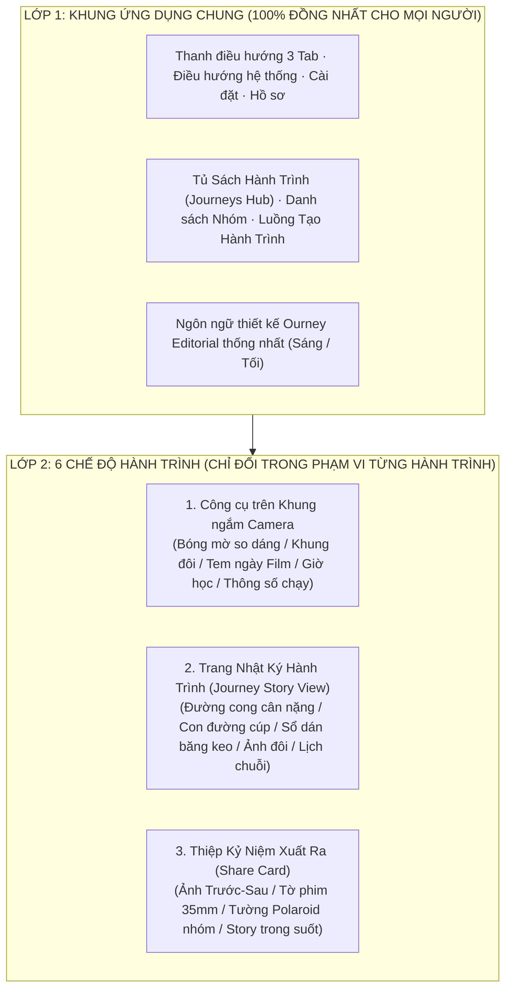

# Ourney — Đánh Giá UI Hiện Tại, Phân Tích Bài Toán Sản Phẩm & Kiến Trúc Đa Hành Trình

> **Ngày cập nhật:** 21/10/2026  
> **Phạm vi:** Kiểm tra đối chiếu code thực tế trên nhánh `main` (`48a1eb7`) so với 6 bản thiết kế (`assets/design_personas/`), phân tích điểm nghẽn trong bài toán sản phẩm của nhóm, luồng người dùng (User Flow), cơ chế kích hoạt thu hút (Triggers), và lời giải cho bài toán **6 mẫu giao diện vs. 1 giao diện chung khi một người có nhiều hành trình trong suốt cuộc đời**.

---

## Phần 1 — Audit Thực Tế: UI Trong Code Đã Giống Với 6 Bản Thiết Kế Chưa?

Sau khi pull 25 commits mới nhất từ `origin/main` (đến commit `48a1eb7`), tiến độ thực tế trên toàn bộ ứng dụng đang ở mức **~45% hoàn thiện (Phần khung nền đã xong 100%, nhưng mới có 2/6 phong cách được dựng giao diện thật, và đang có 5 lỗi lệch thiết kế nghiêm trọng)**.

### 1.1. Bảng đối chiếu tiến độ 6 Phong cách & các màn hình chính

| Hạng mục | File thực tế trong `apps/mobile/lib/` | Trạng thái so với Design | Chi tiết kiểm tra |
|---|---|---:|---|
| **Nền tảng dùng chung (`F1–F6`)** | [`app.dart`](../apps/mobile/lib/app/app.dart), [`ourney_dock.dart`](../apps/mobile/lib/shared/ourney_dock.dart), [`persona_switchers.dart`](../apps/mobile/lib/personas/persona_switchers.dart), [`template_icons.dart`](../apps/mobile/lib/shared/template_icons.dart) | ✅ **90%** | Đã có `OurneyPersonaTheme` (Sáng/Tối), chuyển màu 320ms, `AnimatedSwitcher` 260ms, icon vector thay cho emoji, thanh 3 tab dưới cùng. *(Còn lỗi trùng 2 nút chụp trên màn Camera — xem Mục 1.2).* |
| **Phong cách 1: Quiet Transformer** *(Giảm cân)* | [`personas/quiet_transformer/`](../apps/mobile/lib/personas/quiet_transformer/timeline.dart) | ❌ **0% (Đang là Placeholder)** | Cả 3 màn (`timeline.dart`, `camera_hud.dart`, `share_card.dart`) đều đang gọi [`PlaceholderTimeline`](../apps/mobile/lib/personas/persona_placeholder.dart) / `PlaceholderHud` / `PlaceholderShareBoard`. Chưa có đường cong cân nặng, chưa có bóng mờ Ngày 1 (`ghostAlignVault`), chưa có thiệp so sánh Ngày 1 vs Hôm nay. |
| **Phong cách 2: Accountability Squad** *(Học nhóm)* | [`personas/accountability_squad/`](../apps/mobile/lib/personas/accountability_squad/timeline.dart) | ⚠️ **80%** | Đã dựng xong con đường chữ S (`SteppingStoneQuestTimeline`), nhãn giờ học trên Camera (`StudyTimerSnapHud`) và tường ảnh nhóm (`SquadPolaroidWall`). **Tuy nhiên:** trên màn Share Card ([`persona_registry.dart:100`](../apps/mobile/lib/personas/persona_registry.dart#L100)) vẫn đang hiện thẻ tạm `_SquadSummary` vì chưa truyền danh sách thành viên sang màn Share. |
| **Phong cách 3: Memory Collectors** *(Du lịch)* | [`personas/memory_collectors/`](../apps/mobile/lib/personas/memory_collectors/timeline.dart) | ✅ **95%** | Đã dựng xong đường chỉ khâu đất nung + ảnh Polaroid dán băng keo (`ScrapbookThreadTimeline`), khung máy ảnh film (`DisposableFilmStampHud`) và cuộn phim 35mm (`FilmContactSheetShareCard`). |
| **Phong cách 4: Couple Rituals** *(Cặp đôi)* | [`personas/couple_rituals/`](../apps/mobile/lib/personas/couple_rituals/timeline.dart) | ❌ **0% (Đang là Placeholder)** | Cả 3 màn đều đang là widget giữ chỗ (`PlaceholderTimeline`, `PlaceholderHud`, `PlaceholderShareBoard`). Chưa có khung đôi trái/phải hay camera chia nửa khung hình. |
| **Phong cách 5: Aesthetic Flexer** *(30 ngày tập)* | [`personas/aesthetic_flexer/`](../apps/mobile/lib/personas/aesthetic_flexer/timeline.dart) | ❌ **0% (Đang là Placeholder)** | Cả 3 màn đều đang là widget giữ chỗ. Chưa có biểu đồ neon, bộ chọn 3 kiểu tem thông số Strava hay thiệp Story 9:16 kèm dải ngày tập. |
| **Phong cách 6: Minimalist Habit** *(Thói quen)* | [`personas/minimalist_habit/`](../apps/mobile/lib/personas/minimalist_habit/timeline.dart) | ❌ **0% (Đang là Placeholder)** | Cả 3 màn đều đang là widget giữ chỗ. Chưa có đường dây cam nối liền các ngày trên lịch, chưa có chụp 1 chạm không qua màn nhập chữ. |
| **Màn Hub Hành Trình & Tạo Hành Trình (`J1, J2`)** | [`journeys_list_screen.dart`](../apps/mobile/lib/features/journeys/ui/journeys_list_screen.dart), [`template_picker_screen.dart`](../apps/mobile/lib/features/journeys/ui/template_picker_screen.dart), [`create_journey_screen.dart`](../apps/mobile/lib/features/journeys/ui/create_journey_screen.dart) | ❌ **Chưa cập nhật** | Vẫn dùng giao diện danh sách đơn giản từ đợt đầu: chưa dùng nền trung tính `editorialNeutralBase`, màn chọn mẫu chỉ liệt kê 5 dòng chữ (thiếu lựa chọn thứ 6 cho **Cặp đôi**), chưa có ảnh xem trước trực tiếp (`designAssetPath`). |

---

### 1.2. Năm lỗi lệch thiết kế (UI/UX Bugs) đang tồn tại ngay trong code hiện tại

1. **Lỗi #1 — Bị xuất hiện HAI nút chụp ảnh khổng lồ (76×76dp) chồng lên nhau ở màn Camera:**
   - Trong [`capture_screen.dart:565`](../apps/mobile/lib/features/camera/capture_screen.dart#L565), màn Camera tự vẽ một nút `_ShutterButton` tròn 76dp nằm giữa nút Thư viện và nút Đổi ống kính.
   - Ngay bên dưới nó, [`ourney_dock.dart:202`](../apps/mobile/lib/shared/ourney_dock.dart#L202) (khi ở tab `captureIndex`) **lại vẽ thêm một nút `_HeroShutter` tròn 76dp nữa** ở giữa thanh điều hướng dưới!
   - Nghiêm trọng hơn: bấm vào nút chụp ở thanh dưới (`_HeroShutter`) **không hề chụp ảnh** mà chỉ gọi hàm chọn lại tab `_go(1)`. Người dùng nhìn thấy 2 nút chụp giống nhau nằm sát nhau và bấm nút dưới không thấy chụp được ảnh.
2. **Lỗi #2 — Nhồi nhét giao diện cũ đè lên giao diện mới ở màn Chi tiết hành trình (`JourneyDetailScreen`):**
   - Trong [`journey_detail_screen.dart:176-229`](../apps/mobile/lib/features/journeys/ui/journey_detail_screen.dart#L176-L229), phía trên `PersonaTimelineSwitcher` vẫn giữ nguyên **4 ô thống kê lớn (`_Stats`) + 2 nút bấm to hết chiều ngang (`Check-in ngay`, `Mở nhóm`) + tiêu đề `"Dòng thời gian"`**.
   - Trong khi đó, bản thân `SteppingStoneQuestTimeline` (Phong cách 2) và `ScrapbookThreadTimeline` (Phong cách 3) đã tự vẽ thanh tiêu đề và phần mở đầu riêng. Kết quả là nửa trên màn hình bị chiếm hết bởi các hộp thống kê cũ, đẩy con đường hành trình tụt xuống tận nửa dưới màn hình.
3. **Lỗi #3 — Màn Share Card (`ShareCardScreen`) hiển thị 2 thiệp khác nhau và xuất sai ảnh:**
   - Trong [`share_card_screen.dart:197-204`](../apps/mobile/lib/features/share_card/ui/share_card_screen.dart#L197-L204), khu vực `RepaintBoundary` (dùng để xuất ra ảnh PNG khi bấm Chia sẻ) vẫn đang bọc widget `ShareCard` cũ.
   - Còn widget giao diện mới `PersonaShareSwitcher` (như tờ phim 35mm `FilmContactSheetShareCard`) lại bị đặt tuốt ở cuối trang ([`share_card_screen.dart:309`](../apps/mobile/lib/features/share_card/ui/share_card_screen.dart#L309)) **nằm ngoài `RepaintBoundary`**. Do đó khi người dùng bấm nút Chia sẻ, ảnh xuất ra mạng xã hội vẫn là mẫu thiệp cũ chứ không phải mẫu thiệp của phong cách đó!
4. **Lỗi #4 — Màn Nhóm hôm nay (`GroupTodayScreen`) hiển thị danh sách thành viên 2 lần liên tiếp:**
   - Trong [`persona_switchers.dart:171-174`](../apps/mobile/lib/personas/persona_switchers.dart#L171-L174), khi phong cách có tường ảnh nhóm (`SquadPolaroidWall`), app vẽ lưới ảnh Polaroid của các thành viên ở trên, rồi ngay bên dưới lại vẽ tiếp `membersFooter` (`_MemberSections`) liệt kê lại đúng những thành viên đó một lần nữa.
5. **Lỗi #5 — Luồng chụp ảnh bị đứt mạch với thiết kế Camera của từng phong cách:**
   - Bản thiết kế của Phong cách 1 (thanh trượt cân nặng ngay trên Camera) và Phong cách 6 (chụp 1 chạm xong ngay trong 3 giây, không nhập chữ) đều hướng tới thao tác trực tiếp tại màn Camera. Nhưng hiện tại [`capture_screen.dart:368`](../apps/mobile/lib/features/camera/capture_screen.dart#L368) luôn đẩy sang màn hình form `/checkin` bắt bấm thêm bước xác nhận và nhập lại từ đầu.

---

## Phần 2 — Phân Tích Bài Toán & Giải Pháp Của Team: Đang Sai Hoặc Cần Cải Thiện Chỗ Nào?

### 2.1. Luồng người dùng vào App hiện tại (Current User Flow) đang quá nặng nề

Hãy nhìn vào luồng thực tế trong [`redirect.dart`](../apps/mobile/lib/app/redirect.dart) và [`capture_screen.dart`](../apps/mobile/lib/features/camera/capture_screen.dart) khi một người dùng mới tải app về:

```mermaid
flowchart LR
  A["Mở App lần đầu"] --> B["Onboarding<br/>(3 trang chữ + icon đơn điệu)"]
  B --> C["Đăng nhập Email<br/>(Chờ & nhập mã OTP 6 số)"]
  C --> D["Màn hình Tạo Hồ Sơ<br/>(Nhập tên hiển thị)"]
  D --> E["Màn hình Điều khoản EULA<br/>(Bắt bấm đồng ý)"]
  E --> F["Màn Camera Trống Rỗng<br/>(Camera TẮT · Hiện thông báo lỗi chưa có hành trình)"]
  F --> G["Chọn Mẫu<br/>(5 dòng chữ đơn sơ)"]
  G --> H["Form Tạo Hành Trình<br/>(8 mục cấu hình dài)"]
  H --> I["Chi tiết hành trình trống<br/>(Mới được bấm Chụp lần đầu!)"]
```

**Tại sao luồng này sẽ làm rơi rụng 70–85% người dùng mới?**
1. **Rào cản trước khi thấy giá trị (Pre-Value Friction quá cao):** Người dùng tải một ứng dụng "chụp ảnh 3 giây mỗi ngày như Locket", nhưng phải đi qua **8 màn hình hành chính** (Onboarding chữ -> Chờ mail OTP -> Đặt tên -> Đồng ý điều khoản pháp lý -> Màn hình trống -> Chọn mẫu -> Điền form 8 trường) trước khi camera bật lên lần đầu tiên!
2. **Màn hình Camera khi chưa có hành trình (`capture-no-journeys`) là một "Bức tường chết":** Định vị là Camera-first, nhưng khi vừa vượt qua đăng nhập xong, màn hình chính `/capture` lại **tắt camera** và hiện một icon lá cờ trên nền đen với dòng chữ *"Bạn chưa có hành trình nào"*. Cảm xúc hào hứng tụt về 0 ngay lập tức.
3. **Form tạo hành trình (`CreateJourneyScreen`) hỏi quá nhiều thứ kỹ thuật ngay lúc bắt đầu:** Hỏi từ *Có theo dõi chỉ số không? Tên chỉ số là gì? Đơn vị là gì? Có ẩn chỉ số không? Có làm mờ ảnh khi chia sẻ không? Quyền riêng tư là Riêng tư hay Có link? Múi giờ là gì?* — trong khi 90% thông tin này đã nằm sẵn trong Mẫu (Template) và chỉ nên nằm trong nút *"Tuỳ chỉnh nâng cao"* hoặc Cài đặt hành trình về sau.
4. **Chia đôi khái niệm Hành trình ở 2 tab (`Journeys` và `Squad`):** Một hành trình nhóm (ví dụ *"Học IELTS cùng nhau"*) vừa nằm trong tab `Journeys` (xem lịch của riêng mình), vừa nằm trong tab `Squad` (xem ảnh hôm nay của cả nhóm). Người dùng không hiểu tại sao cùng một hành trình lại bị tách làm 2 nơi rời rạc.

---

### 2.2. Chức năng nào mới thực sự là Trigger thu hút và giữ chân người dùng?

Một ứng dụng thói quen + mạng xã hội nhóm nhỏ (như Locket, BeReal, Duolingo, Strava) sống còn nhờ **4 vòng lặp kích hoạt (Triggers)** sau đây — hiện tại trong code đang thiếu hoặc làm chưa tới:

| Loại Trigger | Cơ chế tâm lý thu hút người dùng | Hiện trạng trong code Ourney | Cần bổ sung / sửa đổi gì ngay? |
|---|---|---|---|
| **1. Trigger Mở Khóa Nhóm ("Chụp để xem bạn bè" — kiểu BeReal)** | Tò mò xã hội (Social Curiosity): Muốn biết hôm nay hội bạn thân chụp gì, tập ở đâu, học gì. | Đang cho xem miễn phí: Dù mình **chưa chụp hôm nay**, vào tab `Squad` vẫn thấy rõ ảnh hôm nay của tất cả bạn bè. | **Làm mờ nhẹ (Frosted Blur) ảnh hôm nay của nhóm nếu bạn chưa check-in hôm nay**, kèm nút nổi trên ảnh: *"3/4 bạn đã điểm danh · Chụp ảnh hôm nay để mở khóa cả nhóm!"* |
| **2. Trigger "Nhắc nhẹ / Gõ cửa bạn thân" (`Nudge 👋`)** | Áp lực đồng trang lứa tích cực (Friendly Accountability): Thông báo hệ thống dễ bị lờ đi, nhưng **bạn thân gọi tên** thì mở app ngay. | Trong [`TASKS.md:83`](../docs/TASKS.md#L83), nhóm đã **cắt bỏ nút Nudge** ở bản đầu tiên! | **Phải giữ lại nút `Nhắc nhẹ 👋` trên thẻ thành viên đang chờ (`WAITING`)!** Dù chưa có Push Notification từ Apple trả phí, bấm `Nhắc nhẹ 👋` có thể mở nhanh bảng chia sẻ tin nhắn Zalo/iMessage/Messenger với câu soạn sẵn vui nhộn + deeplink `ourney://journey/<id>` hoặc lưu lượt vẫy tay trên Supabase để khi bạn mở app sẽ thấy *"Linh và 2 bạn vừa vẫy tay chờ bạn hôm nay 👋"*. |
| **3. Trigger Thấy Sự Thay Đổi Bằng Mắt (`Ghost Align` & `Ngày 1 vs Hôm nay`)** | Phần thưởng tự thân (Self-Progress): Người tập gym/giảm cân bỏ cuộc vì ngày thường nhìn gương không thấy khác biệt. | Chưa làm (`Q2`, `Q3` đang là placeholder); màn `CheckinSuccessView` chỉ hiện số chuỗi ngày và pháo giấy đơn giản. | Khi vừa chụp xong ảnh hôm nay, màn **Check-in Thành Công** phải đặt ngay **Ảnh Ngày 1 cạnh Ảnh Hôm Nay** (hoặc hiệu ứng lướt qua lại Trước/Sau) ngay lập tức. Đó là khoảnh khắc "Aha!" khiến người dùng sướng rơn mỗi ngày. |
| **4. Trigger Lan Truyền Tự Nhiên Qua Story (`Viral Share Artifact`)** | Tâm lý tự hào muốn khoe (Identity Flexing): Người dùng chỉ đăng lên Instagram/Facebook/TikTok nếu tấm ảnh trông **đẹp như tạp chí hoặc ngầu như Strava**. | Đang bị lỗi xuất nhầm thẻ cũ (`ShareCardScreen` xuất thẻ đơn điệu thay vì tờ phim 35mm / tường Polaroid / kính mờ Strava). | Đưa chính xác 6 mẫu thiệp đặc trưng vào trong `RepaintBoundary` để xuất ảnh chất lượng cao, có gắn nhãn nhỏ tinh tế `OURNEY` kèm mã mời nhóm (nếu người tạo bật mời bạn). |

---

## Phần 3 — Giải Quyết Bài Toán Cốt Lõi: 6 Giao Diện Theo Loại Người Hay 1 Giao Diện Chung? Đa Hành Trình Trong Cuộc Đời Xử Lý Sao?

Đây là câu hỏi quan trọng nhất về mặt kiến trúc sản phẩm của Ourney:

> *"Nên để 6 cái template journey đó theo từng loại người hay 1 loại chung cho tất cả? Mỗi người sẽ có nhiều journey trong cuộc đời họ thì giải quyết sao? Màn hình chính hiển thị gì: chọn template hay gì?"*

### 3.1. Sai lầm nếu hiểu "6 Phong cách = 6 Loại Người Cố Định"

Trong đời thực, **một con người KHÔNG bao giờ chỉ thuộc về 1 kiểu người cố định**:
- Cùng một bạn **Linh (22 tuổi)** trong cùng một tháng có thể có:
  1. Hành trình **Giảm 4kg** đi một mình cần tuyệt đối riêng tư (`Quiet Transformer`).
  2. Hành trình **Học IELTS 30 ngày** cùng 4 đứa bạn thân (`Accountability Squad`).
  3. Chuyến đi **Đà Lạt 4 ngày 3 đêm** cùng người yêu (`Memory Collectors` hoặc `Couple Rituals`).
- Và trong suốt **3–5 năm cuộc đời**, Linh sẽ đi qua hàng chục hành trình khác nhau.

Do đó:
- ❌ **Nếu làm 6 UI biến đổi toàn bộ khung App theo "Loại người" (như cách `activePersonaSkinProvider` đang nhuộm lại toàn bộ App hiện tại):** Mỗi lần Linh bấm từ hành trình *Học tiếng Anh* (vàng cam viền đen dày kiểu hoạt hình Neo-Brutalist) sang *Giảm cân* (xanh ngọc tối giản) rồi sang *Đà Lạt* (giấy nâu cổ điển), cả thanh điều hướng, nút bấm hệ thống và khung ứng dụng biến dạng hoàn toàn. Người dùng sẽ thấy **app bị loạn nhân cách, thiếu sự nhất quán của một sản phẩm chuyên nghiệp**.
- ❌ **Ngược lại, nếu gộp thành 1 UI chung đơn điệu cho tất cả:** Chuyến du lịch Đà Lạt hay kỷ niệm cặp đôi sẽ trông khô khan y hệt bảng theo dõi cân nặng. Ourney sẽ mất đi "vũ khí cảm xúc" lớn nhất giúp tạo ra những tấm ảnh kỷ niệm khiến người dùng muốn khoe lên mạng xã hội.

---

### 3.2. Lời giải chuẩn xác nhất: Kiến trúc **"1 Khung Ứng Dụng Chung (Unified App Shell) + 6 Chế Độ Trình Bày Theo Hành Trình (Journey Lenses)"**

Hãy học cách **Apple Wallet** (mỗi thẻ ngân hàng/vé máy bay có thiết kế riêng nhưng nằm trong 1 khung ví thống nhất) hoặc **Spotify / Notion** tổ chức:

**Nguyên tắc vàng của kiến trúc này:**
1. **Giao diện thuộc về HÀNH TRÌNH, không thuộc về NGƯỜI DÙNG:** Mỗi hành trình khi tạo sẽ chọn 1 trong 6 **Chế độ trình bày (Journey Theme / Lens)**.
2. **Khung ngoài của App (`AppShell`, `OurneyDock`, `JourneysListScreen`, `GroupsListScreen`, `ProfileScreen`) LUÔN GIỮ MỘT PHONG CÁCH CHUNG DUY NHẤT:**
   - Thanh điều hướng dưới cùng (`OurneyDock`), phông chữ, độ dày viền hệ thống và nền trang chính luôn giữ đúng bản sắc **Ourney Editorial** (sạch sẽ, hiện đại, chỉ điểm xuyết màu nhấn nhỏ của hành trình đang chọn trên viên thuốc chọn hành trình, **không** biến cả thanh điều hướng hay toàn bộ app thành viền đen dày 2dp hay đổi phông nền toàn cục).
3. **Bên trong từng Hành trình (`JourneyDetailScreen`) có nút chuyển đổi linh hoạt `[ Xem theo Câu chuyện | Xem Lịch 7 cột ]`:**
   - Mặc định mở vào **Chế độ Câu chuyện (Story View)** đặc trưng của mẫu đó (ví dụ: Sổ lưu niệm dán băng keo cho Du lịch, Con đường leo cúp cho Học nhóm, Đường cong cân nặng cho Giảm cân).
   - Đồng thời ở góc trên luôn có công tắc nhỏ chuyển sang **Chế độ Lịch 7 cột đồng nhất (`Grid View`)** nếu người dùng muốn tra cứu nhanh theo ngày tháng.

---

### 3.3. Giải quyết bài toán "Mỗi người có nhiều Journey trong cuộc đời": Mô hình **Tủ Sách Cuộc Đời (Life Passport)**

Hiện tại app chỉ chia đơn giản thành 2 danh sách phẳng: `Đang chạy (x/3)` và `Đã kết thúc`. Khi một người dùng gắn bó với app qua nhiều tháng/năm (có 10, 20, 50 hành trình đã đi qua), thiết kế cần giải quyết 2 tầng:

#### Tầng 1: Nhiều hành trình ĐANG CHẠY cùng lúc trong một ngày (Đa nhiệm hằng ngày)
- Giữ giới hạn **tối đa 3 hành trình thói quen đang chạy cùng lúc**, **NHƯNG tách riêng loại "Chuyến đi ngắn ngày" (Trip / Event ≤ 14 ngày)**:
  - Nếu người dùng đang có 3 hành trình thói quen (Giảm cân, Học tiếng Anh, Đọc sách) mà cuối tuần đi Đà Lạt 4 ngày, họ vẫn mở được một **"Cuộn phim chuyến đi"** mà không bị bắt phải xóa hay kết thúc thói quen đang chạy!
- **Hành trình nhóm hiển thị ngay trong cùng một nơi:** Không bắt người dùng phải tự nhớ hành trình nào ở tab `Journeys`, hành trình nào ở tab `Squad`. Trên mỗi thẻ hành trình nhóm có sẵn dải avatar bạn bè (`3/5 bạn đã chụp hôm nay`).

#### Tầng 2: Nhiều hành trình TRONG SUỐT CUỘC ĐỜI (Kệ sách kỷ niệm — Life Chapters)
- Khi một hành trình kết thúc (đủ 30 ngày, kết thúc chuyến đi, hoặc đạt mục tiêu), nó **không biến thành một dòng chữ xám xịt nhàm chán**, mà được đóng gói thành một **"Cuốn Kỷ Niệm / Cuộn Phim Đã Hoàn Thành" (Completed Memory Book)** xếp trên kệ theo từng năm (`2026`, `2025`...):
  - Có ảnh bìa ghép từ ngày đầu & ngày cuối.
  - Ghi rõ tổng số ngày duy trì và số khoảnh khắc đã lưu.
  - Bấm vào bất kỳ lúc nào cũng xem lại được như lật một cuốn album kỷ niệm của từng giai đoạn cuộc đời.

---

### 3.4. Nếu có một hành trình KHÔNG liên quan tới 6 mẫu có sẵn thì giải quyết sao?

Trong thực tế, người dùng sẽ có vô số hành trình không nằm trong 5–6 chủ đề gợi ý (Giảm cân, Tiếng Anh, Du lịch, Cặp đôi, Tập luyện), ví dụ:
- *"Hành trình niềng răng / Trị mụn 60 ngày"*
- *"Trồng cây sen đá ban công / Nuôi mèo lớn lên"*
- *"30 ngày tự nấu cơm hộp đi làm"*
- *"Thử thách 30 ngày không tiêu tiền hoang phí"*
- *"100 ngày tập đàn Guitar / Học vẽ"*

Nếu gắn cứng **1 Chủ đề = 1 Giao diện**, người dùng tạo hành trình *"Trị mụn"* hay *"Nấu ăn"* sẽ không biết chọn mẫu nào.

#### Lời giải: Tách **"Chủ đề gợi ý (Preset Topic)"** khỏi **"Kiểu Nhật Ký (Journal Mode / Lens)"**

Dù con người có **1.000 mục tiêu khác nhau**, cách họ ghi nhận bằng hình ảnh mỗi ngày thực chất chỉ xoay quanh **6 Kiểu Nhật Ký (6 Journal Modes)** dưới đây:

| Kiểu Nhật Ký (Lens) | Trước đây bị bó hẹp vào | Thực chất dùng được cho MỌI hành trình nào? |
|---|---|---|
| **1. Lịch Chuỗi Ngày (`Minimalist Grid` — MẶC ĐỊNH)** | Thói quen tự đặt | **Mặc định chuẩn cho mọi hành trình tự tạo!** (Dậy sớm, uống nước, đọc sách, dọn phòng — chỉ cần chụp 1 ảnh/ngày vào lịch 7 cột). |
| **2. So Sánh Thay Đổi (`Before & After + Bóng mờ căn góc`)** | Chỉ Giảm cân | **Mọi hành trình muốn thấy sự biến đổi bằng mắt:** Giảm cân, **Trị mụn / Skincare, Niềng răng, Trồng cây lớn lên, Xây/sửa phòng, Vẽ một bức tranh lớn**. |
| **3. Sổ Lưu Niệm & Phim (`Scrapbook & 35mm Film`)** | Chỉ Du lịch | **Mọi hành trình lưu giữ kỷ niệm đời sống:** Du lịch, **30 ngày tự nấu ăn, Nhật ký nuôi con/thú cưng, Mùa hè đại học, Tháng đầu đi làm**. |
| **4. Tem Thông Số (`Telemetry HUD`)** | Chỉ Tập luyện 30 ngày | **Mọi hành trình muốn đóng dấu con số lên ảnh:** Chạy bộ/Gym, **Số giờ tự học/code, Số trang sách, Số tiền tiết kiệm mỗi ngày**. |
| **5. Đường Đua Nhóm (`Squad Quest & Polaroid Wall`)** | Chỉ Học tiếng Anh | **Mọi thử thách rủ hội bạn cùng làm (3–10 người):** Học ngoại ngữ, **Đọc sách nhóm, Cùng dậy 5h sáng, Cùng tự nấu ăn**. |
| **6. Khung Ảnh Đôi (`Duo Half-Frame`)** | Chỉ Cặp đôi | **Mọi hành trình của 2 người:** Người yêu, **Đôi bạn thân (Bestie), Mẹ và con, Hai anh chị em ở xa chụp ảnh mỗi ngày**. |

#### Cách hoạt động mượt mà trong App khi người dùng có hành trình bất kỳ:
1. **Mặc định không cần nghĩ (`Zero-Friction Default`):**
   - Khi người dùng bấm **`+ Tự tạo hành trình riêng`**, họ chỉ cần gõ **Tên hành trình** (ví dụ: *"30 ngày tự nấu cơm trưa"*).
   - App mặc định dùng **Kiểu 1: Lịch Chuỗi Ngày (`Minimalist Grid`)** — giao diện trung tính, sạch sẽ, phù hợp 100% mọi chủ đề trên đời.
2. **Cho phép chọn (hoặc đổi bất cứ lúc nào) "Kiểu Nhật Ký" độc lập với Chủ đề:**
   - Ngay dưới ô đặt tên (và trong Cài đặt hành trình), người dùng có hàng chọn nhanh **"Cách hiển thị nhật ký"**:
     - `🗓️ Lịch chuỗi ngày (Mặc định)`
     - `🔄 So sánh Trước/Sau (Có bóng mờ căn góc)` *(Rất hợp cho Trị mụn, Niềng răng, Trồng cây)*
     - `🎞️ Sổ lưu niệm Film` *(Rất hợp cho Nấu ăn, Đời sống, Thú cưng)*
     - `📊 Tem thông số lên ảnh` *(Khi có bật theo dõi con số mỗi ngày)*
   - Nếu chọn đi **2 người** ➔ Tự gợi ý `💞 Khung ảnh đôi`. Nếu chọn đi **Nhóm 3–10 người** ➔ Tự gợi ý `🏆 Đường đua & Tường ảnh nhóm`.
3. **Đổi Kiểu Nhật Ký ngay cả khi đang đi giữa chừng (Zero Data Loss):**
   - Vì dữ liệu bên dưới của mọi hành trình đều chung một cấu trúc (`Journey` + `CheckIn` gồm ảnh, ngày, chú thích, chỉ số), người dùng tạo hành trình *"Trồng cây"* ở dạng Lịch mặc định đến ngày 20 hoàn toàn có thể bấm chuyển sang xem ở dạng **So sánh Ngày 1 vs Ngày 20** hoặc xuất thiệp **Cuộn phim 35mm** mà không cần tạo lại hành trình!

---

### 3.5. Màn hình chính (Home Screen) nên hiển thị gì? Chọn Template hay gì?

Câu trả lời dứt khoát: **Màn hình chính KHÔNG BAO GIỜ chỉ là một màn hình chọn Template cố định**, vì người dùng chỉ tạo hành trình mới vài tuần một lần, nhưng mở app để **chụp ảnh điểm danh mỗi ngày**.

Màn hình chính cần tự động thích ứng thông minh theo **2 trạng thái của người dùng**:

#### Trạng thái A — Khi người dùng MỚI TINH (`0 hành trình đang chạy`)
Thay vì hiện màn Camera đen thui báo lỗi *"Bạn chưa có hành trình nào"*, màn hình chính hiển thị **"Bắt Đầu Hành Trình Đầu Tiên Của Bạn" (First-Journey Launchpad)**:
1. **Trên cùng:** Ô nhỏ gọn **"Có mã mời từ bạn bè? Nhập mã 8 ký tự ➔"** (để người được bạn rủ vào nhóm tham gia ngay trong 1 chạm).
2. **Chính giữa:** Lưới **6 Thẻ Mẫu Hành Trình trực quan (có hình minh họa phong cách ngay trên thẻ)**:
   - `⚖️ Giảm cân & Giữ dáng` *(Riêng tư · Có bóng mờ so dáng)*
   - `📚 Học tập cùng Hội bạn` *(Nhóm bạn · Đua chuỗi ngày)*
   - `✈️ Chuyến đi & Kỷ niệm` *(Sổ lưu niệm & Cuộn phim 35mm)*
   - `💞 Nhật ký Cặp đôi` *(Ghép đôi 2 nửa khung hình mỗi ngày)*
   - `💪 30 Ngày Tập luyện` *(Tem thông số thể thao cực ngầu)*
   - `✨ Thói quen tối giản` *(Chụp 1 chạm trong 3 giây)*
3. **Chạm vào 1 thẻ ➔ Mở Bottom Sheet gọn nhẹ (chỉ 2 thông tin: Tên hành trình + Đi một mình / Đi cùng bạn) ➔ Bấm "Chụp Ngày 1 Ngay"!**

#### Trạng thái B — Khi người dùng ĐÃ CÓ hành trình đang chạy (`≥ 1 hành trình Active` — 99% thời gian sử dụng)
Màn hình chính mở thẳng vào **Màn hình Camera Điểm Danh Nhanh (`/capture`)** với thiết kế chuẩn:
1. **Thanh Gạt Hành Trình (Swipeable Journey Pill Carousel) ngay trên đầu khung ngắm:**
   - Hiển thị các hành trình đang chạy của người dùng:
     `[ ⏳ 📚 Học IELTS · Chưa chụp hôm nay ]`  `[ ✓ 💪 Gym 30 ngày · Đã chụp ]`  `[ + ]`
   - **Tự động chọn sẵn hành trình CHƯA CHỤP hôm nay** để người dùng mở app ra là bấm chụp được ngay!
   - Vuốt nhẹ sang trái/phải hoặc chạm vào viên thuốc để đổi sang hành trình khác (ống kính Camera tự đổi lớp phủ theo mẫu của hành trình đó).
   - Nút `[ + ]` nhỏ ở cuối dải viên thuốc (hoặc nút `+ Hành trình mới` trong tab `Journeys`) dùng khi muốn bắt đầu thêm một hành trình mới.
2. **Chỉ có DUY NHẤT 1 nút Chụp ảnh (Hero Shutter)**, bỏ hoàn toàn tình trạng 2 nút chụp chồng lên nhau hiện tại.
3. **Chụp xong ➔ Hiện lớp xác nhận nhanh ngay trên ảnh (Inline Quick-Post Overlay):**
   - Cho phép bấm **"Đăng ngay (1 chạm)"** hoặc kéo nhanh thanh trượt chỉ số / gõ vài chữ chú thích ngay trên bức ảnh vừa chụp mà không cần chuyển sang một màn hình form trắng tinh riêng biệt.

---

## Phần 4 — Lộ Trình Hành Động Đề Xuất Cho Team (Action Plan)

Để đưa dự án về đúng quỹ đạo thiết kế và tối ưu trải nghiệm người dùng mà **không làm vỡ phần dữ liệu/backend đã viết xong**, nhóm nên thực hiện theo thứ tự ưu tiên sau:

### Ưu tiên 1 — Sửa ngay 4 lỗi giao diện bị chồng chéo trên `main` (1–2 ngày)
1. **Gộp nút chụp trên `CaptureScreen` và `OurneyDock`:** Khi đang ở màn `/capture`, chỉ giữ 1 nút chụp duy nhất (hoặc ẩn hàng nút chụp phụ của `CaptureScreen` và truyền callback `_capture` xuống nút `_HeroShutter` của `OurneyDock`, hoặc giữ thanh dock gọn ở dưới và để cụm `[Thư viện · Chụp · Đổi cam]` làm chủ).
2. **Dọn sạch phần thừa trên `JourneyDetailScreen`:** Khi hiển thị `PersonaTimelineSwitcher`, ẩn 4 ô `_Stats` cũ và dùng `CustomScrollView` toàn màn hình để dòng thời gian của từng phong cách hiển thị đúng như bản thiết kế.
3. **Sửa `RepaintBoundary` trên `ShareCardScreen`:** Đặt `PersonaShareSwitcher` vào bên trong `RepaintBoundary` chính để khi bấm Chia sẻ sẽ xuất ra đúng tấm thiệp của phong cách đó.
4. **Bỏ danh sách thành viên bị lặp lần 2 trên `GroupTodayScreen`:** Đưa menu `Báo cáo / Chặn / Xóa thành viên` vào nút `⋮` góc trên mỗi tấm thẻ Polaroid trong `SquadPolaroidWall`.

### Ưu tiên 2 — Chốt quy tắc "1 Khung Chung + 6 Chế Độ Hành Trình" (1 ngày)
1. Giữ màu nền và khung của `AppShell`, `OurneyDock`, `JourneysListScreen`, `GroupsListScreen` theo bảng màu trung tính **Ourney Editorial Base** (Sáng/Tối) để toàn bộ ứng dụng luôn đồng nhất, không bị nhảy viền/đổi phông nền toàn cục khi chuyển tab.
2. Áp dụng `PersonaSkinScope` **chỉ bên trong 3 nơi của từng hành trình**: Khung ngắm Camera (`PersonaCameraHudSwitcher`), Chi tiết hành trình (`PersonaTimelineSwitcher`), và Thiệp chia sẻ (`PersonaShareSwitcher`).

### Ưu tiên 3 — Hoàn thiện 4 phong cách còn đang là Placeholder & nâng cấp Luồng vào App
1. Hoàn thiện 4 phong cách đang giữ chỗ: `Quiet Transformer (Q1–Q3)`, `Couple Rituals (D2–D4)`, `Aesthetic Flexer (R1–R3)`, `Minimalist Habit (Z1–Z3)`.
2. Thay màn hình trống `capture-no-journeys` bằng **Màn chọn hành trình đầu tiên trực quan (6 mẫu + Nhập mã nhóm)** và rút gọn màn tạo hành trình thành 1 bước nhanh để người dùng mới có thể chụp bức ảnh Ngày 1 trong vòng **dưới 30 giây**.
3. Khôi phục nút **`Nhắc nhẹ 👋` (Nudge)** trên thẻ bạn bè chưa check-in và thêm cơ chế **Làm mờ nhẹ ảnh nhóm hôm nay cho tới khi bạn hoàn thành check-in**.
