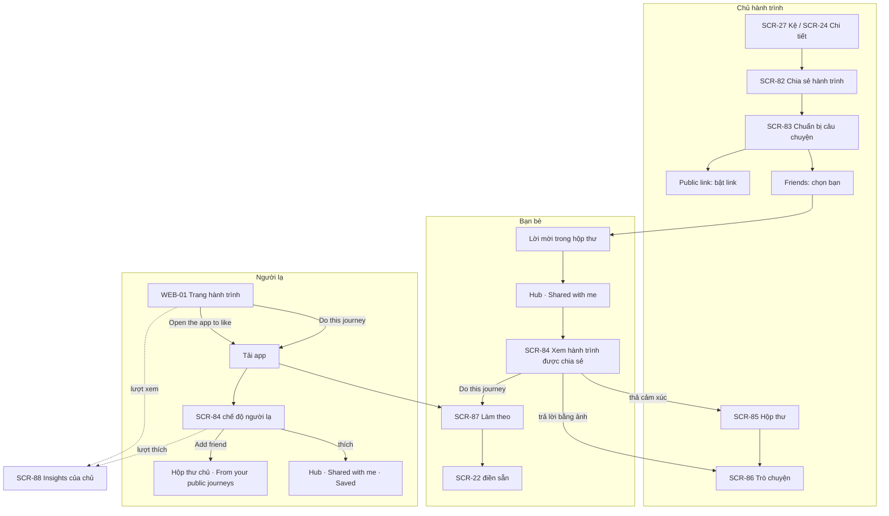

# Ourney — Chia sẻ hành trình đã trải qua (Journey Sharing)

> Phiên bản 0.3 · 2026-10-26 · Trạng thái: **đã chốt với chủ dự án**, chờ thiết kế và PR contract dữ liệu. v0.2 thêm **công khai có thống kê** (S19–S28, §2.1). v0.3 thêm **chia sẻ hành trình nhóm/cặp đôi** (S29–S35, §2.2) và chốt các câu mở O1–O6 (S36–S40, §2.3).
> **Vì sao có tài liệu này:** bản v0.3 tập trung vào check-in hằng ngày, chưa có cách để người đã đi xong một hành trình (hoặc đã đi từ trước khi có app) đưa nó lên và chia sẻ. Tài liệu này ghi lại quyết định (S1–S40), luồng, và **đề xuất** dữ liệu.
> **Quan hệ với tài liệu khác:** màn hình chi tiết nằm trong [07-SDS-ui-design.md](07-SDS-ui-design.md) §5.9 (SCR-80…89) và §13 (WEB-01, WEB-05). Yêu cầu chức năng ở [SRS.md](SRS.md) FR-H. Phần dữ liệu ở §5 dưới đây **chỉ là đề xuất**: [contracts/schema.md](contracts/schema.md) chỉ đổi qua PR riêng cho contract.

---

## 1. Mục tiêu

| Mục tiêu | Tính năng đáp ứng |
|---|---|
| **Kéo người dùng mới** | Link công khai của hành trình đã xong có nút `Do this journey` / `Làm theo` → tải app → mở sẵn lộ trình |
| **Cảm hứng để bắt đầu** | Người mới thấy hành trình thật của bạn bè (Shared with me) và có thể làm theo; màn ngày 0 có lối `Retell a past journey` |
| **Giá trị sau khi xong** | Hành trình trên kệ có "đời sau": viết lời kể, chia sẻ, nhận phản hồi |
| **Biết mình lan tỏa tới đâu** | Hành trình công khai có **thống kê** (lượt xem, lượt thích, lượt làm theo) và tùy chọn cho người lạ có tài khoản thả thích (S19–S28) |

**Vẫn giữ nguyên:** Ourney **không** có feed, không có Khám phá, không follow người lạ, không lên Google, không đếm follower công khai (D1, §1.2 của SDS). Ngoại lệ duy nhất về con số công khai: chủ **tự bật** `Show counts` thì người xem thấy lượt thích + lượt làm theo của **một hành trình** (S22).

## 2. Quyết định (S1–S40)

| # | Quyết định |
|---|---|
| S1 | Tính năng gồm 3 phần: **kể lại** hành trình cũ từ ảnh trong máy (SCR-28), **chia sẻ** hành trình đã chạy trong app, và **làm theo** lộ trình của người khác |
| S2 | **Bạn bè hai chiều**: gửi lời mời, bên kia `Accept` mới thành bạn |
| S3 | Kết bạn bằng **link mời / mã QR** hoặc **tìm đúng @username**. Không đồng bộ danh bạ, không gợi ý bạn |
| S4 | Danh sách bạn bè và lời mời đang chờ nằm trong **Hồ sơ** (SCR-70 → SCR-80). Số bạn bè **chỉ mình thấy** |
| S5 | **Không có feed.** Trong app mỗi người chỉ thấy kệ của mình và những hành trình **được mời xem** |
| S6 | Hai mức chia sẻ một hành trình: **`Friends`** (bạn bè được chọn) và **`Public link`** (ai có link đều xem) |
| S7 | `Friends`: danh sách bạn bè **tick sẵn tất cả**, bỏ tick được. **Mẫu nhạy cảm** (1 Quiet Transformer, 7 Glow Ritual, 8 Little Milestones): **không tick sẵn ai** |
| S8 | Người được mời thấy hành trình trong segment **`Shared with me`** của Hub (`Active` \| `Shelf` \| `Shared with me`) |
| S9 | **Thời điểm:** hành trình đang chạy chỉ chia sẻ được cho `Friends` (ảnh mới hiện khi chủ đăng). Chỉ hành trình **đã xong / trên kệ** (gồm hành trình kể lại đã lưu lên kệ) mới bật được `Public link` và `Do this journey` |
| S10 | `Public link` = link chỉ đọc, `noindex` (Q12), công tắc mặc định tắt. Mẫu nhạy cảm giữ luật R2-06 (sheet cảnh báo + ảnh xem trước tự mờ). 13–17 tuổi: khóa (R2-07). Little Milestones: link tắt mặc định |
| S11 | **Trước khi chia sẻ**, chủ được: **ẩn bớt ảnh/kỳ**, **ẩn số liệu**, **viết lời kể** (tiêu đề câu chuyện, đoạn giới thiệu, điều rút ra, ảnh bìa). Áp cho cả `Friends` và `Public link` |
| S12 | Hành trình kể lại hiện nhãn **`Imported`** / **`Kể lại`** với người xem, khoảng ngày theo ngày chụp, **không hiện chuỗi** (giữ D15) |
| S13 | Bạn bè được mời xem: **thả cảm xúc** (CMP-09) và **trả lời bằng ảnh** (clip khi có clip, xem S17) trên từng ảnh. Câu trả lời **chỉ chủ hành trình thấy** (solo); hành trình nhóm/cặp đôi đi tới người nhận theo S33, chỉ người nhận thấy |
| S14 | Người xem qua link **trên web (chưa đăng nhập)**: **chỉ xem**, có nút `Do this journey` và `Open the app to like`. Trả lời bằng ảnh / chat chỉ dành cho bạn bè. Người lạ **có tài khoản**: xem S23–S24 |
| S15 | `Do this journey` chỉ sao chép **khung lộ trình**: mẫu (→ phong cách), thời lượng, nhịp, tên + đơn vị chỉ số (không có giá trị), tiêu đề gợi ý. **Không** sao chép ảnh, caption, số liệu |
| S16 | Phản hồi vào **hộp thư riêng** (SCR-85), icon trên header Hub cạnh avatar, chấm đỏ khi có mới. Hộp thư gộp: trả lời ảnh, lời mời xem hành trình, lời mời kết bạn |
| S17 | Trong hộp thư, chủ và người trả lời **chat qua lại 1-1** (chữ, ảnh; clip ≤ 5s đi cùng đợt phát hành clip — SRS §7 đặt ở v0.2). Mỗi cuộc trò chuyện gắn với một hành trình |
| S18 | **Thu hồi:** tắt chia sẻ cho tất cả hoặc **gỡ từng người**; `Reset link` làm link cũ chết. Người đã `Do this journey` vẫn giữ hành trình của họ |

### 2.1 Công khai có thống kê (S19–S28)

| # | Quyết định |
|---|---|
| S19 | Hành trình bật `Public link` **tự có thống kê**: **lượt xem** (số **người** đã xem, mỗi người tính **một lần trong toàn kỳ** — tải lại hay quay lại ngày khác không cộng thêm; biểu đồ theo ngày tính riêng từng ngày), **lượt thích/cảm xúc** (tách bạn bè / người lạ), **lượt làm theo** |
| S20 | Chủ thấy **tên + avatar người đã thích**. Lượt xem **chỉ là con số**, không bao giờ lộ ai đã xem. "Chủ" trong S19–S21 = chủ hành trình solo; với hành trình nhóm/cặp đôi là **mọi thành viên** (S32) |
| S21 | Thống kê ở hai nơi: dòng nhỏ trong SCR-24/SCR-82 ("1.2k views · 340 ❤️ · 28 started") → màn **Insights** (SCR-88); và **tổng trong Hồ sơ** ("Your stories reached 1.2k people" = số người **khác nhau** đã xem ít nhất một hành trình công khai của mình), chỉ chủ thấy |
| S22 | Công tắc **`Show counts`** theo từng hành trình, **mặc định tắt**. Bật: người xem thấy **lượt thích + lượt làm theo** ("❤️ 340 · 28 people did this journey"). **Lượt xem luôn chỉ chủ thấy** |
| S23 | Người lạ **phải có tài khoản** mới thả thích được. Web chưa đăng nhập không có nút thích, chỉ có `Open the app to like` |
| S24 | Người lạ có tài khoản: **thích + `Do this journey` + gửi lời mời kết bạn**. **Không** trả lời ảnh, **không** chat |
| S25 | Công tắc **`Let anyone react`** theo từng hành trình (cho người lạ có tài khoản thả thích). Tắt thì chỉ bạn bè được thích. Mặc định: **bật** với mẫu thường (S38), theo S28 với mẫu nhạy cảm |
| S26 | Người lạ thả thích → hành trình được lưu vào **`Shared with me` → `Saved`** của họ, gỡ được. Không thích thì không lưu |
| S27 | Lời mời kết bạn từ người lạ vào mục riêng **"From your public journeys"** trong hộp thư, **không có chấm đỏ**. Công tắc `Allow friend requests from viewers` theo từng hành trình (mặc định bật). Giới hạn số lời mời mỗi người gửi mỗi ngày |
| S28 | **Mẫu nhạy cảm:** giảm cân (1) và glow-up (7) — `Show counts`, `Let anyone react`, `Allow friend requests from viewers` **mặc định tắt**, bật lên có sheet cảnh báo giọng ấm. **Em bé (8): người lạ không bao giờ thả thích hay gửi lời mời được.** 13–17 tuổi vẫn khóa link công khai (R2-07) |

### 2.2 Hành trình nhóm và cặp đôi (S29–S35)
> Thay luật cũ "hành trình nhóm không bao giờ có link công khai" (SRS FR-E3, SDS §9.1). Mọi quy tắc S1–S28 vẫn áp, trừ chỗ ghi khác dưới đây.

| # | Quyết định |
|---|---|
| S29 | **Thành viên nào cũng đề nghị được** chia sẻ hành trình nhóm/cặp đôi ra ngoài (`Share this journey`). Yêu cầu đồng ý gửi tới **từng thành viên còn lại** (hộp thư + thẻ trong SCR-41) |
| S30 | **Mỗi người quyết định cho ảnh của mình.** Chia sẻ có hiệu lực ngay; ảnh của người **chưa trả lời hoặc từ chối bị ẩn** khỏi bản chia sẻ (ô trống trơn, không ghi tên). Đồng ý sau thì ảnh hiện lại |
| S31 | Đã đồng ý vẫn **rút ảnh của mình được bất cứ lúc nào** (`Remove my photos from sharing`). Rời nhóm → ảnh ẩn như luật hiện tại. Thành viên mới vào → nhận yêu cầu đồng ý, chưa đồng ý thì ảnh không hiện. Couple: người kia rời (Q8) → ảnh của họ ẩn khỏi bản chia sẻ |
| S32 | **Bạn bè:** mỗi thành viên chia sẻ cho **bạn bè của chính mình** (SCR-82 như solo). **Link công khai, `Show counts`, 3 công tắc công khai và lời kể chung** do **chủ nhóm** quản lý. **Mọi thành viên** xem được Insights (SCR-88). Link vẫn chỉ bật khi hành trình **đã xong** (S9) |
| S33 | **Trả lời bằng ảnh** trên hành trình nhóm đi tới **người đã chia sẻ cho mình** (nhiều thành viên cùng chia sẻ thì là người chia sẻ sớm nhất còn hiệu lực), kèm ảnh được trả lời làm ngữ cảnh. Nếu tác giả ảnh **cũng là bạn** của người xem, câu trả lời đi thẳng tới tác giả. Không ai bị người lạ nhắn tin |
| S34 | Người xem thấy tên + avatar **chỉ của thành viên đã đồng ý**, cùng chuỗi chung của nhóm. Thống kê chuỗi từng người (SCR-55) **không** hiện với người ngoài nhóm |
| S35 | **Làm theo** hành trình nhóm/cặp đôi → tạo hành trình **cùng kiểu** (nhóm hoặc cặp đôi), mình làm chủ, rồi mở SCR-42 để mời người của mình. Không sao chép thành viên hay ảnh |

### 2.3 Chốt các câu mở trước đó (S36–S40)

| # | Quyết định |
|---|---|
| S36 | (O2) SCR-22 của hành trình làm theo có dòng nhỏ **"Based on {name}'s journey"**, người làm theo bỏ được |
| S37 | (O3) **Không giới hạn** số bạn bè. Tin nhắn **được giữ**. Một bên xóa cuộc trò chuyện chỉ xóa **phía mình**, bên kia vẫn giữ lịch sử; tin chỉ xóa thật khi cả hai bên đã xóa, hoặc khi người gửi xóa tài khoản |
| S38 | (O4) `Let anyone react` **mặc định bật** với mẫu thường |
| S39 | (O5) Tối đa **20 lời mời kết bạn từ trang công khai / người gửi / ngày** |
| S40 | (O6) Ảnh bật `Hide until they post` (D16) **vẫn hiện với người xem ngoài nhóm** nếu tác giả đã đồng ý chia sẻ (S30). Luật che chỉ áp cho thành viên chưa chụp kỳ đó |

**Chat 1-1 qua lại (S17) làm đủ ở v1**, không tách sang v1.1. Chấp nhận v1 chưa có push (§6).

## 3. Luồng chính

**Kết bạn:** SCR-80 → `Add friends` (SCR-81) → gửi link/QR hoặc tìm @username → người kia nhận lời mời trong hộp thư → `Accept`. Mở link mời khi chưa có app → WEB-05 → tải app → đăng nhập → lời mời hiện sẵn.

**Kể lại (S1, S12):** màn ngày 0 / sheet `New journey` → `Retell a past journey` → SCR-28 → `Save to shelf` → (tùy chọn) chia sẻ ngay.

## 4. Quy tắc hiển thị

| Người xem | Thấy gì | Làm được gì |
|---|---|---|
| Chủ | Mọi thứ, kể cả ảnh/số liệu đã ẩn khi chia sẻ (có icon "ẩn khi chia sẻ") | Sửa lời kể, ẩn/hiện, quản lý người xem, đọc hộp thư |
| Bạn bè được mời | Ảnh và kỳ không bị ẩn, lời kể, tiến độ; số liệu nếu chủ không ẩn; chuỗi (trừ hành trình kể lại) | Cảm xúc, trả lời bằng ảnh/clip (→ chat 1-1), `Do this journey` (chỉ khi đã xong) |
| Người có link, trên web chưa đăng nhập | Như bạn bè, nhưng ảnh đặt làm mờ thì mờ; ảnh xem trước link của mẫu nhạy cảm luôn mờ; lượt thích + làm theo nếu chủ bật `Show counts` | Chỉ xem, `Do this journey`, `Open the app to like`, `Get the app` |
| Người lạ có tài khoản (mở link trong app) | Như dòng trên, trong SCR-84 | Thích (nếu `Let anyone react`), `Do this journey`, `Add friend` (nếu `Allow friend requests from viewers`). Thích xong → lưu vào `Saved` |
| Thành viên nhóm (hành trình nhóm/cặp đôi đang được chia sẻ) | Như hiện tại; thêm trạng thái đồng ý của từng người và Insights | Đồng ý / từ chối / rút ảnh của mình; chia sẻ cho bạn bè của mình; chủ nhóm quản lý link và lời kể |
| Người đã bị gỡ / bị chặn / hết là bạn / link bị tắt hoặc reset | Hành trình biến khỏi `Shared with me` (kể cả `Saved`); mở lại thấy "This journey is private now" | Không |

- **Không chia sẻ lại:** người xem không có nút chia sẻ hành trình của người khác.
- **Hủy kết bạn** = mất quyền xem mọi hành trình được chia sẻ giữa hai người; cuộc trò chuyện chuyển thành chỉ đọc.
- **Chặn** (SCR-72) = như hủy kết bạn + không gửi lại lời mời được + ẩn cuộc trò chuyện.

## 5. Đề xuất dữ liệu (cần PR contract riêng)

> Chưa có trong `supabase/migrations`. Mọi bảng mới phải có RLS + pgTAP (SRS §6.4). Tên chỉ là đề xuất.

| Đối tượng | Đề xuất |
|---|---|
| `friendships` | `(user_low, user_high)` PK (sắp thứ tự để mỗi cặp một dòng), `requested_by`, `status` ∈ `pending`/`accepted`, `accepted_at`, soft delete khi hủy. **`source`** ∈ `direct`/`public_journey` + `source_journey_id` (S27; lời mời từ `public_journey` tối đa 20 / người gửi / ngày, S39). Đọc: chỉ hai người trong cặp |
| `friend_invites` | `token` (thu hồi được) cho link/QR mời kết bạn; mở link → `request_friend_by_token` |
| RPC tìm username | `find_user_by_username(username)` trả về avatar + tên **chỉ khi khớp chính xác**; rate limit như `join_by_code`. Hiện tại **chưa có** RPC tra cứu username (schema v1.2) |
| `journey_shares` | **`(journey_id, viewer_id, shared_by)` PK** — mỗi dòng là **một lượt cấp quyền** của một thành viên (S32–S33), `granted_at`, `revoked_at`. Hai thành viên cùng chia sẻ cho một người bạn chung = hai dòng. Người xem **có quyền khi còn ít nhất một dòng chưa `revoked_at`**; một thành viên gỡ (`Remove`, `Stop sharing`) chỉ thu hồi **dòng của chính mình**, quyền do người khác cấp vẫn giữ. Solo: `shared_by` = chủ. Chủ nhóm `Stop sharing` = thu hồi mọi dòng + tắt link. Câu trả lời ảnh (S33) đi tới `shared_by` của dòng còn hiệu lực **cấp sớm nhất**. Chỉ `shared_by` ghi/gỡ dòng của mình; người xem chỉ đọc các dòng có `viewer_id` là mình |
| `journey_share_consents` | `(journey_id, user_id)` PK, `status` ∈ `pending`/`accepted`/`declined`/`withdrawn`, `requested_by`, `decided_at` (S29–S31). Chỉ hành trình nhóm/cặp đôi. Ảnh của thành viên **không ở `accepted`** không bao giờ trả về cho người ngoài nhóm (RLS + Edge `public-journey`) |
| `journeys` | thêm `origin` ∈ `live`/`imported` (S12), `story_title`, `story_intro`, `story_lessons`, `cover_checkin_id`, `followed_from` (journey nguồn của `Do this journey`, dùng để đếm lượt làm theo S19; không lộ cho người làm theo nếu nguồn đã thu hồi), `show_counts bool`, `allow_public_reactions bool`, `allow_viewer_requests bool` (S22–S27; mặc định theo S28, server ép `false` cho hai cột sau với Little Milestones) |
| `check_ins` | thêm `hidden_in_share bool` (S11). Ẩn số liệu dùng lại `memberships.hide_metric` |
| `journey_visibility` | giữ `private`/`group`/`link`. `set_public_link` chỉ cho bật khi `status = ended` hoặc `origin = imported` đã lên kệ (S9). **Đổi luật hiện tại** "`link` chỉ cho solo" (schema v1.2, FR-E3): hành trình nhóm có link riêng (`public_token`) do **owner** bật, visibility trong nhóm vẫn là `group` — cần tách `public_token` khỏi `visibility` (S32) |
| `reactions` | mở RLS cho (a) người có `journey_shares` còn hiệu lực, và (b) **người lạ có tài khoản** khi hành trình có **`public_token` còn hiệu lực** (solo `visibility = link`, hoặc nhóm/cặp đôi có token riêng theo S32 dù `visibility = group`) + `allow_public_reactions` (S23–S25). Với nhóm, chỉ thích được ảnh của thành viên đã `accepted` (S30). Hiện chỉ cho member. Người xem không đọc được reaction của người khác; chủ đọc danh sách người thích qua RPC insights |
| `conversations` | `id`, `journey_id`, `member_id` (chủ solo, hoặc thành viên nhận câu trả lời theo S33), `viewer_id`, `last_message_at`. **Trạng thái theo từng bên:** `member_read_at` / `viewer_read_at`, `member_cleared_at` / `viewer_cleared_at` (S37 — `Delete conversation` chỉ đặt mốc của bên mình; bên đó không còn thấy tin cũ hơn mốc, bên kia giữ nguyên lịch sử; tin mới sau mốc hiện lại cuộc trò chuyện). Một cuộc / (journey, member, viewer) |
| `messages` | `id`, `conversation_id`, `sender_id`, `reply_to_checkin_id null`, `kind` ∈ `text`/`photo`/`clip` (`clip` từ v0.2), `body ≤ 500`, `media_path`, `created_at`, `deleted_at`. `deleted_at` **chỉ server đặt** (kiểm duyệt, xóa tài khoản), ẩn tin với **cả hai** bên. Storage `messages/{conversation_id}/{sender_id}/{id}.jpg` |
| `message_hides` | `(message_id, user_id)` PK — `Delete for me` (SCR-86) **ẩn một tin chỉ với người đó**. RLS: chỉ đọc/ghi dòng của mình |
| Lưu giữ tin (S37) | Tin và ảnh chỉ xóa thật khi **cả hai bên** đã xóa cuộc trò chuyện (mọi tin cũ hơn cả hai mốc `*_cleared_at`), khi kiểm duyệt, hoặc khi một bên xóa tài khoản (xóa tin **của người đó**, như FR-A4) |
| `reports` | thêm `target_message_id` + lý do như hiện có (FR-F1). Store yêu cầu báo cáo/chặn cho nhắn tin giữa người dùng |
| Edge `public-journey` | trả thêm lời kể, bỏ ảnh `hidden_in_share`, trả khung lộ trình cho `Do this journey`; trả số thích + làm theo **chỉ khi** `show_counts` |
| `journey_views` | `(journey_id, viewer_key, day)` PK — `viewer_key` = user id khi đăng nhập, hoặc hash ẩn danh theo trình duyệt (không lưu IP thô); không đếm chủ. Chỉ chủ đọc **tổng** qua RPC `journey_insights(journey)`, **không có API trả danh sách người xem** (S20). Cách tính: **`Views` = `count(distinct viewer_key)` trên toàn kỳ** (không cộng các ngày); biểu đồ = số `viewer_key` khác nhau **mỗi ngày**; mức tăng tuần này **tính riêng từng chỉ số** — Views: `viewer_key` có ngày đầu tiên rơi vào tuần này; Likes: reaction tạo trong tuần còn hiệu lực; Started: journey có `followed_from` = hành trình này tạo trong tuần; **reach ở Hồ sơ** = `count(distinct viewer_key)` trên mọi hành trình công khai mà người dùng là chủ (solo) hoặc thành viên (nhóm/cặp đôi). RPC chỉ trả cho chủ solo hoặc thành viên đang hoạt động của nhóm (S32). RPC còn trả likes theo bạn bè/người lạ, follow-alongs, danh sách người thích |
| `saved_journeys` | `(user_id, journey_id)` PK, tạo khi người lạ thả thích (S26), xóa khi bỏ thích hoặc tự gỡ. Mất hiệu lực khi link bị tắt/reset |

## 6. Rủi ro

| Rủi ro | Hệ quả | Giảm thiểu |
|---|---|---|
| **Chat 1-1 ở v1 không có push** (chưa có tài khoản Apple trả phí) | Người dùng chỉ biết có tin mới khi tự mở app | Chấm đỏ ở icon hộp thư + số trên segment; push tin nhắn `[v2]` (NTF-16) |
| Chat là khối lượng lớn nhất (realtime, đã đọc, chặn, báo cáo, xóa) | Có thể làm trễ v1 | **Đã chốt làm đủ ở v1.** Lên kế hoạch chat như một luồng việc riêng ngay từ đầu, có pgTAP cho RLS tin nhắn |
| Đồng ý của nhóm phức tạp (người không trả lời, rút lại, người mới vào) | Dễ lộ ảnh của người chưa đồng ý | Mặc định **ẩn** ảnh của ai chưa `accepted`; kiểm tra ở cả RLS và Edge Function; pgTAP cho từng trạng thái (S30–S31) |
| Đảo quyết định cũ: SDS §1.2 "không phải ứng dụng chat", SRS FR-D4 "không có comment ở v1", FR-E3 link cả khi đang chạy và "nhóm không bao giờ có link" | Tài liệu và code cũ lệch nhau | SDS (từ v0.4) và SRS đã cập nhật; code `set_public_link` đổi theo S9 trong PR contract |
| Ảnh nhạy cảm đi tới bạn bè | Lộ ảnh cơ thể/trẻ em | S7 không tick sẵn, S10 giữ cảnh báo, S11 ẩn từng ảnh |
| Con số công khai tạo áp lực so bì | Đi ngược "Consistency, not comparison" | `Show counts` mặc định tắt, không hiện lượt xem công khai, không có bảng xếp hạng hay "hành trình nổi bật" (S22) |
| Lượt xem bị thổi phồng / bot | Số không đáng tin | Tổng đếm mỗi `viewer_key` một lần trong toàn kỳ, không đếm tải lại hay ngày quay lại. Sai số còn lại được chấp nhận: người xem ẩn danh dùng 2 trình duyệt/thiết bị, hoặc xem ẩn danh rồi đăng nhập, sẽ thành 2 người |
| Người lạ quấy rối qua lời mời kết bạn | Hộp thư bị ngập | Mục riêng không chấm đỏ, công tắc theo hành trình, rate limit, báo cáo/chặn (S27) |

## 7. Còn mở

O1–O6 đã chốt (S29–S40). Không còn câu mở.
