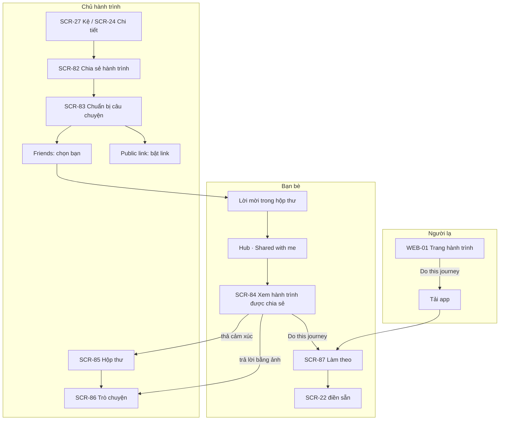

# Ourney — Chia sẻ hành trình đã trải qua (Journey Sharing)

> Phiên bản 0.1 · 2026-10-26 · Trạng thái: **đã chốt với chủ dự án**, chờ thiết kế và PR contract dữ liệu.
> **Vì sao có tài liệu này:** bản v0.3 tập trung vào check-in hằng ngày, chưa có cách để người đã đi xong một hành trình (hoặc đã đi từ trước khi có app) đưa nó lên và chia sẻ. Tài liệu này ghi lại quyết định (S1–S18), luồng, và **đề xuất** dữ liệu.
> **Quan hệ với tài liệu khác:** màn hình chi tiết nằm trong [07-SDS-ui-design.md](07-SDS-ui-design.md) §5.9 (SCR-80…87) và §13 (WEB-01, WEB-05). Yêu cầu chức năng ở [SRS.md](SRS.md) FR-H. Phần dữ liệu ở §5 dưới đây **chỉ là đề xuất**: [contracts/schema.md](contracts/schema.md) chỉ đổi qua PR riêng cho contract.

---

## 1. Mục tiêu

| Mục tiêu | Tính năng đáp ứng |
|---|---|
| **Kéo người dùng mới** | Link công khai của hành trình đã xong có nút `Do this journey` / `Làm theo` → tải app → mở sẵn lộ trình |
| **Cảm hứng để bắt đầu** | Người mới thấy hành trình thật của bạn bè (Shared with me) và có thể làm theo; màn ngày 0 có lối `Retell a past journey` |
| **Giá trị sau khi xong** | Hành trình trên kệ có "đời sau": viết lời kể, chia sẻ, nhận phản hồi |

**Vẫn giữ nguyên:** Ourney **không** có feed, không có Khám phá, không follow người lạ, không lên Google, không đếm follower công khai (D1, §1.2 của SDS).

## 2. Quyết định (S1–S18)

| # | Quyết định |
|---|---|
| S1 | Tính năng gồm 3 phần: **kể lại** hành trình cũ từ ảnh trong máy (SCR-28), **chia sẻ** hành trình đã chạy trong app, và **làm theo** lộ trình của người khác |
| S2 | **Bạn bè hai chiều**: gửi lời mời, bên kia `Accept` mới thành bạn |
| S3 | Kết bạn bằng **link mời / mã QR** hoặc **tìm đúng @username**. Không đồng bộ danh bạ, không gợi ý bạn |
| S4 | Danh sách bạn bè và lời mời đang chờ nằm trong **Hồ sơ** (SCR-70 → SCR-80). Số bạn bè **chỉ mình thấy** |
| S5 | **Không có feed.** Trong app mỗi người chỉ thấy kệ của mình và những hành trình **được mời xem** |
| S6 | Hai mức chia sẻ một hành trình: **`Friends`** (bạn bè được chọn) và **`Public link`** (ai có link đều xem) |
| S7 | `Friends`: danh sách bạn bè **tick sẵn tất cả**, bỏ tick được. **Mẫu nhạy cảm** (1 Quiet Transformer, 7 Glow Ritual, 8 Little Milestones): **không tick sẵn ai** |
| S8 | Người được mời thấy hành trình trong segment **`Shared with me`** của Hub (`Active` \| `Shelf` \| `Shared with me`) |
| S9 | **Thời điểm:** hành trình đang chạy chỉ chia sẻ được cho `Friends` (ảnh mới hiện khi chủ đăng). Chỉ hành trình **đã xong / trên kệ** (gồm hành trình kể lại đã lưu lên kệ) mới bật được `Public link` và `Do this journey` |
| S10 | `Public link` = link chỉ đọc, `noindex` (Q12), công tắc mặc định tắt. Mẫu nhạy cảm giữ luật R2-06 (sheet cảnh báo + ảnh xem trước tự mờ). 13–17 tuổi: khóa (R2-07). Little Milestones: link tắt mặc định |
| S11 | **Trước khi chia sẻ**, chủ được: **ẩn bớt ảnh/kỳ**, **ẩn số liệu**, **viết lời kể** (tiêu đề câu chuyện, đoạn giới thiệu, điều rút ra, ảnh bìa). Áp cho cả `Friends` và `Public link` |
| S12 | Hành trình kể lại hiện nhãn **`Imported`** / **`Kể lại`** với người xem, khoảng ngày theo ngày chụp, **không hiện chuỗi** (giữ D15) |
| S13 | Bạn bè được mời xem: **thả cảm xúc** (CMP-09) và **trả lời bằng ảnh/clip** trên từng ảnh. Câu trả lời **chỉ chủ hành trình thấy** |
| S14 | Người xem qua link (web): **chỉ xem**, có nút `Do this journey`. Muốn thả cảm xúc / trả lời phải là bạn bè trong app |
| S15 | `Do this journey` chỉ sao chép **khung lộ trình**: mẫu (→ phong cách), thời lượng, nhịp, tên + đơn vị chỉ số (không có giá trị), tiêu đề gợi ý. **Không** sao chép ảnh, caption, số liệu |
| S16 | Phản hồi vào **hộp thư riêng** (SCR-85), icon trên header Hub cạnh avatar, chấm đỏ khi có mới. Hộp thư gộp: trả lời ảnh, lời mời xem hành trình, lời mời kết bạn |
| S17 | Trong hộp thư, chủ và người trả lời **chat qua lại 1-1** (chữ, ảnh, clip ≤ 5s). Mỗi cuộc trò chuyện gắn với một hành trình |
| S18 | **Thu hồi:** tắt chia sẻ cho tất cả hoặc **gỡ từng người**; `Reset link` làm link cũ chết. Người đã `Do this journey` vẫn giữ hành trình của họ |

## 3. Luồng chính

**Kết bạn:** SCR-80 → `Add friends` (SCR-81) → gửi link/QR hoặc tìm @username → người kia nhận lời mời trong hộp thư → `Accept`. Mở link mời khi chưa có app → WEB-05 → tải app → đăng nhập → lời mời hiện sẵn.

**Kể lại (S1, S12):** màn ngày 0 / sheet `New journey` → `Retell a past journey` → SCR-28 → `Save to shelf` → (tùy chọn) chia sẻ ngay.

## 4. Quy tắc hiển thị

| Người xem | Thấy gì | Làm được gì |
|---|---|---|
| Chủ | Mọi thứ, kể cả ảnh/số liệu đã ẩn khi chia sẻ (có icon "ẩn khi chia sẻ") | Sửa lời kể, ẩn/hiện, quản lý người xem, đọc hộp thư |
| Bạn bè được mời | Ảnh và kỳ không bị ẩn, lời kể, tiến độ; số liệu nếu chủ không ẩn; chuỗi (trừ hành trình kể lại) | Cảm xúc, trả lời bằng ảnh/clip (→ chat 1-1), `Do this journey` (chỉ khi đã xong) |
| Người có link | Như bạn bè, nhưng ảnh đặt làm mờ thì mờ; ảnh xem trước link của mẫu nhạy cảm luôn mờ | Chỉ xem, `Do this journey`, `Get the app` |
| Người đã bị gỡ / bị chặn / hết là bạn | Hành trình biến khỏi `Shared with me`; mở lại thấy "This journey is private now" | Không |

- **Không chia sẻ lại:** người xem không có nút chia sẻ hành trình của người khác.
- **Hủy kết bạn** = mất quyền xem mọi hành trình được chia sẻ giữa hai người; cuộc trò chuyện chuyển thành chỉ đọc.
- **Chặn** (SCR-72) = như hủy kết bạn + không gửi lại lời mời được + ẩn cuộc trò chuyện.

## 5. Đề xuất dữ liệu (cần PR contract riêng)

> Chưa có trong `supabase/migrations`. Mọi bảng mới phải có RLS + pgTAP (SRS §6.4). Tên chỉ là đề xuất.

| Đối tượng | Đề xuất |
|---|---|
| `friendships` | `(user_low, user_high)` PK (sắp thứ tự để mỗi cặp một dòng), `requested_by`, `status` ∈ `pending`/`accepted`, `accepted_at`, soft delete khi hủy. Đọc: chỉ hai người trong cặp |
| `friend_invites` | `token` (thu hồi được) cho link/QR mời kết bạn; mở link → `request_friend_by_token` |
| RPC tìm username | `find_user_by_username(username)` trả về avatar + tên **chỉ khi khớp chính xác**; rate limit như `join_by_code`. Hiện tại **chưa có** RPC tra cứu username (schema v1.2) |
| `journey_shares` | `(journey_id, viewer_id)` PK, `granted_at`, `revoked_at`. Quyền xem của từng bạn bè (S7, S18). Chỉ chủ ghi; người xem chỉ đọc dòng của mình |
| `journeys` | thêm `origin` ∈ `live`/`imported` (S12), `story_title`, `story_intro`, `story_lessons`, `cover_checkin_id`, `followed_from` (journey nguồn của `Do this journey`, chỉ để thống kê, không lộ cho người làm theo nếu nguồn đã thu hồi) |
| `check_ins` | thêm `hidden_in_share bool` (S11). Ẩn số liệu dùng lại `memberships.hide_metric` |
| `journey_visibility` | giữ `private`/`group`/`link`. `set_public_link` chỉ cho bật khi `status = ended` hoặc `origin = imported` đã lên kệ (S9) |
| `reactions` | mở RLS cho người có `journey_shares` còn hiệu lực (hiện chỉ cho member) |
| `conversations` | `id`, `journey_id`, `owner_id`, `viewer_id`, `last_message_at`, `read_at` theo từng bên. Một cuộc / (journey, viewer) |
| `messages` | `id`, `conversation_id`, `sender_id`, `reply_to_checkin_id null`, `kind` ∈ `text`/`photo`/`clip`, `body ≤ 500`, `media_path`, `created_at`, `deleted_at`. Storage `messages/{conversation_id}/{sender_id}/{id}.jpg` |
| `reports` | thêm `target_message_id` + lý do như hiện có (FR-F1). Store yêu cầu báo cáo/chặn cho nhắn tin giữa người dùng |
| Edge `public-journey` | trả thêm lời kể, bỏ ảnh `hidden_in_share`, trả khung lộ trình cho `Do this journey` |

## 6. Rủi ro

| Rủi ro | Hệ quả | Giảm thiểu |
|---|---|---|
| **Chat 1-1 ở v1 không có push** (chưa có tài khoản Apple trả phí) | Người dùng chỉ biết có tin mới khi tự mở app | Chấm đỏ ở icon hộp thư + số trên segment; push tin nhắn `[v2]` (NTF-16) |
| Chat là khối lượng lớn nhất (realtime, đã đọc, chặn, báo cáo, xóa) | Có thể làm trễ v1 | Nếu cần cắt: giữ hộp thư + trả lời bằng ảnh, để trả lời lại bằng chữ sang v1.1 |
| Đảo quyết định cũ: SDS §1.2 "không phải ứng dụng chat", SRS FR-D4 "không có comment ở v1", FR-E3 link cả khi đang chạy | Tài liệu và code cũ lệch nhau | PR này cập nhật SDS/SRS; code `set_public_link` đổi theo S9 trong PR contract |
| Ảnh nhạy cảm đi tới bạn bè | Lộ ảnh cơ thể/trẻ em | S7 không tick sẵn, S10 giữ cảnh báo, S11 ẩn từng ảnh |

## 7. Còn mở

| # | Câu hỏi | Đề xuất tạm |
|---|---|---|
| O1 | Hành trình **nhóm/cặp đôi** có chia sẻ cho bạn bè ngoài nhóm hoặc bật link được không? (Hiện: nhóm không bao giờ có link) | v1 chỉ hành trình **solo** (gồm kể lại). Nhóm để sau, cần mọi thành viên đồng ý |
| O2 | Người làm theo có thấy "From Linh's journey" không? Chủ có thấy số người đã làm theo không? | Có dòng nhỏ ở SCR-22; chủ thấy "4 people started this" (chỉ chủ thấy) |
| O3 | Giới hạn số bạn bè? Giữ lịch sử chat bao lâu? | Không giới hạn bạn; chat giữ đến khi một bên xóa tài khoản |
